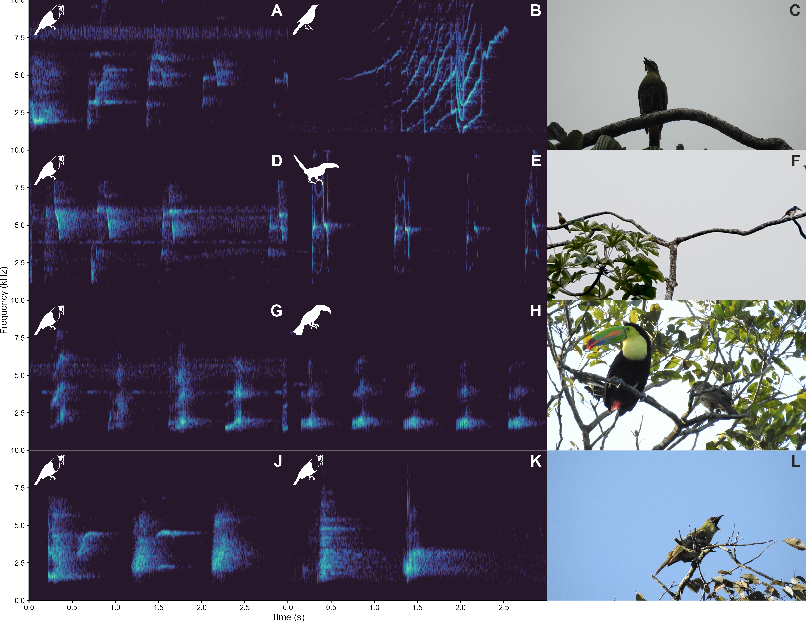

This site contains the analyses and the presentation of the study. We evaluated whether the vocalizations of a juvenile Three-wattled Bellbird (*Procnias tricarunculatus*) observed in Monteverde, Costa Rica, represent genuine mimicry of sympatric species or resemblances arising by chance. To do so, we retrained BirdNET with three sympatric species it could have imitated, their closely related allopatric species that could not have served as vocal models, and vocalizations of other bellbirds.

The vocalizations of the focal individual were classified mostly as sympatric species, a bias not found in other bellbirds. Sounds resembling the Keel-billed Toucan (*Ramphastos sulfuratus*) and the Collared Aracari (*Pteroglossus torquatus*) were frequent in the first observations, and classification as bellbird increased over time.

## Contents

- **[Data preparation](scripts/birdnet_acoustic_data_prep.qmd)**: annotations, selection tables and export of the data for BirdNET
- **[Statistical analysis](scripts/statistical_analysis.qmd)**: classifiers, Bayesian models and changes over time
- **[Presentation](presentation.qmd)**: slides of the talk (in Spanish), with the spectrograms and their sounds

## Main results

::: {.figure-gallery}

:::

## Reproducibility

The code is available in the [GitHub repository](https://github.com/maRce10/bellbird_vocal_mimicry). Audio data and fitted models are too large to be hosted there, so the reports are published with their results already computed.
