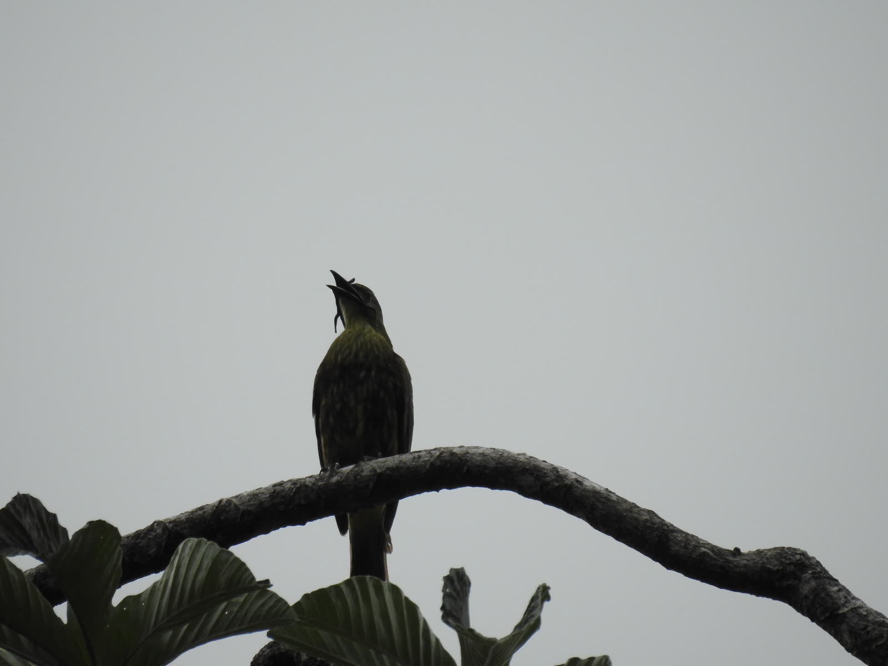
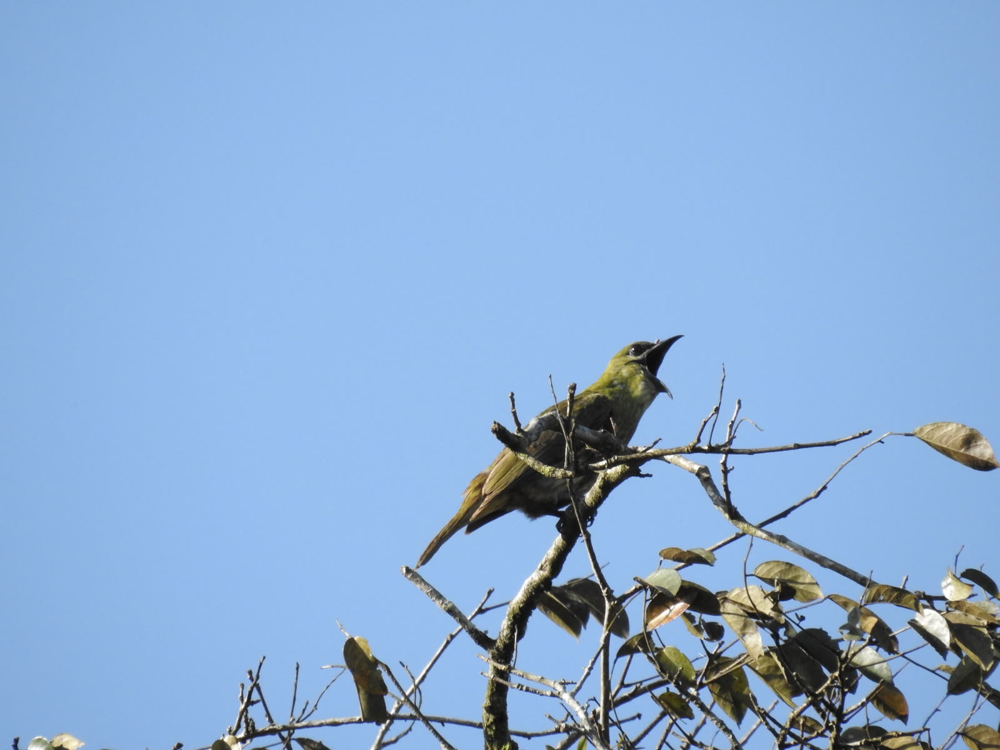

Videos and photos of the focal bellbird, and a video of an adult Three-wattled Bellbird. Click on an image to enlarge it.

## Videos

::: {.media-grid}

::: {.media-item}
<video controls preload="metadata" src="presentation/images/focal_spectrogram_black_en.mp4"></video>

Vocalizations of the focal bellbird with their spectrogram

:::

::: {.media-item}
<video controls preload="metadata" src="presentation/images/mimetic_and_toucan.mp4"></video>

The focal bellbird and a Keel-billed Toucan in the same tree (29 s)

:::

::: {.media-item}
<video controls preload="metadata" src="presentation/images/adult_bellbird_spectrogram_short_black_en.mp4"></video>

Song of an adult Three-wattled Bellbird with its spectrogram

:::

:::

## Focal bellbird

::: {.media-grid}

{group="focal"}

{group="focal"}

{group="focal"}

:::
