Videos and images of the focal bellbird, of adult bellbirds and of the study results. Click on an image to enlarge it.

## Videos

::: {.media-grid}

::: {.media-item}
<video controls preload="metadata" src="presentation/images/mimic_campana.mp4"></video>

The focal bellbird producing aracari-like and then toucan-like sounds (66 s)

:::

::: {.media-item}
<video controls preload="metadata" src="presentation/images/mimic_aracari.mp4"></video>

The focal bellbird producing aracari-like sounds (36 s)

:::

::: {.media-item}
<video controls preload="metadata" src="presentation/images/hanging_with_models_web.mp4"></video>

The focal bellbird next to a Collared Aracari and then a Keel-billed Toucan, two of its apparent models (42 s)

:::

::: {.media-item}
<video controls preload="metadata" src="presentation/images/mimetic_and_toucan.mp4"></video>

The focal bellbird and a Keel-billed Toucan in the same tree (29 s)

:::

::: {.media-item}
<video controls preload="metadata" src="presentation/images/focal_spectrogram_black_en.mp4"></video>

Vocalizations of the focal bellbird with their spectrogram

:::

::: {.media-item}
<video controls preload="metadata" src="presentation/images/adult_bellbird_spectrogram_short_black_en.mp4"></video>

Song of an adult Three-wattled Bellbird with its spectrogram

:::

::: {.media-item}
<video controls preload="metadata" src="presentation/images/adulto_monteverde.mp4"></video>

Adult male Three-wattled Bellbird singing in Monteverde (9 s)

:::

:::

## Focal bellbird

::: {.media-grid}

{group="focal"}

{group="focal"}

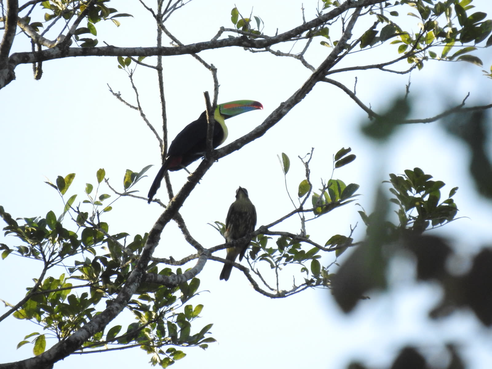{group="focal"}

:::

## Adult bellbirds

::: {.media-grid}

{group="adults"}

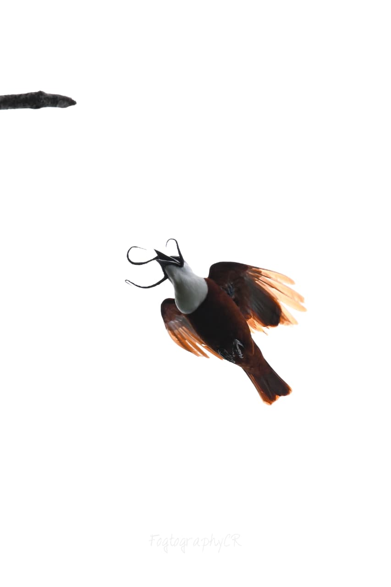{group="adults"}

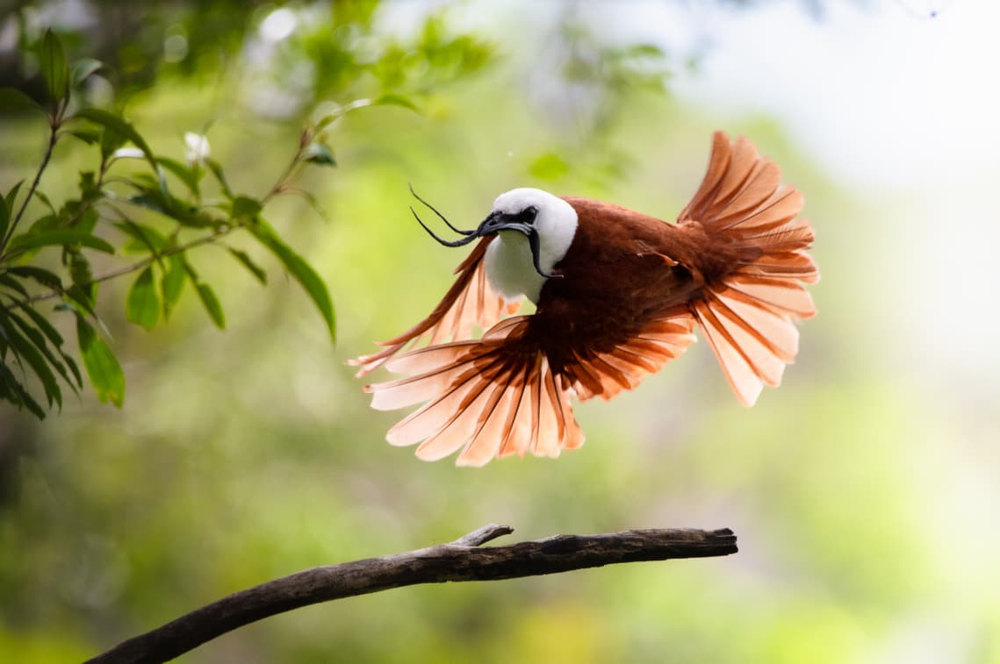{group="adults"}

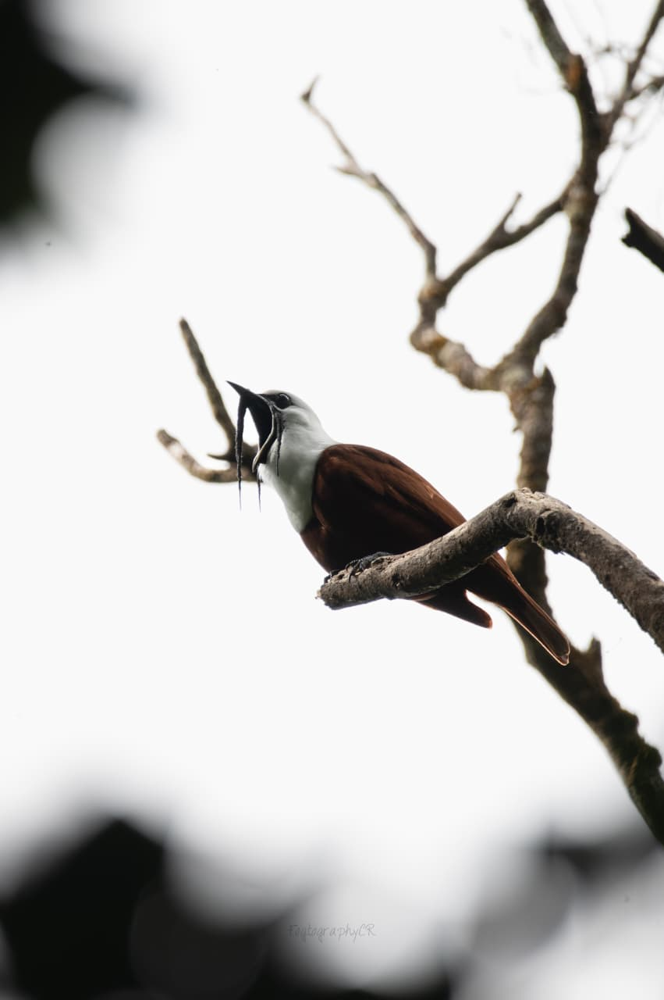{group="adults"}

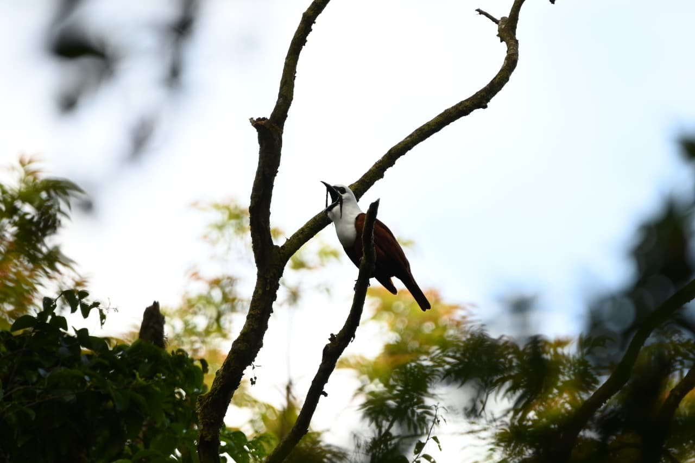{group="adults"}

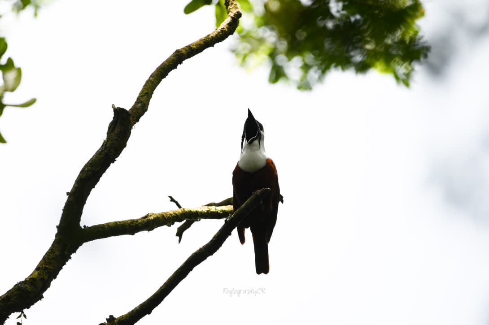{group="adults"}

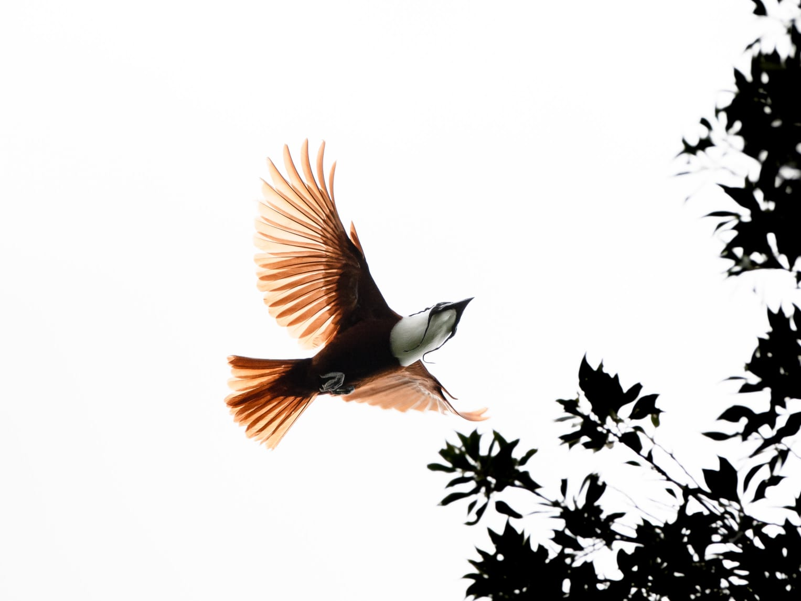{group="adults"}

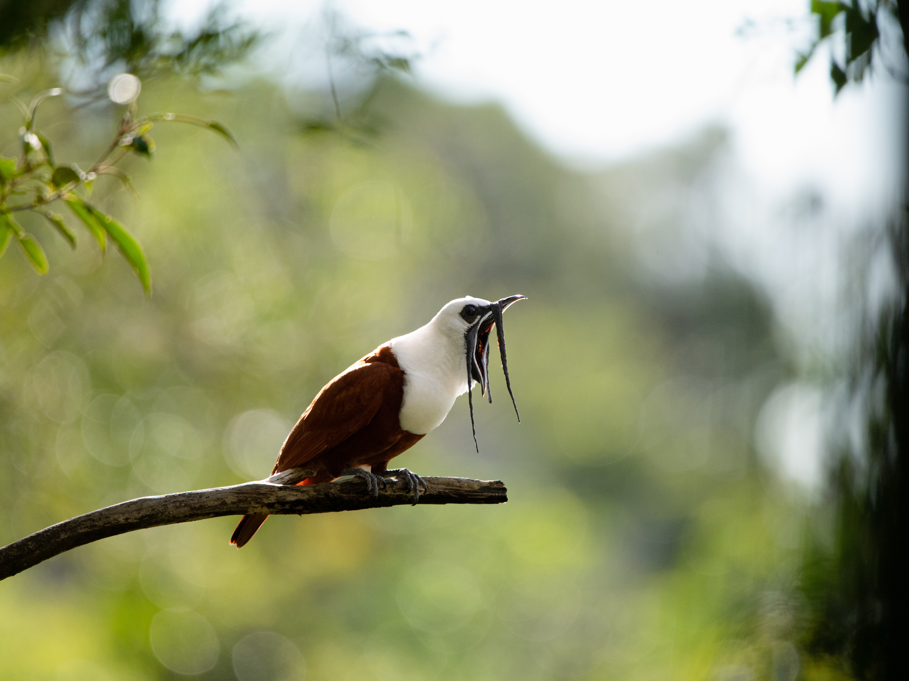{group="adults"}

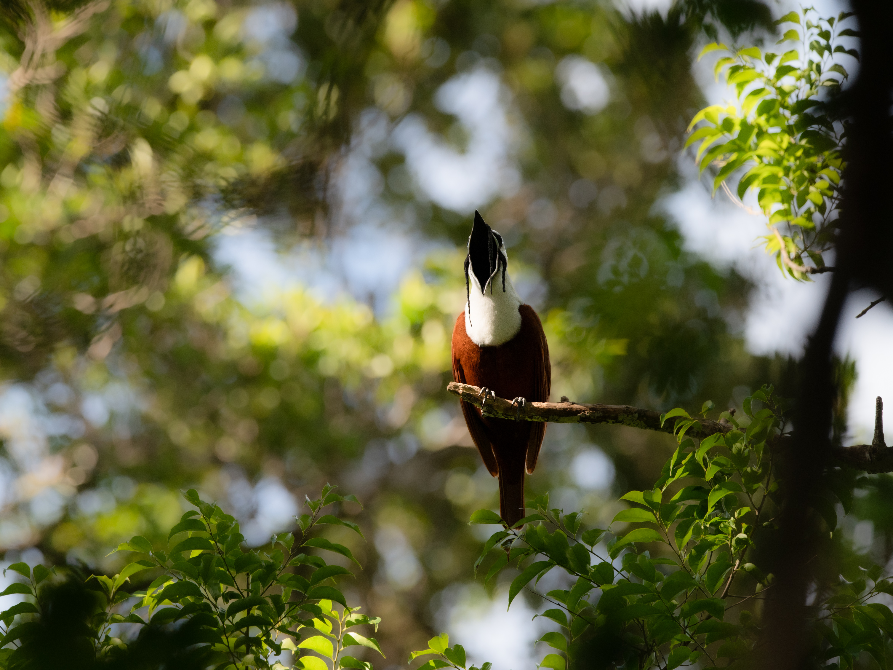{group="adults"}

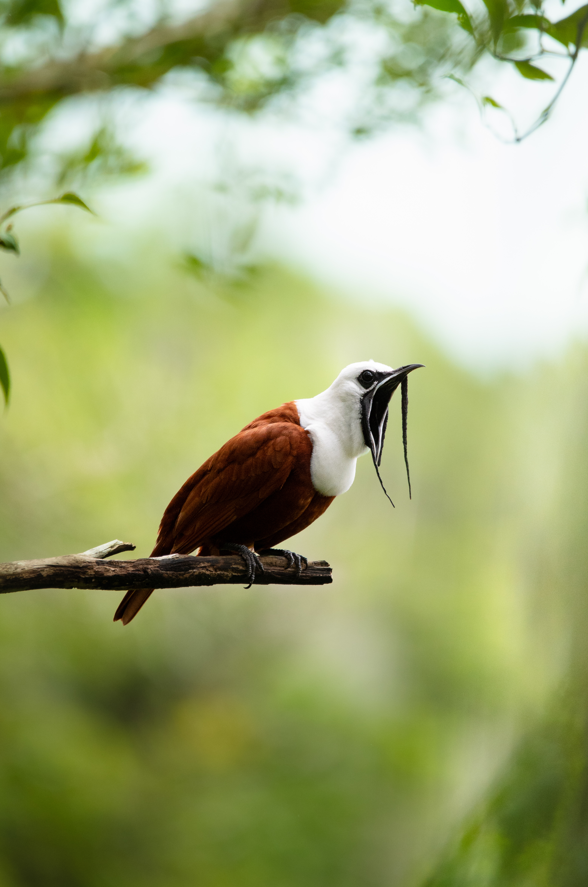{group="adults"}

:::

Photos: David Jimenez

## Results

::: {.figure-gallery}

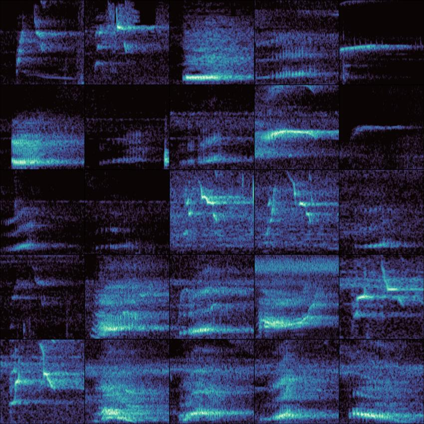{group="results"}

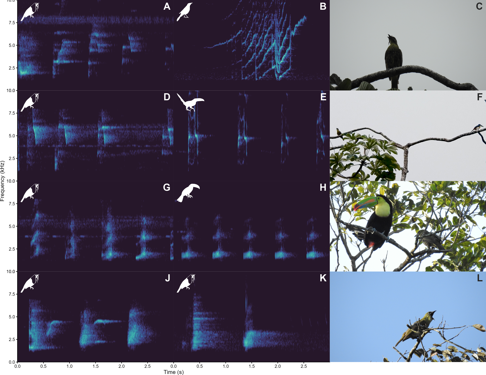{group="results"}

{group="results"}

:::
