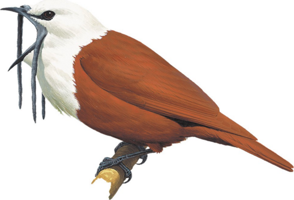
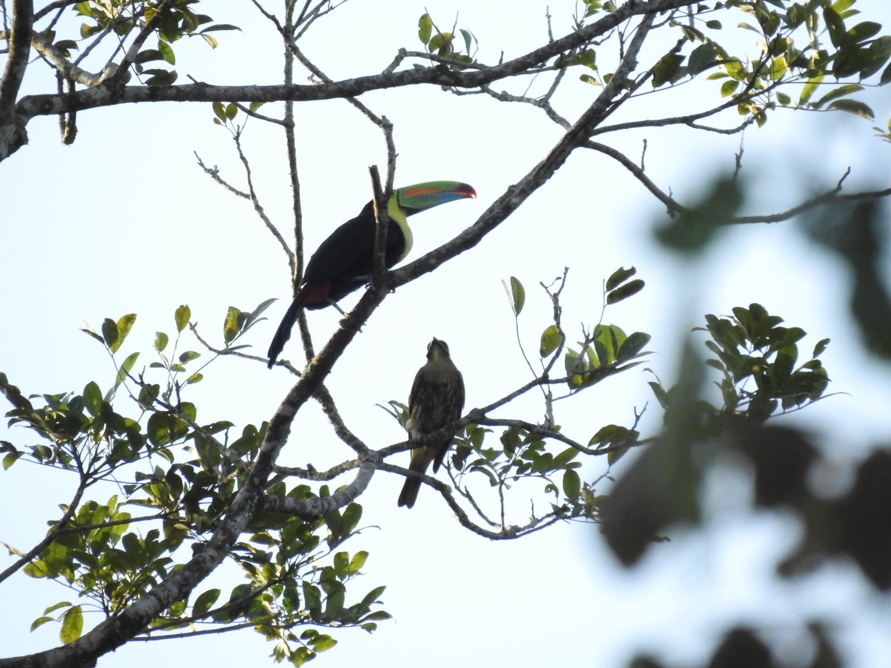
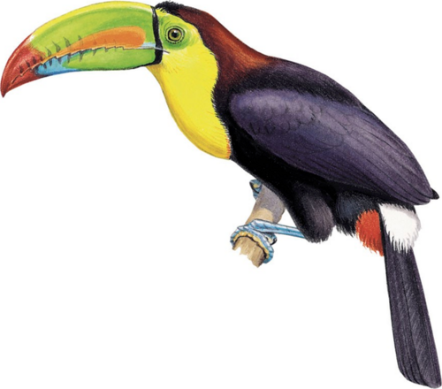
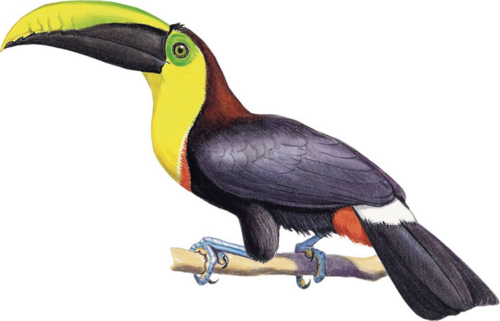
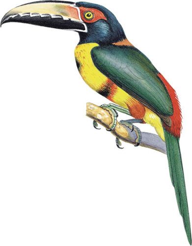
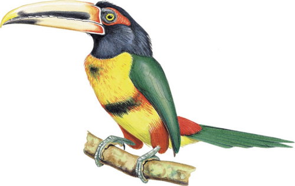
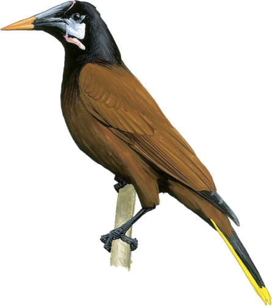
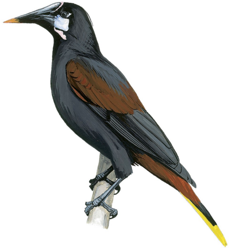

---
format:
  revealjs:
    fig-width: 10
    fig-height: 6.2
    toc: false
    number-sections: false
    embed-resources: true
    auto-section: false
    auto-play-media: false
    dpi: 300
    fig-dpi: 300
    code-line-numbers: false
    code-block-border-left: true
    slide-number: true
    preview-links: auto
    css: styles_revealjs.css
    include-after-body: dynaspec_player.html
execute:
  echo: false
  warning: false
  message: false
editor_options:
  chunk_output_type: console
---

```{r}
#| echo: false

# data and images are built by prepare_slide_assets.R (run from the project root)

# install/ load packages
sketchy::load_packages(
    packages = c(
        "knitr",
        "ggplot2",
        "dynaSpec",
        "viridis",
        "scales"
    )
)

## ggplot themes
theme_function <- theme_classic
presentation_theme <- theme_function(base_size = 20)

theme_set(presentation_theme)

counts <- read.csv("./data/classification_counts.csv")

# Spanish names shown on the slides
spanish_names <- c(
    "Procnias tricarunculatus" = "Pájaro campana",
    "Psarocolius guatimozinus" = "Oropéndola negra",
    "Psarocolius montezuma" = "Oropéndola de Moctezuma",
    "Pteroglossus erythropygius" = "Aracari piquipálido",
    "Pteroglossus torquatus" = "Aracari de collar",
    "Ramphastos brevis" = "Tucán del Chocó",
    "Ramphastos sulfuratus" = "Tucán pico iris"
)

bird_labels <- c(focal = "Campana focal", other = "Otros campanas")

# species drawing (built by prepare_slide_assets.R); silhouette while a species has none
sp_file <- function(sp) {
    f <- file.path("images", paste0("dibujo_", gsub(" ", "_", tolower(sp)), ".png"))
    if (file.exists(f)) f else "images/sil_oropendola.png"
}

# drawing as a grob that fits in a box of w x h cm
sp_grob <- function(sp, w, h, ...) {
    img <- png::readPNG(sp_file(sp))
    scale <- min(w / dim(img)[2], h / dim(img)[1])
    grid::rasterGrob(img, width = grid::unit(dim(img)[2] * scale, "cm"),
                     height = grid::unit(dim(img)[1] * scale, "cm"), interpolate = TRUE, ...)
}

# drawing under a discrete x axis position, outside the panel
sp_below <- function(sp, x, offset, w, h) {
    annotation_custom(
        sp_grob(sp, w, h, y = grid::unit(0, "npc") - grid::unit(offset, "cm"), vjust = 1),
        xmin = x - 0.4, xmax = x + 0.4, ymin = -Inf, ymax = Inf
    )
}

# confusion matrix heatmap
plot_confusion <- function(file, species_order, text_size = 6, sp_size = 1.5, sp_offset = 7) {
    d <- read.csv(file)
    d$reference <- factor(spanish_names[d$reference], levels = spanish_names[species_order])
    d$predicted <- factor(spanish_names[d$predicted], levels = spanish_names[species_order])
    ggplot(d, aes(x = reference, y = predicted, fill = proportion)) +
        geom_tile() +
        geom_text(aes(label = gsub(".", ",", round(proportion, 2), fixed = TRUE)), size = text_size) +
        lapply(seq_along(species_order), function(i) annotation_custom(
            sp_grob(species_order[i], sp_size * 1.3, sp_size,
                    x = grid::unit(0, "npc") - grid::unit(sp_offset, "cm"), hjust = 1),
            xmin = -Inf, xmax = -Inf, ymin = i - 0.4, ymax = i + 0.4
        )) +
        coord_equal(clip = "off") +
        scale_fill_gradient(low = "white", high = mako(10)[7], name = "Proporción", labels = label_number(decimal.mark = ",")) +
        labs(x = "Especie de referencia", y = "Especie predicha") +
        theme(axis.text.x = element_text(angle = 30, hjust = 1, color = "black"),
              axis.text.y = element_text(color = "black"),
              axis.title.y = element_text(margin = margin(r = (sp_size * 1.3 + 1.2) * 28.35)))
}

# dynaSpec comparison of focal (top) and model (bottom), with the photo of the event,
# as one raw HTML block: one player shows both spectrograms and plays them in sequence
ds_pair <- function(pair, model_sp, model_title, wl = 512, collevels = seq(-50, 0, 5)) {
    clips <- paste0("clip_", pair, c("_focal", "_model"))
    titles <- c("Pájaro campana focal", model_title)
    drawings <- sp_file(c("Procnias tricarunculatus", model_sp)[1])
    drawings <- c(drawings, sp_file(model_sp))

    # the time axis is labelled only on the lower spectrogram
    ds_sound <- function(i, xlab) {
        dynaspec(file.path("images", paste0(clips[i], ".wav"))) +
            ds_theme_presentation(xlab = xlab, ylab = "Frec. (kHz)",
                                  col.panel = "white")
    }

    x <- ds_compare(ds_sound(1, ""), ds_sound(2, "Tiempo (s)"), flim = c(0, 10), gap = 0.5) +
        ds_spectrogram(wl = wl, ovlp = 90, collevels = collevels,
                       pal = function(n) gray(seq(1, 0, length.out = n))) +
        ds_static(width = 860, height = 330, res = 100, lcol = "#366A9F",
                  alt = paste("Espectrograma:", paste(titles, collapse = " y "))) +
        ds_player(speeds = 1, buttons = character())
    # when knitting, dynaSpec wraps its output in a raw HTML fence: this function writes its own
    html <- as.character(save_dynaspec(x, play = FALSE, verbose = FALSE))
    html <- paste(gsub("```(\\{=html\\})?", "", html), collapse = "\n")

    # the player script is the same for all pairs: it loads once, after the slides
    writeLines(paste0("<script>", sub(".*<script>", "", html)), "dynaspec_player.html")
    player <- sub("<script>.*", "", html)

    # base64 data makes pandoc stall, so the player points to files that Quarto embeds at the end;
    # each sound also gets its drawing and name, in a column to the left of the plot
    for (i in 1:2) {
        png_file <- file.path("images", paste0("ds_", clips[i], ".png"))
        png_b64 <- sub('(?s).*?srcset="data:image/png;base64,([^ "]+)[^"]*".*', "\\1", player, perl = TRUE)
        writeBin(base64enc::base64decode(png_b64), png_file)
        player <- sub('srcset="data:image/png;base64,[^"]+"', paste0('src="', png_file, '"'), player)
        player <- sub(
            '<audio([^>]*) src="data:audio/[^"]+"></audio>',
            paste0('<audio\\1 src="images/', clips[i], '.wav"></audio>',
                   '<div class="ds-etiqueta"><span>', titles[i], '</span></div>'),
            player
        )
    }

    cat(
        "\n```{=html}\n<div class=\"ds-fila\">",
        paste0('<div class="ds-col">', player, "</div>"),
        paste0(''),
        "</div>\n```\n", sep = "\n"
    )
}
```

# Cuantificación del mimetismo vocal heteroespecífico mediante aprendizaje profundo: evidencia en un juvenil de pájaro campana {.titulo-largo background-color="white" background-image="./images/photo_toucan_bellbird.jpg" background-size="cover" background-opacity="0.27"}

<center><font size=6>Pablo Huertas-Vásquez, Marcos Q. Oliva, <b><a href="https://marce10.github.io/">Marcelo Araya-Salas</a></b><br></font><font size=4>Universidad Nacional de Costa Rica · Royal Holloway University of London · Universidad de Costa Rica</font><br/></center>

::: footer
<font size=4><a href="https://marce10.github.io/">https://marce10.github.io/</a></font>
:::

```{r}
#| eval: false
#| echo: false

## TO DO LIST

- Completar financiamiento y agradecimientos (el borrador del manuscrito aún no los incluye)
- Añadir los videos de los eventos de mimetismo, si se quieren mostrar
- Revisar los nombres comunes en español de las especies
- Ensayar con cronómetro: los tiempos en las notas (tecla S) son estimados
```

::: {.notes}
**0:00–0:15.** Presentar el tema y a los coautores.
:::

## Mimetismo vocal

::: {.callout-note icon=false appearance="simple"}
<font size=6>**Aprendizaje de la producción vocal:** adquirir patrones vocales imitando un modelo; depende de la retroalimentación auditiva y de circuitos neurales complejos</font>
:::

<br>

<font size=6>

- El mimetismo vocal es común en las aves
- Cuando el modelo es **otra especie**, la imitación implica aprendizaje vocal
- Por eso se usa como evidencia de aprendizaje incluso fuera de los grupos reconocidos: Passeri, loros y colibríes

</font>

::: {.fuente}
Janik & Slater 2000; Jarvis 2004; Goller & Shizuka 2018; Ten Cate 2021
:::

::: {.notes}
**Hasta 1:15.** El mimetismo vocal es común en las aves y nos interesa por lo que implica: copiar a otra especie requiere aprender a producir el sonido. Esa capacidad se reconoce en tres grupos de aves, y el mimetismo suele ser la mejor pista de aprendizaje fuera de ellos. Pero todo depende de una pregunta: ¿eso que suena parecido es realmente una copia?
:::

## ¿Mimetismo genuino o semejanza por azar?

<font size=6>

Demostrarlo en el campo requiere:

1. Identificar la **fuente** del sonido heteroespecífico
2. Definir un **umbral de similitud** entre modelo y copia
3. Descartar la **convergencia** vocal

</font>

<br>

::: {.callout-note icon=false appearance="simple"}
<font size=6>No existe un **marco cuantitativo riguroso** para evaluar si una semejanza acústica aparente es mimetismo o azar</font>
:::

::: {.fuente}
Kelley et al. 2008; Dalziell et al. 2015
:::

::: {.notes}
**Hasta 2:20.** Estos tres requisitos son difíciles de cumplir con animales silvestres. Además, la mayor parte de la evidencia se basa en descripciones cualitativas de la semejanza: un sonido variable puede parecerse a otro simplemente por casualidad. Ese es el vacío que queremos llenar.
:::

## Pájaros campana (_Procnias_)

:::: {.columns}

::: {.column width="58%"}
<font size=6>

Tyranni: en general, considerados no aprendices. Pero en _Procnias_ hay:

- Dialectos y sonidos nuevos
- Cambios vocales durante la ontogenia
- Mimetismo en un individuo **cautivo**

</font>
:::

::: {.column width="42%"}
{width="52%"}

{.ave-grande}
:::

::::

::: {.callout-note icon=false appearance="simple"}
<font size=6>**Objetivo:** desarrollar un enfoque de aprendizaje profundo para evaluar el mimetismo vocal heteroespecífico en un juvenil de pájaro campana</font>
:::

::: {.fuente}
Snow 1970, 1977; Saranathan et al. 2007; Kroodsma et al. 2013
:::

::: {.notes}
**Hasta 3:10.** Los pájaros campana son un caso especial: pertenecen a los Tyranni, considerados no aprendices, pero varias observaciones sugieren aprendizaje. Esto los vuelve ideales para probar el enfoque, que es nuestro objetivo.
:::

## Un juvenil en Monteverde

:::: {.columns}

::: {.column width="55%"}
{width="100%"}
:::

::: {.column width="45%"}
<font size=6>

- Monteverde, Costa Rica
- Juvenil de _Procnias tricarunculatus_ (~2–3 años), sin otros individuos de su especie en el área
- Vocalizaciones similares a las de varias especies simpátricas
- 11 eventos de muestreo, abril a noviembre de 2020

</font>

{.ave-grande}
:::

::::

::: {.notes}
**Hasta 3:55.** Pablo encontró este juvenil solo, interactuando con tucanes y aracaris. No vio otro pájaro campana en el área, ni antes ni después, así que es poco probable que los sonidos vengan de otro individuo. Por la muda y la falta de carúnculas estimamos unos dos o tres años. Y sonaba así.
:::

## Imitando al tucán

```{r}
#| output: asis
ds_pair("toucan", "Ramphastos sulfuratus", "Tucán pico iris")
```

::: {.notes}
**Hasta 4:35.** Play reproduce los dos en secuencia: primero el focal (arriba), luego el tucán pico iris (abajo). Clic sobre un espectrograma para empezar desde ese punto.
:::

## Imitando al aracari

```{r}
#| output: asis
ds_pair("aracari", "Pteroglossus torquatus", "Aracari de collar")
```

::: {.notes}
**Hasta 5:10.** Play reproduce los dos en secuencia: focal y aracari de collar. También hubo sonidos parecidos a la oropéndola (en respaldo). Suena convincente, pero el oído puede engañar: necesitamos una prueba.
:::

## ¿Mimetismo o azar?

:::: {.columns}

::: {.column width="50%"}
::: {.callout-note icon=false appearance="simple"}
<font size=5><b>Variación del desarrollo:</b> vocalizaciones variables que solo coinciden acústicamente. Clasificación **similar** como simpátricas y alopátricas</font>
:::
:::

::: {.column width="50%"}
::: {.callout-note icon=false appearance="simple"}
<font size=5><b>Mimetismo genuino:</b> copia a las especies disponibles como modelos. **Mayor** clasificación como simpátricas</font>
:::
:::

::::

<font size=5>

| Grupo | Modelo simpátrico | Pariente alopátrico |
|:--:|:-----:|:-----:|
| Tucanes | {.ave} _Ramphastos sulfuratus_ | {.ave} _Ramphastos brevis_ |
| Aracaris | {.ave} _Pteroglossus torquatus_ | {.ave} _Pteroglossus erythropygius_ |
| Oropéndolas | {.ave} _Psarocolius montezuma_ | {.ave} _Psarocolius guatimozinus_ |

**BirdNET** reentrenado con estas especies y otros pájaros campana; grabaciones obtenidas con _suwo_

</font>

::: {.fuente}
Araya-Salas et al. 2026
:::

::: {.notes}
**Hasta 6:15.** Reentrenamos BirdNET, un algoritmo de aprendizaje profundo, con tres grupos: las especies simpátricas que pudo imitar, sus parientes alopátricos que no pudieron servirle de modelo, y otros pájaros campana. Si solo produce sonidos variables durante el desarrollo, debería clasificarse igual como simpátricas y alopátricas. Si hay mimetismo, predominan las simpátricas. El clasificador distingue bien las especies; la matriz está en respaldo.
:::

## Solo el campana focal muestra el sesgo

```{r}
#| fig-height: 5
pairs <- data.frame(
    pred = c("Ramphastos sulfuratus", "Ramphastos brevis",
             "Pteroglossus torquatus", "Pteroglossus erythropygius",
             "Psarocolius montezuma", "Psarocolius guatimozinus"),
    group = rep(c("Tucanes", "Aracaris", "Oropéndolas"), each = 2),
    type = rep(c("Simpátrica", "Alopátrica"), times = 3)
)

totals <- unique(counts[counts$model == "sympatric_allopatric", c("bird", "total")])
bars <- merge(merge(pairs, totals), counts[counts$model == "sympatric_allopatric", c("pred", "bird", "Freq")], all.x = TRUE)
bars$Freq[is.na(bars$Freq)] <- 0
bars$prop <- bars$Freq / bars$total
bars$bird <- factor(bird_labels[bars$bird], levels = bird_labels)
bars$group <- factor(bars$group, levels = c("Tucanes", "Aracaris", "Oropéndolas"))

# drawings under each pair of bars: alopatric on the left, sympatric on the right
bias_sp <- data.frame(
    sp = c("Ramphastos brevis", "Ramphastos sulfuratus",
           "Pteroglossus erythropygius", "Pteroglossus torquatus",
           "Psarocolius guatimozinus", "Psarocolius montezuma"),
    x = rep(1:3, each = 2) + c(-0.2, 0.2)
)

ggplot(bars, aes(x = group, y = prop, fill = type)) +
    geom_col(position = position_dodge(width = 0.8), width = 0.75) +
    geom_text(aes(label = Freq), position = position_dodge(width = 0.8),
              vjust = -0.4, size = 6) +
    facet_wrap(~ bird) +
    lapply(seq_len(nrow(bias_sp)), function(i) sp_below(bias_sp$sp[i], bias_sp$x[i], 1.05, 1.4, 1.15)) +
    coord_cartesian(clip = "off") +
    scale_fill_manual(values = mako(10)[c(3, 7)], name = "") +
    scale_y_continuous(labels = label_percent(), expand = expansion(mult = c(0, 0.2))) +
    labs(x = "", y = "Vocalizaciones clasificadas como", caption = "Números sobre las barras: cantidad de vocalizaciones") +
    theme(legend.position = "top", strip.background = element_blank(),
          strip.text = element_text(size = 22),
          axis.title.x = element_text(margin = margin(t = 48)))
```

::: {.callout-note icon=false appearance="simple"}
<center><font size=5>Probabilidad de clasificarse como simpátrica: focal **0,93**, otros campanas **0,44**. Focal vs. otros: **15,9 veces** más odds (IC 95%: 11,82–22,12)</font></center>
:::

::: {.notes}
**Hasta 7:20.** El resultado principal. Izquierda, el individuo focal: la gran mayoría de sus clasificaciones heteroespecíficas caen en la especie simpátrica. Derecha, otros pájaros campana: sin este sesgo. La probabilidad es de 0,93 contra 0,44, que equivale a 15,9 veces más odds que los otros campanas. Esto apoya el mimetismo genuino.
:::

## ¿A cuáles especies imita?

```{r}
sp <- counts[counts$model == "sympatric", ]
sp_levels <- c("Ramphastos sulfuratus", "Pteroglossus torquatus", "Psarocolius montezuma")
sp_bars <- expand.grid(pred = sp_levels, bird = c("focal", "other"), stringsAsFactors = FALSE)
sp_bars <- merge(sp_bars, sp[, c("pred", "bird", "Freq")], all.x = TRUE)
sp_bars$Freq[is.na(sp_bars$Freq)] <- 0
sp_bars$total <- unique(sp[, c("bird", "total")])$total[match(sp_bars$bird, unique(sp[, c("bird", "total")])$bird)]
sp_bars$prop <- sp_bars$Freq / sp_bars$total
sp_bars$species <- factor(spanish_names[sp_bars$pred], levels = spanish_names[sp_levels])
sp_bars$bird <- factor(bird_labels[sp_bars$bird], levels = bird_labels)

ggplot(sp_bars, aes(x = species, y = prop, fill = bird)) +
    geom_col(position = position_dodge(width = 0.8), width = 0.75) +
    geom_text(aes(label = percent(prop, accuracy = 0.1, decimal.mark = ",")), position = position_dodge(width = 0.8),
              vjust = -0.4, size = 6) +
    scale_fill_manual(values = mako(10)[c(7, 3)], name = "") +
    scale_y_continuous(labels = label_percent(), expand = expansion(mult = c(0, 0.1))) +
    lapply(seq_along(sp_levels), function(i) sp_below(sp_levels[i], i, 1.1, 3, 1.9)) +
    coord_cartesian(clip = "off") +
    labs(x = "", y = "Vocalizaciones clasificadas como") +
    theme(legend.position = "top", axis.text.x = element_text(color = "black"),
          axis.title.x = element_text(margin = margin(t = 68)))
```

::: {.fuente}
Segundo clasificador, solo con simpátricas. Focal vs. otros campanas: 164,9 veces más odds de clasificarse como especie modelo (IC 95%: 82,84–392,53)
:::

::: {.notes}
**Hasta 8:05.** Un segundo clasificador, solo con las simpátricas, permite estimar cuánto se parece a cada una. Sobre todo al tucán pico iris, luego al aracari de collar, y muy poco a la oropéndola. En los otros campanas, estas clasificaciones son prácticamente inexistentes.
:::

## El repertorio cambia con el tiempo

```{r}
points <- read.csv("./data/temporal_points.csv")
curves <- read.csv("./data/temporal_curves.csv")

time_labels <- c("Three-wattled Bellbird" = "Pájaro campana",
                 "Collared Aracari" = "Aracari de collar",
                 "Keel-billed Toucan" = "Tucán pico iris",
                 "Unassigned" = "Sin asignar")

for (nm in c("points", "curves")) {
    d <- get(nm)
    d$date <- as.Date(d$date)
    d$species <- factor(time_labels[d$species], levels = time_labels)
    assign(nm, d)
}

months <- as.Date(sprintf("2020-%02d-01", 4:11))

ggplot(points[points$prop > 0, ], aes(x = date, y = prop, color = species, fill = species)) +
    geom_point(aes(size = n), pch = 21) +
    geom_line(data = curves, linewidth = 1.8) +
    scale_color_viridis_d(alpha = 0.9, end = 0.8, name = "") +
    scale_fill_viridis_d(alpha = 0.5, end = 0.8, name = "") +
    scale_size_area(max_size = 12, name = "Vocalizaciones") +
    scale_x_date(breaks = months, labels = c("abr", "may", "jun", "jul", "ago", "set", "oct", "nov")) +
    scale_y_continuous(labels = label_percent()) +
    # drawings beside the end of each curve
    annotation_custom(sp_grob("Procnias tricarunculatus", 2.6, 2, x = grid::unit(0.2, "cm"), hjust = 0),
                      xmin = Inf, xmax = Inf, ymin = 0.73, ymax = 0.73) +
    annotation_custom(sp_grob("Ramphastos sulfuratus", 2.6, 2, x = grid::unit(0.2, "cm"), hjust = 0),
                      xmin = Inf, xmax = Inf, ymin = 0.32, ymax = 0.32) +
    annotation_custom(sp_grob("Pteroglossus torquatus", 2.6, 2, x = grid::unit(0.2, "cm"), hjust = 0),
                      xmin = Inf, xmax = Inf, ymin = 0.06, ymax = 0.06) +
    coord_cartesian(clip = "off") +
    labs(x = "2020", y = "Vocalizaciones clasificadas como") +
    theme(legend.position = "top", legend.box = "vertical",
          plot.margin = margin(5, 85, 5, 5))
```

::: {.fuente}
Pendiente: pájaro campana 0,78 (IC 95%: 0,66–0,90); tucán −0,72 (−0,83 a −0,60); aracari −0,11 (−0,27 a 0,05)
:::

::: {.notes}
**Hasta 8:55.** Las primeras observaciones están dominadas por sonidos parecidos al tucán y, en menor medida, al aracari. Con el tiempo aumenta la probabilidad de clasificarse como pájaro campana y baja la de tucán. El aracari no muestra una tendencia clara.
:::

## Implicaciones para el desarrollo vocal

:::: {.columns}

::: {.column width="50%"}
::: {.callout-note icon=false appearance="simple"}
<font size=6><b>Aprendizaje</b><br><br>Evidencia adicional de aprendizaje de la producción vocal en esta especie</font>
:::
:::

::: {.column width="50%"}
::: {.callout-note icon=false appearance="simple"}
<font size=6><b>Complejidad</b><br><br>Un desarrollo vocal comparable en complejidad al de las aves canoras</font>
:::
:::

::::

<br>

::: {.callout-note icon=false appearance="simple"}
<center><font size=6>El mimetismo podría ser un componente **transitorio** del desarrollo vocal</font></center>
:::

::: {.notes}
**Hasta 9:45.** Un Tyranni que incorpora sonidos de otras especies y luego avanza hacia los de su propia especie muestra un desarrollo vocal más complejo de lo esperado. Si esta trayectoria se confirma, el mimetismo podría ser una etapa del desarrollo y no un rasgo permanente del repertorio.
:::

## Limitaciones

<font size=6>

- La inferencia se basa en **un solo individuo**
- El descenso es claro en el tucán, no en el aracari
- No sabemos si el mimetismo **persiste en la adultez**

</font>

<br>

::: {.callout-note icon=false appearance="simple"}
<font size=6>Si las imitaciones se clasifican como la especie modelo, pueden generar **falsas detecciones** en el monitoreo acústico automatizado</font>
:::

::: {.notes}
**Hasta 10:15.** Por eso hablamos de que "podría" ser transitorio: hace falta seguir individuos a lo largo del tiempo. Una implicación práctica: un imitador convincente puede generar falsas detecciones en el monitoreo acústico.
:::

## {background="#DEF5E5FF" background-image="./images/photo_perched.jpg" background-size="cover" background-opacity="0.25"}

:::: {.columns}

::: {.column width="85%"}

### Mimetismo vocal en _Procnias tricarunculatus_

::: {.callout-note icon=false appearance="simple"}
<font size=5.5>

- Evidencia **cuantitativa** de mimetismo vocal heteroespecífico en un juvenil de pájaro campana

</font>
:::

::: {.callout-note icon=false appearance="simple"}
<font size=5.5>

- Aprendizaje profundo + controles alopátricos: un marco para **descartar el azar**

</font>
:::

::: {.callout-note icon=false appearance="simple"}
<font size=5.5>

- Evidencia adicional de **aprendizaje de la producción vocal** en la especie

</font>
:::

::: {.callout-note icon=false appearance="simple"}
<font size=5.5>

- El mimetismo podría ser un componente **transitorio** del desarrollo vocal

</font>
:::

:::

::: {.column width="15%"}
:::

::::

::: {.notes}
**Hasta 10:55.** Cuatro mensajes. El método es aplicable a otros casos: a diferencia de los métodos de correlación, no requiere una plantilla específica ni un umbral arbitrario.
:::

## {background="#DEF5E5FF"}

:::: {.columns}

::: {.column width="70%"}

### Agradecimientos

**Financiamiento**: [por completar]

**Siluetas**: Edwin Prince, Ferran Sayol, Gabriela Palomo-Munoz

:::

::: {.column width="30%"}
:::

::::

::: {.notes}
**Hasta 11:10.** Agradecer y pasar a preguntas.
:::

# Cuantificación del mimetismo vocal heteroespecífico mediante aprendizaje profundo: evidencia en un juvenil de pájaro campana {.titulo-largo background-color="white" background-image="./images/photo_toucan_bellbird.jpg" background-size="cover" background-opacity="0.27"}

<center><font size=6>Pablo Huertas-Vásquez, Marcos Q. Oliva, <b><a href="https://marce10.github.io/">Marcelo Araya-Salas</a></b><br></font><font size=4>Universidad Nacional de Costa Rica · Royal Holloway University of London · Universidad de Costa Rica</font><br/></center>

::: footer
<font size=4><a href="https://marce10.github.io/">https://marce10.github.io/</a></font>
:::

::: {.notes}
Dejar esta diapositiva durante las preguntas (3 min). Después vienen las de respaldo.
:::

## Respaldo: primer modelo

:::: {.columns}

::: {.column width="50%"}
<div class="cifra-texto"><b>Campana focal</b></div>
<div class="cifra">0,93</div>
<div class="cifra-texto">probabilidad de clasificarse como simpátrica</div>
<br>
<div class="cifra-texto">Odds simpátrica vs. alopátrica:<br><b>12,68</b> (IC 95%: 4,07–39,49)</div>
:::

::: {.column width="50%"}
<div class="cifra-texto"><b>Otros campanas</b></div>
<div class="cifra">0,44</div>
<div class="cifra-texto">probabilidad de clasificarse como simpátrica</div>
<br>
<div class="cifra-texto">Odds simpátrica vs. alopátrica:<br><b>0,80</b> (IC 95%: 0,27–2,44)</div>
:::

::::

## Respaldo: ¿cómo adquirió estos sonidos?

:::: {.columns}

::: {.column width="50%"}
::: {.callout-note icon=false appearance="simple"}
<font size=6><b>Aislamiento</b><br><br>Una migración incompleta lo separa de sus conespecíficos durante un periodo sensible, y aprende los sonidos locales</font>
:::
:::

::: {.column width="50%"}
::: {.callout-note icon=false appearance="simple"}
<font size=6><b>Desarrollo normal</b><br><br>Los sonidos heteroespecíficos se aprenden como parte del desarrollo inmaduro, y el aislamiento es incidental</font>
:::
:::

::::

<br>

<font size=6>

En ambos casos, adquirir sonidos heteroespecíficos **implica aprendizaje vocal**

</font>

## Respaldo: clasificador con 7 especies

```{r}
plot_confusion(
    "./data/confusion_sympatric_allopatric.csv",
    c("Procnias tricarunculatus", "Psarocolius guatimozinus", "Psarocolius montezuma",
      "Pteroglossus torquatus", "Pteroglossus erythropygius",
      "Ramphastos sulfuratus", "Ramphastos brevis")
)
```

## Respaldo: clasificador con 4 especies

```{r}
plot_confusion(
    "./data/confusion_sympatric.csv",
    c("Procnias tricarunculatus", "Psarocolius montezuma", "Pteroglossus torquatus", "Ramphastos sulfuratus"),
    text_size = 7
)
```

## Respaldo: la oropéndola

```{r}
#| output: asis
ds_pair("oropendola", "Psarocolius montezuma", "Oropéndola de Moctezuma", wl = 1024, collevels = seq(-45, 0, 1))
```

## Respaldo: el "bock"

```{r}
#| output: asis
ds_pair("bock", "Procnias tricarunculatus", "Pájaro campana adulto")
```
