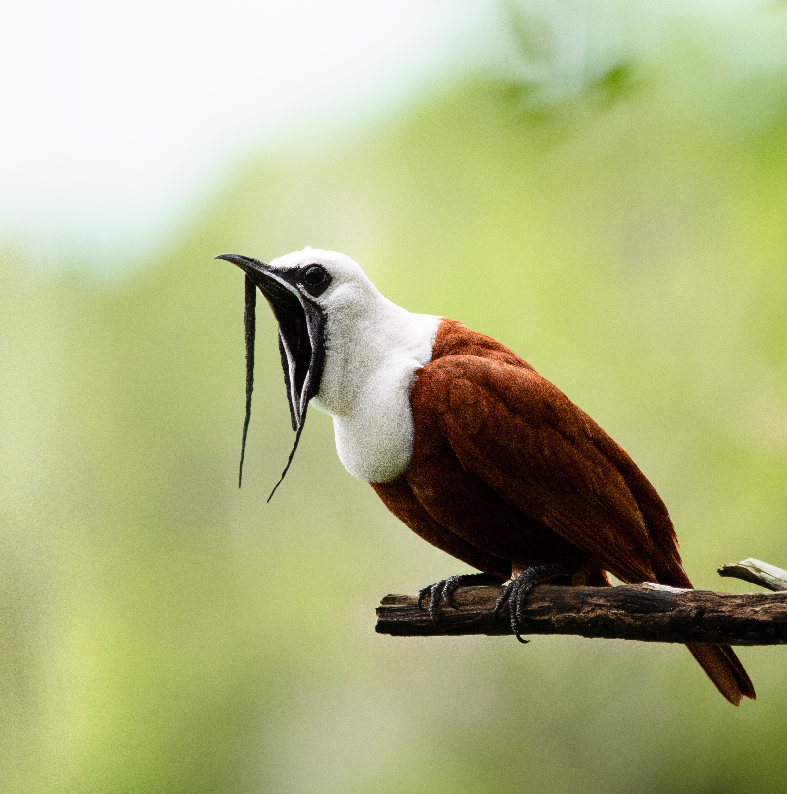
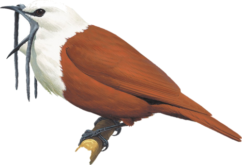
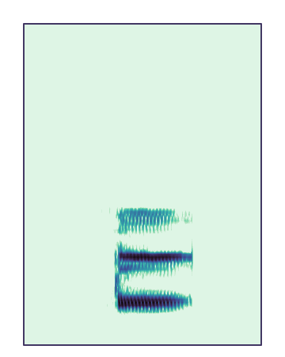

---
format:
  revealjs:
    fig-width: 10
    fig-height: 6.2
    toc: false
    number-sections: false
    embed-resources: true
    auto-section: false
    auto-play-media: false
    dpi: 300
    fig-dpi: 300
    code-line-numbers: false
    code-block-border-left: true
    slide-number: true
    preview-links: auto
    css: styles_revealjs.css
    include-after-body: dynaspec_player.html
execute:
  echo: false
  warning: false
  message: false
editor_options:
  chunk_output_type: console
---

```{r}
#| echo: false

# data and images are built by prepare_slide_assets.R (run from the project root)

# install/ load packages
sketchy::load_packages(
    packages = c(
        "knitr",
        "ggplot2",
        "dynaSpec",
        "ggtext",
        "viridis",
        "scales"
    )
)

## ggplot themes
theme_function <- theme_classic
# Source Sans Pro, as in the slides (must be installed on the computer that renders)
font_family <- "Source Sans Pro"
presentation_theme <- theme_function(base_size = 20, base_family = font_family)

theme_set(presentation_theme)

## spectrogram theme: colours and palette of every spectrogram in the deck (comparisons and
## examples). Change it here, e.g. ds_theme_dark(), ds_theme_paper() or
## ds_theme(pal = viridis::magma, colbg = "black")
spectro_theme <- ds_theme_mako()
ds_set_theme(spectro_theme)

## colour key for sympatric and allopatric species, used throughout the deck: bar charts,
## maps, matrix labels, tables and coloured words in the text
type_cols <- c("Alopátrica" = "#3a7ca5", "Simpátrica" = "#d1603d")
update_geom_defaults("text", list(family = font_family))
update_geom_defaults("label", list(family = font_family))

counts <- read.csv("./data/classification_counts.csv")

# Spanish names shown on the slides
spanish_names <- c(
    "Procnias tricarunculatus" = "Pájaro campana",
    "Psarocolius guatimozinus" = "Oropéndola negra",
    "Psarocolius montezuma" = "Oropéndola de Moctezuma",
    "Pteroglossus erythropygius" = "Aracari piquipálido",
    "Pteroglossus torquatus" = "Aracari de collar",
    "Ramphastos brevis" = "Tucán del Chocó",
    "Ramphastos sulfuratus" = "Tucán pico iris"
)

bird_labels <- c(focal = "Campana focal", other = "Otros campanas")

# species drawing (built by prepare_slide_assets.R); silhouette while a species has none
sp_file <- function(sp) {
    snake <- gsub(" ", "_", tolower(sp))
    # transparent copy (icono_) if there is one, so drawings do not cover bars or lines
    f <- file.path("images", paste0(c("icono_", "dibujo_"), snake, ".png"))
    f <- f[file.exists(f)]
    if (length(f)) f[1] else "images/sil_oropendola.png"
}

# drawing as a grob that fits in a box of w x h cm
sp_grob <- function(sp, w, h, ...) {
    img <- png::readPNG(sp_file(sp))
    scale <- min(w / dim(img)[2], h / dim(img)[1])
    grid::rasterGrob(img, width = grid::unit(dim(img)[2] * scale, "cm"),
                     height = grid::unit(dim(img)[1] * scale, "cm"), interpolate = TRUE, ...)
}

# drawing under a discrete x axis position, outside the panel
sp_below <- function(sp, x, offset, w, h) {
    annotation_custom(
        sp_grob(sp, w, h, y = grid::unit(0, "npc") - grid::unit(offset, "cm"), vjust = 1),
        xmin = x - 0.4, xmax = x + 0.4, ymin = -Inf, ymax = Inf
    )
}

# drawing above a bar (and its label), at data position x and bar height y
sp_above <- function(sp, x, y, offset = 0.75, w = 1.25, h = 1.1) {
    annotation_custom(
        sp_grob(sp, w, h, y = grid::unit(0, "npc") + grid::unit(offset, "cm"), vjust = 0),
        xmin = x - 0.4, xmax = x + 0.4, ymin = y, ymax = y
    )
}

# confusion matrix heatmap
plot_confusion <- function(file, species_order, text_size = 6, sp_size = 1.5, sp_offset = 7) {
    d <- read.csv(file)
    d$reference <- factor(spanish_names[d$reference], levels = spanish_names[species_order])
    d$predicted <- factor(spanish_names[d$predicted], levels = spanish_names[species_order])
    ggplot(d, aes(x = reference, y = predicted, fill = proportion)) +
        geom_tile() +
        geom_text(aes(label = gsub(".", ",", round(proportion, 2), fixed = TRUE)), size = text_size) +
        lapply(seq_along(species_order), function(i) annotation_custom(
            sp_grob(species_order[i], sp_size * 1.3, sp_size,
                    x = grid::unit(0, "npc") - grid::unit(sp_offset, "cm"), hjust = 1),
            xmin = -Inf, xmax = -Inf, ymin = i - 0.4, ymax = i + 0.4
        )) +
        coord_equal(clip = "off") +
        scale_fill_gradient(low = "white", high = mako(10)[7], name = "Proporción", labels = label_number(decimal.mark = ",")) +
        labs(x = "Especie de referencia", y = "Especie predicha") +
        theme(axis.text.x = element_text(angle = 30, hjust = 1, color = "black"),
              axis.text.y = element_text(color = "black"),
              axis.title.y = element_text(margin = margin(r = (sp_size * 1.3 + 1.2) * 28.35)))
}

# confusion matrix for the performance slide: abbreviated scientific names, first species at
# the top-left, a drawing above each column and no colour legend (values are printed)
plot_conf <- function(file, species_order, text_size = 5, draw_w = 1, draw_h = 0.85) {
    d <- read.csv(file)
    short <- setNames(paste0(substr(species_order, 1, 1), ". ", sub(".* ", "", species_order)), species_order)
    d$reference <- factor(short[d$reference], levels = short)
    d$predicted <- factor(short[d$predicted], levels = rev(short))
    n <- length(species_order)
    # species names in the colour key (sympatric orange, allopatric blue, bellbird black)
    sympatric <- c("Ramphastos sulfuratus", "Pteroglossus torquatus", "Psarocolius montezuma")
    allopatric <- c("Ramphastos brevis", "Pteroglossus erythropygius", "Psarocolius guatimozinus")
    col_sp <- ifelse(species_order %in% sympatric, type_cols[["Simpátrica"]],
                     ifelse(species_order %in% allopatric, type_cols[["Alopátrica"]], "black"))
    html <- setNames(sprintf("<i style='color:%s'>%s</i>", col_sp, short), short)
    # labels: values that round to 0.00 shown as 0; text white on dark cells, grey off the
    # diagonal below 0.05, black otherwise
    d$label <- sub(".", ",", sprintf("%.2f", d$proportion), fixed = TRUE)
    d$label[d$label == "0,00"] <- "0"
    d$text_col <- ifelse(d$proportion > 0.6, "white",
                         ifelse(d$proportion < 0.05 & as.character(d$reference) != as.character(d$predicted),
                                "grey60", "black"))
    ggplot(d, aes(x = reference, y = predicted, fill = proportion)) +
        geom_tile(colour = "white", linewidth = 0.6) +
        geom_text(aes(label = label, colour = text_col), size = text_size, family = font_family) +
        lapply(seq_len(n), function(i) annotation_custom(
            sp_grob(species_order[i], draw_w, draw_h, y = grid::unit(0, "npc") + grid::unit(0.15, "cm"), vjust = 0),
            xmin = i - 0.45, xmax = i + 0.45, ymin = n + 0.5, ymax = n + 0.5)) +
        coord_equal(clip = "off") +
        scale_fill_gradient(low = "white", high = mako(10)[6], limits = c(0, 1), guide = "none") +
        scale_colour_identity() +
        scale_x_discrete(labels = function(x) html[x]) +
        scale_y_discrete(labels = function(x) html[x]) +
        labs(x = "Especie de referencia", y = "Clase predicha") +
        # semibold: the only regular-weight italic installed is Light Italic, too thin in colour
        theme(axis.text.x = ggtext::element_markdown(angle = 35, hjust = 1, vjust = 1,
                                                     family = "Source Sans Pro Semibold"),
              axis.text.y = ggtext::element_markdown(hjust = 1, family = "Source Sans Pro Semibold"),
              axis.line = element_blank(), axis.ticks = element_blank(),
              plot.margin = margin(t = 45, r = 5, b = 5, l = 5))
}

# dynaSpec comparison of focal (top) and model (bottom), as one raw HTML block: one player
# shows both spectrograms and plays them in sequence. Called by hand from presentation/ (e.g.
# ds_pair("toucan", "Ramphastos sulfuratus", "<i>Ramphastos sulfuratus</i>", wl = 1024)), it just shows the
# player in the viewer. wl (window length) is one value for both
# sounds or two values, focal first and model second (e.g. wl = c(512, 1024))
ds_pair <- function(pair, model_sp, model_title, wl = 512, collevels = seq(-150, 0, 5)) {
    wl <- rep(wl, length.out = 2)
    clips <- paste0("clip_", pair, c("_focal", "_model"))
    titles <- c("<i>Procnias tricarunculatus</i><br>focal", model_title)
    drawings <- sp_file(c("Procnias tricarunculatus", model_sp)[1])
    drawings <- c(drawings, sp_file(model_sp))

    # each sound has its own spectrogram settings; the time axis is labelled only on the lower one.
    # Colours and palette come from the theme set with ds_set_theme() (ds_theme() only changes
    # the settings given here; a preset theme added with + would replace the global theme)
    ds_sound <- function(i, xlab) {
        dynaspec(file.path("images", paste0(clips[i], ".wav"))) +
            ds_spectrogram(wl = wl[i], ovlp = 90, collevels = collevels, pal = viridis::mako) +
            ds_theme(xlab = xlab, ylab = "Frec. (kHz)", family = font_family,
                     cex.lab = 1.6, cex.axis = 1.4, font.lab = 2, tick.length = 0.6)
    }

    x <- ds_compare(ds_sound(1, ""), ds_sound(2, "Tiempo (s)"), flim = c(1, 8), gap = 0.5) +
        ds_static(width = 860, height = 330, res = 100, lcol = "orange",
                  alt = paste("Espectrograma:", gsub("<[^>]+>", " ", paste(titles, collapse = " y ")))) +
        ds_player(speeds = 1, buttons = character())
    # called by hand (not while knitting): return the player, which shows in the viewer, to try
    # settings such as wl; nothing is written to disk
    if (!isTRUE(getOption("knitr.in.progress"))) return(x)

    # when knitting, dynaSpec wraps its output in a raw HTML fence: this function writes its own
    html <- as.character(save_dynaspec(x, play = FALSE, verbose = FALSE))
    html <- paste(gsub("```(\\{=html\\})?", "", html), collapse = "\n")

    # the player script is the same for all pairs: it loads once, after the slides
    # plus a script for the hidden step of each pair: pressing "next" on the slide first presses
    # the player's play button (top sound, then bottom), and only the next press advances
    step_js <- paste0(
        "<script>(function () {",
        "var ready = function () {",
        "Reveal.on('fragmentshown', function (e) {",
        "if (!e.fragment.classList.contains('ds-autoplay')) return;",
        "var b = Array.prototype.slice.call(Reveal.getCurrentSlide().querySelectorAll('.dynaspec-compare .ds-play'))",
        ".filter(function (x) { return x.offsetParent; })[0];",
        "if (b) b.click();",
        "});",
        "Reveal.on('fragmenthidden', function (e) {",
        "if (!e.fragment.classList.contains('ds-autoplay')) return;",
        "Reveal.getCurrentSlide().querySelectorAll('audio').forEach(function (a) { a.pause(); });",
        "});",
        "};",
        "var wait = function () {",
        "if (window.Reveal && Reveal.on && Reveal.isReady && Reveal.isReady()) ready();",
        "else setTimeout(wait, 100);",
        "};",
        "wait();",
        "})();</script>")
    writeLines(c(paste0("<script>", sub(".*<script>", "", html)), step_js), "dynaspec_player.html")
    player <- sub("<script>.*", "", html)

    # base64 data makes pandoc stall, so the player points to files that Quarto embeds at the end;
    # each sound also gets its drawing and name, in a column to the left of the plot
    for (i in 1:2) {
        png_file <- file.path("images", paste0("ds_", clips[i], ".png"))
        png_b64 <- sub('(?s).*?srcset="data:image/png;base64,([^ "]+)[^"]*".*', "\\1", player, perl = TRUE)
        writeBin(base64enc::base64decode(png_b64), png_file)
        player <- sub('srcset="data:image/png;base64,[^"]+"', paste0('src="', png_file, '"'), player)
        player <- sub(
            '<audio([^>]*) src="data:audio/[^"]+"></audio>',
            paste0('<audio\\1 src="images/', clips[i], '.wav"></audio>',
                   '<div class="ds-etiqueta"><span>', titles[i], '</span></div>'),
            player
        )
    }

    cat(
        "\n```{=html}\n<div class=\"ds-fila\">",
        paste0('<div class="ds-col">', player, "</div>"),
        "</div>",
        '<span class="fragment ds-autoplay" aria-hidden="true"></span>',
        "```\n", sep = "\n"
    )
}
```

# Cuantificación del mimetismo vocal heteroespecífico mediante aprendizaje profundo: evidencia en un juvenil de pájaro campana {.titulo-largo background-color="white" background-size="cover" background-image="./images/DSC_2564-3.jpeg" background-opacity="0.33"}

```{r}
#| output: asis
# the colour key as CSS variables, for tables and coloured words (see styles_revealjs.css)
cat(sprintf("\n```{=html}\n<style>:root { --col-simp: %s; --col-alop: %s; }</style>\n```\n",
            type_cols[["Simpátrica"]], type_cols[["Alopátrica"]]))
```

<div class="autores"><span class="autor autor-principal"><b>Marcelo Araya-Salas</b></span><span class="afiliacion">Universidad de Costa Rica</span><span class="autor">Pablo Huertas-Vásquez</span><span class="afiliacion">Universidad Nacional de Costa Rica</span><span class="autor">Marcos Q. Oliva</span><span class="afiliacion">Royal Holloway University of London</span></div>

<div class="logos"></div>

::: footer
<font size=4><a href="https://marce10.github.io/">https://marce10.github.io/</a></font>
:::

```{r}
#| eval: false
#| echo: false

## TO DO LIST
```

::: {.notes}
**0:00–0:15.** Presentar el tema y a los coautores.
:::


## Evolución del aprendizaje vocal

:::: {.columns}

::: {.column width="52%"}
{.filogenia}
:::

::: {.column width="48%"}
<font size=6>

- Solo tres linajes de aves tienen aprendizaje vocal: **aves canoras** (oscines), **loros** y **colibríes**
- Los **suboscines**, grupo del pájaro campana, se consideran no aprendices

</font>
:::

::::

::: {.fuente}
Jarvis 2004; Suh et al. 2011; filogenia: Open Tree of Life v1.7 (McTavish et al. 2025)
:::

::: {.notes}
**Unos 35 s.** El aprendizaje vocal es raro: en aves solo lo tienen tres linajes, marcados en naranja. Los Tyranni, hermanos de las aves canoras, se consideran no aprendices, y ahí están los pájaros campana.
:::

## Evolución del aprendizaje vocal

:::: {.columns}

::: {.column width="52%"}
{.filogenia}
:::

::: {.column width="48%"}
<font size=6>

- Solo tres linajes de aves tienen aprendizaje vocal: **aves canoras** (oscines), **loros** y **colibríes**
- Los <b style="color:#3a7ca5">suboscines</b> (Tyranni), grupo del pájaro campana, se consideran no aprendices

</font>
:::

::::

::: {.fuente}
Jarvis 2004; Suh et al. 2011; filogenia: Open Tree of Life v1.7 (McTavish et al. 2025)
:::

::: {.notes}
**Unos 20 s.** En azul, los Tyranni o suboscines: el grupo hermano de las aves canoras, considerado no aprendiz. Ahí están los pájaros campana, y por eso su caso es tan interesante.
:::

## Mimetismo vocal 

::: {.callout-note icon=false appearance="simple"}
<font size=6>**Aprendizaje de la producción vocal:** adquirir patrones vocales imitando un modelo; depende de la retroalimentación auditiva y de circuitos neurales complejos</font>
:::

<br>

<font size=6>

- El mimetismo vocal es común en las aves
- Cuando el modelo es **otra especie**, la imitación implica aprendizaje vocal
- Por eso se usa como evidencia de aprendizaje incluso fuera de los grupos reconocidos: Passeri, loros y colibríes

</font>

::: {.fuente}
Janik & Slater 2000; Jarvis 2004; Goller & Shizuka 2018; Ten Cate 2021
:::

::: {.notes}
**Hasta 1:15.** El mimetismo vocal es común en las aves y nos interesa por lo que implica: copiar a otra especie requiere aprender a producir el sonido. Esa capacidad se reconoce en tres grupos de aves, y el mimetismo suele ser la mejor pista de aprendizaje fuera de ellos. Pero todo depende de una pregunta: ¿eso que suena parecido es realmente una copia?
:::

## ¿Mimetismo o semejanza por azar?

<font size=6>

Demostrarlo en el campo requiere:

1. Identificar la **fuente** del sonido heteroespecífico
2. Definir un **umbral de similitud** entre modelo y copia
3. Descartar la **convergencia** vocal

</font>

<br>

::: {.callout-note icon=false appearance="simple"}
<font size=6>No existe un **marco cuantitativo riguroso** para evaluar si una semejanza acústica aparente es mimetismo o azar</font>
:::

::: {.fuente}
Kelley et al. 2008; Dalziell et al. 2015
:::

::: {.notes}
**Hasta 2:20.** Estos tres requisitos son difíciles de cumplir con animales silvestres. Además, la mayor parte de la evidencia se basa en descripciones cualitativas de la semejanza: un sonido variable puede parecerse a otro simplemente por casualidad. Ese es el vacío que queremos llenar.
:::

## Pájaros campana (_Procnias_)

:::: {.columns}

::: {.column width="58%"}
<font size=6>

Tyranni: en general, considerados no aprendices. Pero en _Procnias_ hay:

- Dialectos y sonidos nuevos
- Cambios vocales durante la ontogenia
- Mimetismo en un individuo **cautivo**

</font>
:::

::: {.column width="42%"}
{width="52%"}
:::

::::

::: {.callout-note icon=false appearance="simple"}
<font size=6>**Objetivo:** desarrollar un enfoque de aprendizaje profundo para evaluar el mimetismo vocal heteroespecífico en un juvenil de pájaro campana</font>
:::

::: {.fuente}
Snow 1970, 1977; Saranathan et al. 2007; Kroodsma et al. 2013
:::

::: {.notes}
**Hasta 3:10.** Los pájaros campana son un caso especial: pertenecen a los Tyranni, considerados no aprendices, pero varias observaciones sugieren aprendizaje. Esto los vuelve ideales para probar el enfoque, que es nuestro objetivo.
:::


## {.video-subtitulo background-video="images/adulto_monteverde.mp4" background-size="contain" background-color="black"}

<div class="subtitulo-video">Adulto de <i>P. tricarunculatus</i> en Monteverde, Costa Rica</div>

::: {.notes}
Video a pantalla completa (66 s, con sonido): el juvenil imitando al aracari y luego al tucán. Empieza solo al llegar a la diapositiva. Para acortarlo, avanzar a la siguiente.
:::


## {.video-subtitulo background-video="images/combined.mp4" background-size="contain" background-color="black"}

<div class="subtitulo-video">Juvenil de <i>P. tricarunculatus</i> en Bosque Alegre Refuge, Costa Rica</div>

::: {.notes}
Video a pantalla completa (66 s, con sonido): el juvenil imitando al aracari y luego al tucán. Empieza solo al llegar a la diapositiva. Para acortarlo, avanzar a la siguiente.

**Hasta 3:55.** Pablo encontró este juvenil solo, interactuando con tucanes y aracaris. No vio otro pájaro campana en el área, ni antes ni después, así que es poco probable que los sonidos vengan de otro individuo. Por la muda y la falta de carúnculas estimamos unos dos o tres años. Y sonaba así.
:::

## Imitando a _Ramphastos sulfuratus_

```{r}
#| output: asis
ds_pair("toucan", "Ramphastos sulfuratus", "<i>Ramphastos sulfuratus</i>", wl = 512)
```

::: {.notes}
**Hasta 4:35.** Al avanzar (→) suenan los dos en secuencia, y el siguiente → pasa a la otra diapositiva: primero el focal (arriba), luego el tucán pico iris (abajo). Clic sobre un espectrograma para empezar desde ese punto.
:::

## Imitando a _Pteroglossus torquatus_

```{r}
#| output: asis
ds_pair("aracari", "Pteroglossus torquatus", "<i>Pteroglossus torquatus</i>", wl = 600)
```

::: {.notes}
**Hasta 5:10.** Al avanzar (→) suenan los dos en secuencia: focal y aracari de collar. También hubo sonidos parecidos a la oropéndola (en respaldo). Suena convincente, pero el oído puede engañar: necesitamos una prueba.
:::

## Flujo de análisis {visibility="hidden"}

```{=html}
<div class="flujo">
<div class="flujo-caja flujo-focal"><div><b>Grabaciones del juvenil</b><span>Monteverde, abril a noviembre de 2020</span></div></div>
<div class="flujo-flecha">&#8594;</div>
<div class="flujo-caja flujo-focal"><div><b>Anotación</b><span>Vocalizaciones del juvenil</span></div></div>
<div class="flujo-flecha">&#8594;</div>
<div class="flujo-caja flujo-focal"><div><b>Posibles modelos</b><span>Especies <span class="simp">simpátricas</span> que el juvenil parece imitar</span></div></div>
<div></div>
<div></div>
<div></div>
<div></div>
<div class="flujo-flecha flujo-abajo">&#8595;</div>
<div class="flujo-caja flujo-ref"><div><b>Anotación</b><span>Vocalizaciones de cada especie</span></div></div>
<div class="flujo-flecha">&#8592;</div>
<div class="flujo-caja flujo-ref"><div><b>Grabaciones de repositorios</b><span>Descargadas con <i>suwo</i></span></div></div>
<div class="flujo-flecha">&#8592;</div>
<div class="flujo-caja flujo-ref"><div><b>Especies de referencia</b><span>3 <span class="simp">simpátricas</span>, 3 <span class="alop">alopátricas</span> y otros pájaros campana</span></div></div>
<div class="flujo-flecha flujo-abajo">&#8595;</div>
<div></div>
<div></div>
<div></div>
<div></div>
<div class="flujo-caja flujo-modelo"><div><b>Fragmentos de 2 s</b><span>80 % entrenar · 20 % evaluar, separados por grabación</span></div></div>
<div class="flujo-flecha">&#8594;</div>
<div class="flujo-caja flujo-modelo"><div><b>Reentrenar BirdNET</b><span>Modelo 1: 7 clases · modelo 2: 4 clases</span></div></div>
<div class="flujo-flecha">&#8594;</div>
<div class="flujo-caja flujo-modelo"><div><b>Desempeño</b><span>F1 en las grabaciones de prueba</span></div></div>
</div>
```

::: {.notes}
**Unos 30 s.** Primero anotamos las grabaciones del juvenil e identificamos las especies que parecía imitar. Con eso definimos las especies de referencia: las simpátricas, sus parientes alopátricos y otros pájaros campana. Descargamos sus grabaciones con suwo, las anotamos, las cortamos en fragmentos de 2 segundos y reentrenamos BirdNET. Finalmente evaluamos el desempeño con grabaciones que el modelo no había visto.
:::

## Lógica del análisis

:::: {.columns}

::: {.column width="50%"}
::: {.callout-note icon=false appearance="simple"}
<font size=5><b>Azar:</b> vocalizaciones variables que solo coinciden por casualidad con otras especies</font>
:::
:::

::: {.column width="50%"}
::: {.callout-note icon=false appearance="simple"}
<font size=5><b>Mimetismo:</b> copia de las especies que el juvenil puede escuchar</font>
:::
:::

::::

```{r}
#| fig-height: 4.1
# schematic predictions (hypothetical values) for two generic pairs of sister species
pred <- expand.grid(type = c("Alopátrica", "Simpátrica"),
                    group = c("Especies\nhermanas 1", "Especies\nhermanas2"),
                    hyp = c("Predicción si es azar", "Predicción si es mimetismo"))
pred$value <- ifelse(pred$hyp == "Predicción si es azar",
                     c(0.30, 0.29, 0.24, 0.25),
                     c(0.06, 0.44, 0.05, 0.33))

ggplot(pred, aes(x = group, y = value, fill = type)) +
    geom_col(position = position_dodge(width = 0.8), width = 0.75) +
    facet_wrap(~ hyp) +
    scale_fill_manual(values = type_cols, name = "") +
    scale_y_continuous(expand = expansion(mult = c(0, 0.1))) +
    labs(x = "", y = "Similitud") +
    theme(legend.position = "top", strip.background = element_blank(),
          strip.text = element_text(size = 22), axis.text.y = element_blank(),
          axis.ticks.y = element_blank())
```

::: {.callout-note icon=false appearance="simple"}
<center><font size=5>Las <span class="alop">alopátricas</span> son parientes cercanos de los modelos y suenan parecido, pero el juvenil nunca pudo escucharlas: son el **control** ideal</font></center>
:::

::: {.notes}
**Unos 40 s.** Queremos distinguir dos posibilidades. Si el juvenil produce vocalizaciones variables que por casualidad se parecen a otras especies, el clasificador debería asignarlas por igual a las simpátricas y a sus parientes alopátricos (izquierda). Si las está copiando, deberían parecerse más a las simpátricas, que son las que puede escuchar (derecha). Las alopátricas son un buen control porque, al ser especies hermanas, suenan parecido a los modelos: cualquier parecido por azar debería repartirse entre ambas. Las barras son esquemáticas.
:::

## Especies y datos de entrenamiento

```{r}
#| output: asis
tr <- read.csv("./data/entrenamiento_modelos.csv")
n_ex <- setNames(tr$clips_train + tr$clips_test, tr$species)
n_rec <- setNames(tr$recordings_train + tr$recordings_test, tr$species)
abbr <- function(sp) paste0(substr(sp, 1, 1), ". ", sub(".* ", "", sp))
# distribution maps redrawn with the colour key when the (licensed, local) BirdLife data are
# available; otherwise the maps already in images/ are used
if (file.exists("maps/rangos_especies.gpkg")) {
    map_env <- new.env()
    map_env$type_cols <- type_cols
    suppressMessages(sys.source("distribution_maps.R", envir = map_env))
}

# example spectrograms, drawn here so they follow spectro_theme: best-SNR clip of each
# species, 0.8 s, 0-10 kHz (sounds selected by example_spectrograms.R)
for (sp in c("Ramphastos sulfuratus", "Ramphastos brevis", "Pteroglossus torquatus",
             "Pteroglossus erythropygius", "Psarocolius montezuma", "Psarocolius guatimozinus",
             "Procnias tricarunculatus")) {
    snake <- gsub(" ", "_", tolower(sp))
    ex <- dynaspec(file.path("images", paste0("ejemplo_", snake, ".wav")), flim = c(0, 10)) +
        ds_spectrogram(wl = 512, ovlp = 90) +
        ds_theme(axis.type = "none") +
        ds_static(width = 360, height = 450, res = 150)
    invisible(save_dynaspec(ex, file.path("images", paste0("espectro_", snake, ".png")),
                            play = FALSE, verbose = FALSE))
}

# map and example spectrogram side by side
cell <- function(sp) sprintf(
    '<td><div class="esp-par"></div><div class="esp-nombre"><i>%s</i> · %d <span class="ent-grab">(%d)</span></div></td>',
    gsub(" ", "_", tolower(sp)), sp, gsub(" ", "_", tolower(sp)), sp, abbr(sp), n_ex[[sp]], n_rec[[sp]])
groups <- list(c("Ramphastos", "tucanes", "Ramphastos sulfuratus", "Ramphastos brevis"),
               c("Pteroglossus", "aracaris", "Pteroglossus torquatus", "Pteroglossus erythropygius"),
               c("Psarocolius", "oropéndolas", "Psarocolius montezuma", "Psarocolius guatimozinus"))
rows <- vapply(seq_along(groups), function(k) {
    g <- groups[[k]]
    side <- if (k == 1) sprintf(paste0(
        '<td class="esp-campana" rowspan="3">',
        '',
        '<div><i>P. tricarunculatus</i></div><div class="esp-otros">Otros individuos</div>',
        '<div>%d <span class="ent-grab">(%d)</span></div></td>'),
        n_ex[["Procnias tricarunculatus"]], n_rec[["Procnias tricarunculatus"]]) else ""
    sprintf('<tr><th class="esp-genero"><i>%s</i><span>%s</span></th>%s%s%s</tr>',
            g[1], g[2], cell(g[3]), cell(g[4]), side)
}, character(1))
cat("\n```{=html}\n<table class=\"tabla-especies\" data-quarto-disable-processing=\"true\">",
    "<tr><th></th><th class=\"mapa-simpatrico\">Modelo simpátrico</th><th class=\"mapa-alopatrico\">Pariente alopátrico</th><th class=\"esp-campana-tit\">Pájaro campana</th></tr>",
    paste(rows, collapse = "\n"), "</table>\n```\n", sep = "\n")
```


::: {.notes}
**Unos 40 s.** Las tres especies simpátricas, a la izquierda, comparten distribución con el pájaro campana (contorno negro); sus parientes alopátricos, a la derecha, nunca coinciden con él. Bajo cada mapa, el número de ejemplos de 2 segundos y, entre paréntesis, de grabaciones; a la derecha, los otros pájaros campana. Separamos las grabaciones, 80 % para entrenar y 20 % para evaluar, sin repetir ninguna.
:::

## Desempeño del modelo 1 {.desempeno}

:::: {.columns}

::: {.column width="70%"}
```{r}
#| fig-width: 6.6
#| fig-height: 6.3
order7 <- c("Ramphastos sulfuratus", "Ramphastos brevis", "Pteroglossus torquatus",
            "Pteroglossus erythropygius", "Psarocolius montezuma", "Psarocolius guatimozinus",
            "Procnias tricarunculatus")
plot_conf("./data/confusion_sympatric_allopatric.csv", order7, text_size = 6.2)
```
:::

::: {.column width="30%"}
<div class="modelo-lado"><span class="simp">Simpátricas</span>, <span class="alop">alopátricas</span><br>y pájaro campana<br>(7 clases)</div>
:::

::::

::: {.fuente}
Proporción de los fragmentos de cada especie (columnas) asignados a cada clase (filas)
:::

::: {.notes}
**Unos 20 s.** El modelo 1 incluye las siete clases: las tres simpátricas, sus parientes alopátricos y otros pájaros campana. Es el que permite comparar simpátricas y alopátricas. La diagonal es alta: distingue bien las especies; la mayor confusión es entre los dos aracaris.
:::

## 

```{r}
#| fig-height: 5
pairs <- data.frame(
    pred = c("Ramphastos sulfuratus", "Ramphastos brevis",
             "Pteroglossus torquatus", "Pteroglossus erythropygius",
             "Psarocolius montezuma", "Psarocolius guatimozinus"),
    group = rep(c("Tucanes", "Aracaris", "Oropéndolas"), each = 2),
    type = rep(c("Simpátrica", "Alopátrica"), times = 3)
)

totals <- unique(counts[counts$model == "sympatric_allopatric", c("bird", "total")])
bars <- merge(merge(pairs, totals), counts[counts$model == "sympatric_allopatric", c("pred", "bird", "Freq")], all.x = TRUE)
bars$Freq[is.na(bars$Freq)] <- 0
bars$prop <- bars$Freq / bars$total
bars$bird <- factor(bird_labels[bars$bird], levels = bird_labels)
bars$group <- factor(bars$group, levels = c("Tucanes", "Aracaris", "Oropéndolas"))

# drawings above each bar: alopatric on the left, sympatric on the right
bias_sp <- data.frame(
    sp = c("Ramphastos brevis", "Ramphastos sulfuratus",
           "Pteroglossus erythropygius", "Pteroglossus torquatus",
           "Psarocolius guatimozinus", "Psarocolius montezuma"),
    x = rep(1:3, each = 2) + c(-0.2, 0.2)
)

# one plot per group of birds, joined with patchwork, so the first slide can show only the
# focal bird with exactly the same layout as the second
ymax <- max(bars$prop) * 1.55   # room for the drawings above the tallest bar
bias_panel <- function(b, y_axis) {
    d <- bars[bars$bird == b, ]
    g <- ggplot(d, aes(x = group, y = prop, fill = type)) +
        geom_col(position = position_dodge(width = 0.8), width = 0.75) +
        geom_text(aes(label = Freq), position = position_dodge(width = 0.8),
                  vjust = -0.4, size = 6) +
        facet_wrap(~ bird) +
        lapply(seq_len(nrow(bias_sp)), function(i)
            sp_above(bias_sp$sp[i], bias_sp$x[i], d$prop[d$pred == bias_sp$sp[i]])) +
        coord_cartesian(clip = "off") +
        scale_fill_manual(values = type_cols, name = "", drop = FALSE) +
        scale_y_continuous(labels = label_percent(), limits = c(0, ymax), expand = c(0, 0),
                           breaks = seq(0, max(bars$prop), by = 0.05)) +
        labs(x = "", y = "Vocalizaciones clasificadas como") +
        theme(strip.background = element_blank(), strip.text = element_text(size = 22))
    if (y_axis) {
        # left panel: legend inside, in the empty space above the oropendolas, and the note below it
        g <- g + labs(caption = "Números sobre las barras: cantidad de vocalizaciones") +
            theme(legend.position = "inside", legend.position.inside = c(1, 0.85),
                  legend.justification = c(1, 1), legend.direction = "vertical",
                  legend.background = element_blank(),
                  plot.caption = element_text(hjust = 0), plot.caption.position = "plot")
    } else {
        g <- g + theme(axis.line.y = element_blank(), axis.text.y = element_blank(),
                       axis.ticks.y = element_blank(), axis.title.y = element_blank(),
                       legend.position = "none")
    }
    g
}
bias_plot <- function(show_other) {
    right <- if (show_other) bias_panel(bird_labels[["other"]], FALSE) else patchwork::plot_spacer()
    patchwork::wrap_plots(bias_panel(bird_labels[["focal"]], TRUE), right, nrow = 1)
}

bias_plot(show_other = FALSE)
```

::: {.oculto}
::: {.callout-note icon=false appearance="simple"}
<center><font size=5>Probabilidad de clasificarse como <span class="simp">simpátrica</span>: **15,9 veces** más chances en el <i>P. tricarunculatus</i> focal que en otros individusos (IC 95%: 11,82–22,12)</font></center>
:::
:::

::: {.notes}
**Hasta 7:00.** El resultado principal, primero en el individuo focal: la gran mayoría de sus clasificaciones heteroespecíficas caen en la especie simpátrica, sobre todo el tucán pico iris y el aracari de collar.
:::

## 

```{r}
#| fig-height: 5
bias_plot(show_other = TRUE)
```

::: {.callout-note icon=false appearance="simple"}
<center><font size=5>Probabilidad de clasificarse como <span class="simp">simpátrica</span>: **15,9 veces** más chances en el Procnias focal que en otros individusos (IC 95%: 11,82–22,12)</font></center>
:::

::: {.notes}
**Hasta 7:30.** Ahora los otros pájaros campana: sin este sesgo. La probabilidad de clasificarse como simpátrica es de 0,93 en el focal contra 0,44 en los otros, que equivale a 15,9 veces más odds. Esto apoya el mimetismo genuino.
:::

## Desempeño del modelo 2 {.desempeno}

:::: {.columns}

::: {.column width="70%"}
```{r}
#| fig-width: 5.6
#| fig-height: 6
order4 <- c("Ramphastos sulfuratus", "Pteroglossus torquatus", "Psarocolius montezuma",
            "Procnias tricarunculatus")
plot_conf("./data/confusion_sympatric.csv", order4, text_size = 6.5, draw_w = 1.4, draw_h = 1.15)
```
:::

::: {.column width="30%"}
<div class="modelo-lado">Solo <span class="simp">simpátricas</span><br>y pájaro campana<br>(4 clases)</div>
:::

::::

::: {.fuente}
Proporción de los fragmentos de cada especie (columnas) asignados a cada clase (filas)
:::

::: {.notes}
**Unos 15 s.** El modelo 2 solo tiene las simpátricas y el pájaro campana, para estimar a cuál de las especies modelo se parece más cada vocalización. También distingue bien las cuatro clases.
:::

## ¿A cuáles especies imita?

```{r}
sp <- counts[counts$model == "sympatric", ]
sp_levels <- c("Ramphastos sulfuratus", "Pteroglossus torquatus", "Psarocolius montezuma")
sp_bars <- expand.grid(pred = sp_levels, bird = c("focal", "other"), stringsAsFactors = FALSE)
sp_bars <- merge(sp_bars, sp[, c("pred", "bird", "Freq")], all.x = TRUE)
sp_bars$Freq[is.na(sp_bars$Freq)] <- 0
sp_bars$total <- unique(sp[, c("bird", "total")])$total[match(sp_bars$bird, unique(sp[, c("bird", "total")])$bird)]
sp_bars$prop <- sp_bars$Freq / sp_bars$total
sp_short <- setNames(paste0(substr(sp_levels, 1, 1), ". ", sub(".* ", "", sp_levels)), sp_levels)
sp_bars$species <- factor(sp_short[sp_bars$pred], levels = sp_short)
sp_bars$bird <- factor(bird_labels[sp_bars$bird], levels = bird_labels)

ggplot(sp_bars, aes(x = species, y = prop, fill = bird)) +
    geom_col(position = position_dodge(width = 0.8), width = 0.75) +
    geom_text(aes(label = percent(prop, accuracy = 0.1, decimal.mark = ",")), position = position_dodge(width = 0.8),
              vjust = -0.4, size = 6) +
    scale_fill_manual(values = mako(10)[c(7, 3)], name = "") +
    scale_y_continuous(labels = label_percent(), expand = expansion(mult = c(0, 0.45))) +
    # each drawing above the taller bar of its species
    lapply(seq_along(sp_levels), function(i)
        sp_above(sp_levels[i], i, max(sp_bars$prop[sp_bars$pred == sp_levels[i]]), 0.8, 2.6, 1.7)) +
    coord_cartesian(clip = "off") +
    # scientific names in italics, in the colour of sympatric species
    scale_x_discrete(labels = function(x) sprintf("<i style='color:%s'>%s</i>", type_cols[["Simpátrica"]], x)) +
    labs(x = "", y = "Vocalizaciones clasificadas como") +
    theme(legend.position = "top",
          axis.text.x = ggtext::element_markdown(size = 22, family = "Source Sans Pro Semibold"))
```

::: {.fuente}
Segundo clasificador, solo con <span class="simp">simpátricas</span>. Focal vs. otros campanas: 164,9 veces más odds de clasificarse como especie modelo (IC 95%: 82,84–392,53)
:::

::: {.notes}
**Hasta 8:05.** Un segundo clasificador, solo con las simpátricas, permite estimar cuánto se parece a cada una. Sobre todo al tucán pico iris, luego al aracari de collar, y muy poco a la oropéndola. En los otros campanas, estas clasificaciones son prácticamente inexistentes.
:::
## El repertorio cambia con el tiempo

```{r}
points <- read.csv("./data/temporal_points.csv")
curves <- read.csv("./data/temporal_curves.csv")

time_labels <- c("Three-wattled Bellbird" = "<i>P. tricarunculatus</i>",
                 "Collared Aracari" = "<i>P. torquatus</i>",
                 "Keel-billed Toucan" = "<i>R. sulfuratus</i>",
                 "Unassigned" = "Sin asignar")

for (nm in c("points", "curves")) {
    d <- get(nm)
    d$date <- as.Date(d$date)
    d$species <- factor(time_labels[d$species], levels = time_labels)
    assign(nm, d)
}

months <- as.Date(sprintf("2020-%02d-01", 4:11))

ggplot(points[points$prop > 0, ], aes(x = date, y = prop, color = species, fill = species)) +
    geom_point(aes(size = n), pch = 21) +
    geom_line(data = curves, linewidth = 1.8) +
    scale_color_viridis_d(alpha = 0.9, end = 0.8, name = "") +
    scale_fill_viridis_d(alpha = 0.5, end = 0.8, name = "") +
    scale_size_area(max_size = 12, name = "Vocalizaciones") +
    scale_x_date(breaks = months, labels = c("abr", "may", "jun", "jul", "ago", "set", "oct", "nov")) +
    scale_y_continuous(labels = label_percent()) +
    # drawings beside the end of each curve
    annotation_custom(sp_grob("Procnias tricarunculatus", 2.6, 2, x = grid::unit(0.2, "cm"), hjust = 0),
                      xmin = Inf, xmax = Inf, ymin = 0.73, ymax = 0.73) +
    annotation_custom(sp_grob("Ramphastos sulfuratus", 2.6, 2, x = grid::unit(0.2, "cm"), hjust = 0),
                      xmin = Inf, xmax = Inf, ymin = 0.32, ymax = 0.32) +
    annotation_custom(sp_grob("Pteroglossus torquatus", 2.6, 2, x = grid::unit(0.2, "cm"), hjust = 0),
                      xmin = Inf, xmax = Inf, ymin = 0.06, ymax = 0.06) +
    coord_cartesian(clip = "off") +
    labs(x = "2020", y = "Vocalizaciones clasificadas como") +
    theme(legend.position = "top", legend.box = "vertical",
          legend.text = ggtext::element_markdown(),
          plot.margin = margin(5, 85, 5, 5))
```

::: {.fuente}
Pendiente: <i>P. tricarunculatus</i> 0,78 (IC 95%: 0,66–0,90); <i>R. sulfuratus</i> −0,72 (−0,83 a −0,60); <i>P. torquatus</i> −0,11 (−0,27 a 0,05)
:::

::: {.notes}
**Hasta 8:55.** Las primeras observaciones están dominadas por sonidos parecidos al tucán y, en menor medida, al aracari. Con el tiempo aumenta la probabilidad de clasificarse como pájaro campana y baja la de tucán. El aracari no muestra una tendencia clara.
:::

## Implicaciones para el desarrollo vocal

:::: {.columns}

::: {.column width="50%"}
::: {.callout-note icon=false appearance="simple"}
<font size=6><b>Aprendizaje</b><br><br>Evidencia adicional de aprendizaje de la producción vocal en esta especie</font>
:::
:::

::: {.column width="50%"}
::: {.callout-note icon=false appearance="simple"}
<font size=6><b>Complejidad</b><br><br>Un desarrollo vocal comparable en complejidad al de las aves canoras</font>
:::
:::

::::

<br>

::: {.callout-note icon=false appearance="simple"}
<center><font size=6>El mimetismo podría ser un componente **transitorio** del desarrollo vocal</font></center>
:::

::: {.notes}
**Hasta 9:45.** Un Tyranni que incorpora sonidos de otras especies y luego avanza hacia los de su propia especie muestra un desarrollo vocal más complejo de lo esperado. Si esta trayectoria se confirma, el mimetismo podría ser una etapa del desarrollo y no un rasgo permanente del repertorio.
:::

## ¿cómo adquirió estos sonidos?

:::: {.columns}

::: {.column width="50%"}
::: {.callout-note icon=false appearance="simple"}
<font size=6><b>Aislamiento</b><br><br>Una migración incompleta lo separa de sus conespecíficos durante un periodo sensible, y aprende los sonidos locales</font>
:::
:::

::: {.column width="50%"}
::: {.callout-note icon=false appearance="simple"}
<font size=6><b>Desarrollo normal</b><br><br>Los sonidos heteroespecíficos se aprenden como parte del desarrollo inmaduro, y el aislamiento es incidental</font>
:::
:::

::::

<br>

<font size=6>

En ambos casos, adquirir sonidos heteroespecíficos **implica aprendizaje vocal**

</font>


## {.conclusiones background="#DAD4EA" background-size="cover" background-opacity="0.25"}

:::: {.columns}

::: {.column width="85%"}

### Mimetismo vocal en _Procnias tricarunculatus_

::: {.callout-note icon=false appearance="simple"}
<font size=5.5>

- Evidencia **cuantitativa** de mimetismo vocal heteroespecífico en un juvenil de pájaro campana

</font>
:::

::: {.callout-note icon=false appearance="simple"}
<font size=5.5>

- Aprendizaje profundo + controles <span class="alop">alopátricos</span>: un marco para **descartar el azar**

</font>
:::

::: {.callout-note icon=false appearance="simple"}
<font size=5.5>

- Evidencia adicional de **aprendizaje de la producción vocal** en la especie

</font>
:::

::: {.callout-note icon=false appearance="simple"}
<font size=5.5>

- El mimetismo podría ser un componente **transitorio** del desarrollo vocal

</font>
:::

:::

::: {.column width="15%"}
:::

::::

::: {.notes}
**Hasta 10:55.** Cuatro mensajes. El método es aplicable a otros casos: a diferencia de los métodos de correlación, no requiere una plantilla específica ni un umbral arbitrario.
:::

## Respaldo: primer modelo {visibility="hidden"}

:::: {.columns}

::: {.column width="50%"}
<div class="cifra-texto"><b>Campana focal</b></div>
<div class="cifra">0,93</div>
<div class="cifra-texto">probabilidad de clasificarse como <span class="simp">simpátrica</span></div>
<br>
<div class="cifra-texto">Odds <span class="simp">simpátrica</span> vs. <span class="alop">alopátrica</span>:<br><b>12,68</b> (IC 95%: 4,07–39,49)</div>
:::

::: {.column width="50%"}
<div class="cifra-texto"><b>Otros campanas</b></div>
<div class="cifra">0,44</div>
<div class="cifra-texto">probabilidad de clasificarse como <span class="simp">simpátrica</span></div>
<br>
<div class="cifra-texto">Odds <span class="simp">simpátrica</span> vs. <span class="alop">alopátrica</span>:<br><b>0,80</b> (IC 95%: 0,27–2,44)</div>
:::

::::


## Respaldo: la oropéndola {visibility="hidden"}

```{r}
#| output: asis
ds_pair("oropendola", "Psarocolius montezuma", "<i>Psarocolius montezuma</i>", wl = 1024, collevels = seq(-45, 0, 1))
```

## Respaldo: el "bock" {visibility="hidden"}

```{r}
#| output: asis
ds_pair("bock", "Procnias tricarunculatus", "<i>Procnias tricarunculatus</i><br>adulto", wl = 512)
```


## Limitaciones {visibility="hidden"}

<font size=6>

- La inferencia se basa en **un solo individuo**
- El descenso es claro en _R. sulfuratus_, no en _P. torquatus_
- No sabemos si el mimetismo **persiste en la adultez**

</font>

<br>

::: {.callout-note icon=false appearance="simple"}
<font size=6>Si las imitaciones se clasifican como la especie modelo, pueden generar **falsas detecciones** en el monitoreo acústico automatizado</font>
:::

::: {.notes}
**Hasta 10:15.** Por eso hablamos de que "podría" ser transitorio: hace falta seguir individuos a lo largo del tiempo. Una implicación práctica: un imitador convincente puede generar falsas detecciones en el monitoreo acústico.
:::


## Agradecimientos y recursos {background="#DEF5E5FF"}

:::: {.columns}

::: {.column width="62%"}
<div class="recursos">
<p><b>Financiamiento</b>: Centro de Investigación en Neurociencias, UCR</p>
<p><b>Ilustraciones de aves</b>: Birds of the World (Cornell Lab of Ornithology)</p>
</div>

<div class="recursos recursos-enlaces">
<span></span><p><b>Sitio del proyecto</b>: análisis, código y esta presentación<br><a href="https://marce10.github.io/bellbird_vocal_mimicry/">marce10.github.io/bellbird_vocal_mimicry</a></p>
<span></span><p><b>Repositorio en GitHub</b><br><a href="https://github.com/maRce10/bellbird_vocal_mimicry">github.com/maRce10/bellbird_vocal_mimicry</a></p>
<p><b>suwo</b>: grabaciones de repositorios en línea desde R<br><a href="https://docs.ropensci.org/suwo/">docs.ropensci.org/suwo</a></p>
<p><b>BirdNET</b>: identificación de aves por sonido con aprendizaje profundo<br><a href="https://birdnet.cornell.edu/">birdnet.cornell.edu</a></p>
<p><b>dynaSpec</b>: los espectrogramas con sonido de esta presentación<br><a href="https://marce10.github.io/dynaSpec/">marce10.github.io/dynaSpec</a></p>
</div>
:::

::: {.column width="38%"}
<div class="qr-recursos"><div>Esta presentación</div><div class="ref-enlace"><a href="#/referencias">Referencias citadas</a></div></div>
:::

::::

::: {.notes}
**Hasta 11:10.** Agradecer y pasar a preguntas. Puede quedar en pantalla durante las preguntas: el QR abre esta presentación en el sitio del proyecto.
:::

# Cuantificación del mimetismo vocal heteroespecífico mediante aprendizaje profundo: evidencia en un juvenil de pájaro campana {.titulo-largo background-color="white" background-size="cover" background-image="./images/DSC_2564-3.jpeg" background-opacity="0.33" visibility="hidden"}

<div class="autores"><span class="autor autor-principal"><b>Marcelo Araya-Salas</b></span><span class="afiliacion">Universidad de Costa Rica</span><span class="autor">Pablo Huertas-Vásquez</span><span class="afiliacion">Universidad Nacional de Costa Rica</span><span class="autor">Marcos Q. Oliva</span><span class="afiliacion">Royal Holloway University of London</span></div>

<div class="logos"></div>
::: footer
<font size=4><a href="https://marce10.github.io/">https://marce10.github.io/</a></font>
:::

::: {.notes}
Dejar esta diapositiva durante las preguntas (3 min). Después vienen las de respaldo.
:::

## Referencias {visibility="uncounted"}

```{=html}
<ol class="referencias">
<li>BirdLife International y Handbook of the Birds of the World (2025). Bird species distribution maps of the world. Versión 2025.2. <a href="http://datazone.birdlife.org/species/requestdis">http://datazone.birdlife.org/species/requestdis</a></li>
<li>Dalziell, A. H., Welbergen, J. A., Igic, B. y Magrath, R. D. (2015). Avian vocal mimicry: a unified conceptual framework. <i>Biological Reviews</i> 90: 643–668. <a href="https://doi.org/10.1111/brv.12129">doi.org/10.1111/brv.12129</a></li>
<li>Goller, M. y Shizuka, D. (2018). Evolutionary origins of vocal mimicry in songbirds. <i>Evolution Letters</i> 2: 417–426. <a href="https://doi.org/10.1002/evl3.62">doi.org/10.1002/evl3.62</a></li>
<li>Janik, V. M. y Slater, P. J. B. (2000). The different roles of social learning in vocal communication. <i>Animal Behaviour</i> 60: 1–11. <a href="https://doi.org/10.1006/anbe.2000.1410">doi.org/10.1006/anbe.2000.1410</a></li>
<li>Jarvis, E. D. (2004). Learned birdsong and the neurobiology of human language. <i>Annals of the New York Academy of Sciences</i> 1016: 749–777. <a href="https://doi.org/10.1196/annals.1298.038">doi.org/10.1196/annals.1298.038</a></li>
<li>Kahl, S., Wood, C. y Klinck, H. (2025). BirdNET Model V2.4. Zenodo. <a href="https://doi.org/10.5281/ZENODO.15050749">doi.org/10.5281/ZENODO.15050749</a></li>
<li>Kelley, L. A., Coe, R. L., Madden, J. R. y Healy, S. D. (2008). Vocal mimicry in songbirds. <i>Animal Behaviour</i> 76: 521–528. <a href="https://doi.org/10.1016/j.anbehav.2008.04.012">doi.org/10.1016/j.anbehav.2008.04.012</a></li>
<li>Kroodsma, D. E. et al. (2013). Behavioral evidence for song learning in the suboscine bellbirds (<i>Procnias</i> spp.; Cotingidae). <i>The Wilson Journal of Ornithology</i> 125: 1–14. <a href="https://doi.org/10.1676/12-033.1">doi.org/10.1676/12-033.1</a></li>
<li>McTavish, E. J. et al. (2025). A complete and dynamic tree of birds. <i>Proceedings of the National Academy of Sciences</i>.</li>
<li>Saranathan, V., Hamilton, D., Powell, G. V. N., Kroodsma, D. E. y Prum, R. O. (2007). Genetic evidence supports song learning in the three-wattled bellbird <i>Procnias tricarunculata</i>. <i>Molecular Ecology</i> 16: 3689–3702. <a href="https://doi.org/10.1111/j.1365-294X.2007.03415.x">doi.org/10.1111/j.1365-294X.2007.03415.x</a></li>
<li>Snow, B. K. (1970). A field study of the bearded bellbird in Trinidad. <i>Ibis</i> 112: 299–329. <a href="https://doi.org/10.1111/j.1474-919X.1970.tb00109.x">doi.org/10.1111/j.1474-919X.1970.tb00109.x</a></li>
<li>Snow, B. K. (1977). Territorial behavior and courtship of the male three-wattled bellbird. <i>The Auk</i> 94: 623–645. <a href="https://doi.org/10.2307/4085260">doi.org/10.2307/4085260</a></li>
<li>Suh, A. et al. (2011). Mesozoic retroposons reveal parrots as the closest living relatives of passerine birds. <i>Nature Communications</i> 2: 443. <a href="https://doi.org/10.1038/ncomms1448">doi.org/10.1038/ncomms1448</a></li>
<li>Ten Cate, C. (2021). Re-evaluating vocal production learning in non-oscine birds. <i>Philosophical Transactions of the Royal Society B</i> 376: 20200249. <a href="https://doi.org/10.1098/rstb.2020.0249">doi.org/10.1098/rstb.2020.0249</a></li>
</ol>
<div class="ref-volver"><a href="#/agradecimientos-y-recursos">&#8592; Volver a recursos</a></div>
```
