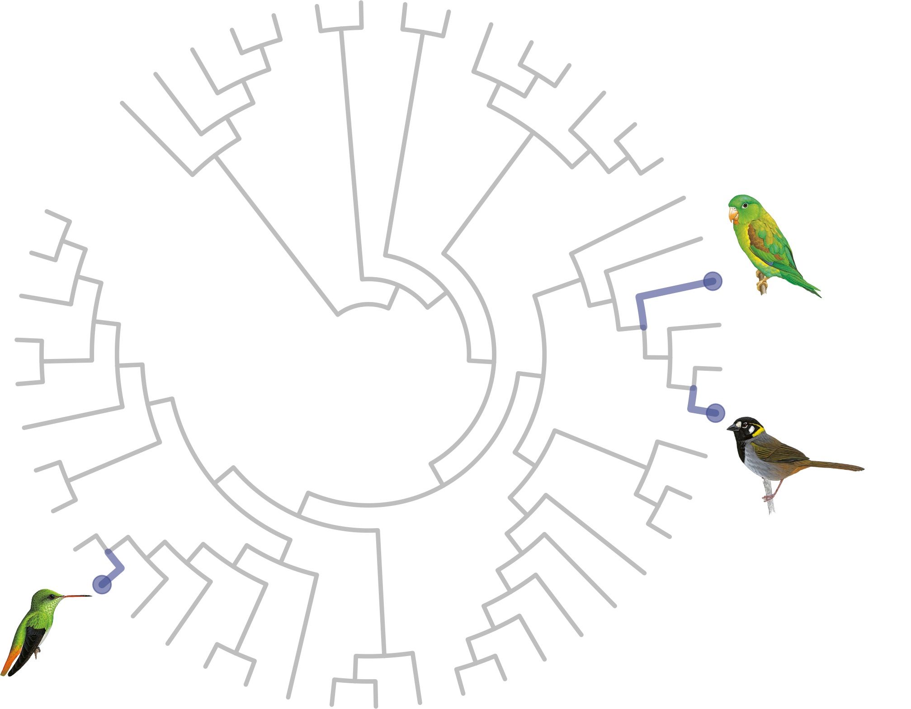
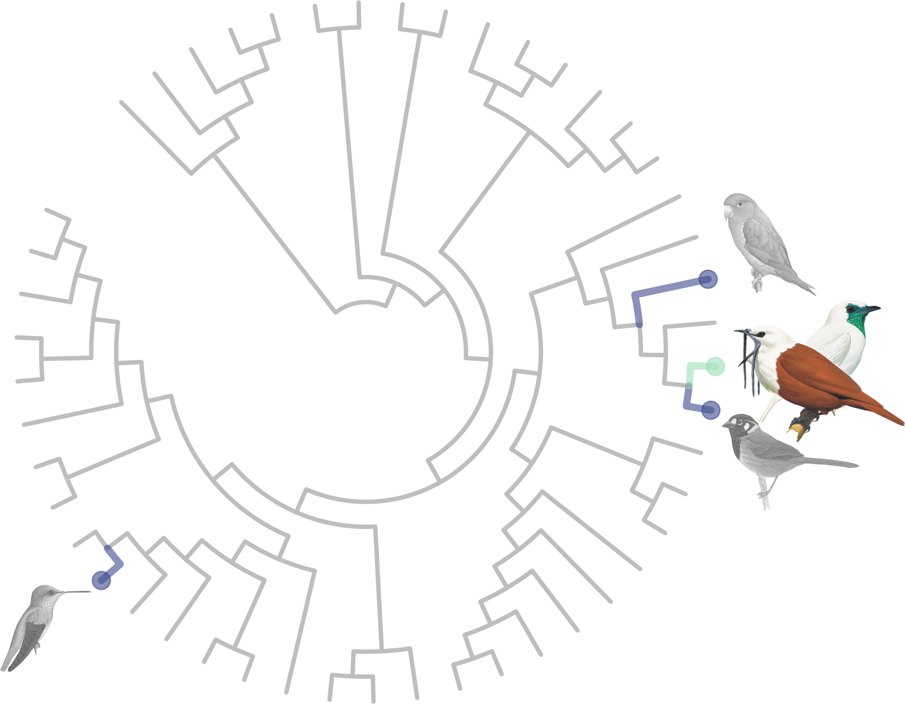
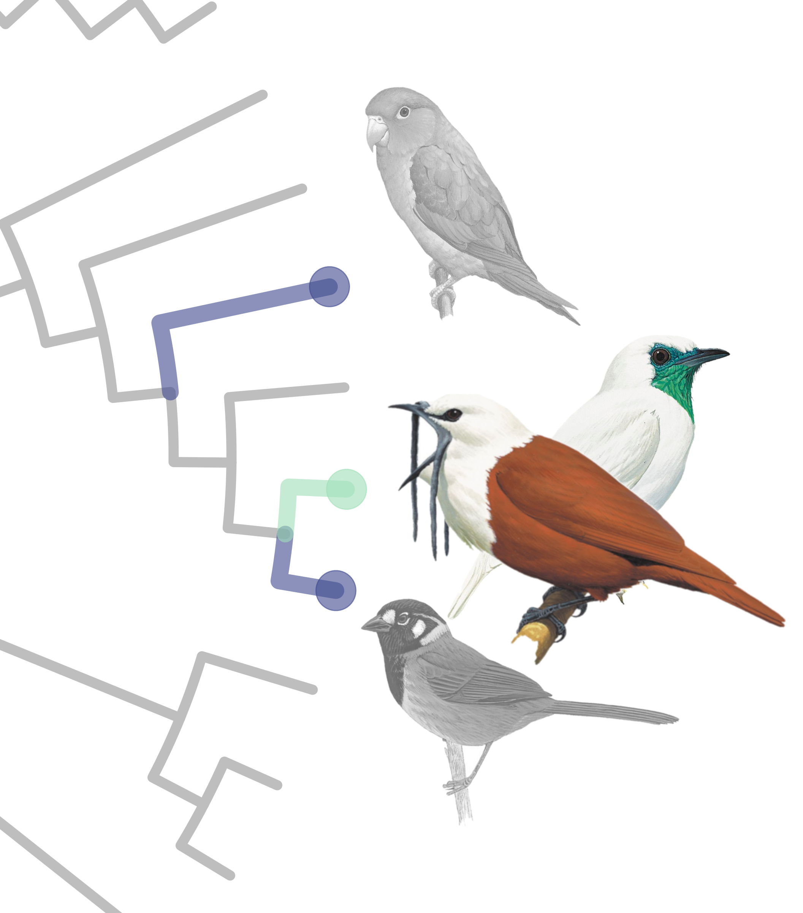
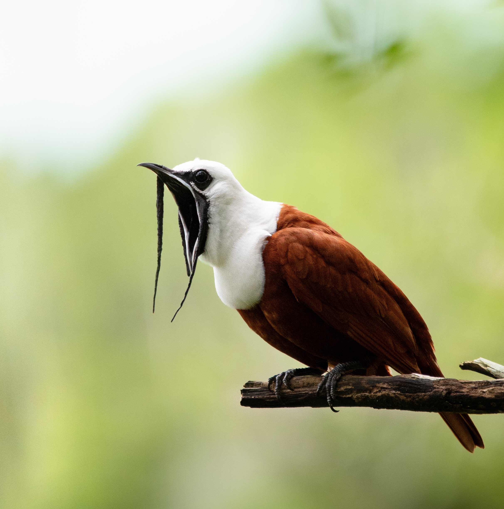
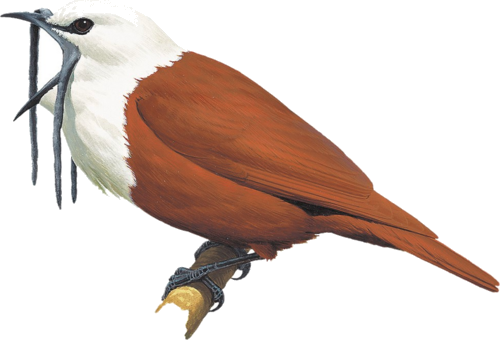
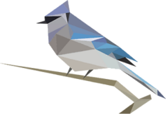
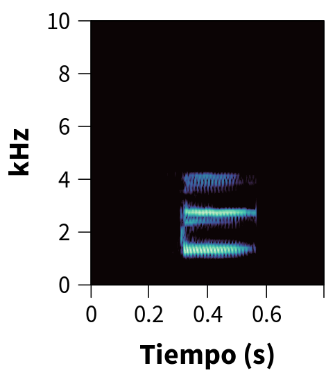

---
format:
  revealjs:
    fig-width: 10
    fig-height: 6.2
    toc: false
    number-sections: false
    embed-resources: true
    auto-section: false
    auto-play-media: false
    dpi: 150
    fig-dpi: 150
    code-line-numbers: false
    code-block-border-left: true
    slide-number: true
    preview-links: auto
    css: styles_revealjs.css
    include-after-body: dynaspec_player.html
execute:
  echo: false
  warning: false
  message: false
editor_options:
  chunk_output_type: console
---

```{r}
#| label: configuracion-global
#| echo: false

# ==== CONFIGURACIÓN GLOBAL =====================================================================
# Every setting that applies to the whole deck. Change a value here and re-render: the CSS
# variables, the ggplot figures, the maps and the spectrograms all take it from here.

## font (must be installed on the computer that renders)
font_family <- "Source Sans Pro"
base_size <- 20                       # base text size of the ggplot figures

## colours of the slides (CSS): titles, text, boxes and backgrounds
deck_cols <- c(
    titulo           = "#366A9F",     # slide titles, table headers, bold text in boxes, arrows
    texto            = "#222222",     # body text
    secundario       = "#555555",     # sources, captions and other secondary text
    acento           = "#38AAAC",     # .custom-color text
    caja             = "#DCEDF9",     # background of the boxes (callouts)
    fondo_conclusion = "#DAD4EA",     # background of the conclusions slide
    fondo_recursos   = "#DEF5E5"      # background of the acknowledgements slide
)

## colour key for sympatric and allopatric species, used throughout the deck: bar charts,
## maps, matrix labels, tables and coloured words in the text
type_cols <- c("Alopátrica" = "#3B2F5ECC", "Simpátrica" = "#348AA6CC")

 # [1] "#0B0405CC" "#28192FCC" "#3B2F5ECC" "#40498ECC" "#366A9FCC" "#348AA6CC" "#38AAACCC" "#54C9ADCC"
 # [9] "#A0DFB9CC" "#DEF5E5CC"

## spectrogram palette, for every spectrogram in the deck (comparisons and examples). It must be
## a palette function (it gets the number of colours); the first colour is the quietest
## (background), so direction = -1 gives a light background. E.g. function(n) viridis::magma(n)
spectro_pal <- function(n) viridis::mako(n, direction = 1)


ovlp <- 90
# ===============================================================================================

# data and images are built by prepare_slide_assets.R (run from the project root)

# install/ load packages
sketchy::load_packages(
    packages = c(
        "knitr",
        "ggplot2",
        "dynaSpec",
        "ggtext",
        "viridis",
        "scales",
        "rnaturalearth",
        "ragg"
    )
)

## ggplot themes
theme_function <- theme_classic
presentation_theme <- theme_function(base_size = base_size, base_family = font_family)

theme_set(presentation_theme)

## spectrogram theme, with the palette set above
## (cex.lab above 1.4 gets the frequency axis title cut on the left: dynaSpec leaves a
## margin of max(3.4, 2.2 + cex.lab) lines for it)
spectro_theme <- ds_theme(pal = spectro_pal, xlab = "Tiempo (s)", ylab = "Frec. (kHz)", family = font_family, cex.lab = 1.4, cex.axis = 1.4, font.lab = 2, tick.length = 0.6)


ds_set_theme(spectro_theme)

update_geom_defaults("text", list(family = font_family))
update_geom_defaults("label", list(family = font_family))

counts <- read.csv("./data/classification_counts.csv")
# numbers quoted on the result slides (prepare_slide_data.R)
nums <- read.csv("./data/result_numbers.csv")

# Spanish names shown on the slides
spanish_names <- c(
    "Procnias tricarunculatus" = "Pájaro campana",
    "Psarocolius guatimozinus" = "Oropéndola negra",
    "Psarocolius montezuma" = "Oropéndola de Moctezuma",
    "Pteroglossus erythropygius" = "Aracari piquipálido",
    "Pteroglossus torquatus" = "Aracari de collar",
    "Ramphastos brevis" = "Tucán del Chocó",
    "Ramphastos sulfuratus" = "Tucán pico iris"
)

bird_labels <- c(focal = "Campana focal", other = "Otros campanas")

# species drawing (built by prepare_slide_assets.R); silhouette while a species has none
sp_file <- function(sp) {
    snake <- gsub(" ", "_", tolower(sp))
    # transparent copy (icono_) if there is one, so drawings do not cover bars or lines
    f <- file.path("images", paste0(c("icono_", "dibujo_"), snake, ".png"))
    f <- f[file.exists(f)]
    if (length(f)) f[1] else "images/sil_oropendola.png"
}

# drawing as a grob that fits in a box of w x h cm
sp_grob <- function(sp, w, h, ...) {
    img <- png::readPNG(sp_file(sp))
    scale <- min(w / dim(img)[2], h / dim(img)[1])
    grid::rasterGrob(img, width = grid::unit(dim(img)[2] * scale, "cm"),
                     height = grid::unit(dim(img)[1] * scale, "cm"), interpolate = TRUE, ...)
}

# drawing under a discrete x axis position, outside the panel
sp_below <- function(sp, x, offset, w, h) {
    annotation_custom(
        sp_grob(sp, w, h, y = grid::unit(0, "npc") - grid::unit(offset, "cm"), vjust = 1),
        xmin = x - 0.4, xmax = x + 0.4, ymin = -Inf, ymax = Inf
    )
}

# drawing above a bar (and its label), at data position x and bar height y
sp_above <- function(sp, x, y, offset = 0.75, w = 1.25, h = 1.1) {
    annotation_custom(
        sp_grob(sp, w, h, y = grid::unit(0, "npc") + grid::unit(offset, "cm"), vjust = 0),
        xmin = x - 0.4, xmax = x + 0.4, ymin = y, ymax = y
    )
}

# confusion matrix heatmap
plot_confusion <- function(file, species_order, text_size = 6, sp_size = 1.5, sp_offset = 7) {
    d <- read.csv(file)
    d$reference <- factor(spanish_names[d$reference], levels = spanish_names[species_order])
    d$predicted <- factor(spanish_names[d$predicted], levels = spanish_names[species_order])
    ggplot(d, aes(x = reference, y = predicted, fill = proportion)) +
        geom_tile() +
        geom_text(aes(label = gsub(".", ",", round(proportion, 2), fixed = TRUE)), size = text_size) +
        lapply(seq_along(species_order), function(i) annotation_custom(
            sp_grob(species_order[i], sp_size * 1.3, sp_size,
                    x = grid::unit(0, "npc") - grid::unit(sp_offset, "cm"), hjust = 1),
            xmin = -Inf, xmax = -Inf, ymin = i - 0.4, ymax = i + 0.4
        )) +
        coord_equal(clip = "off") +
        scale_fill_gradient(low = "white", high = mako(10)[7], name = "Proporción", labels = label_number(decimal.mark = ",")) +
        labs(x = "Especie de referencia", y = "Especie predicha") +
        theme(axis.text.x = element_text(angle = 30, hjust = 1, color = "black"),
              axis.text.y = element_text(color = "black"),
              axis.title.y = element_text(margin = margin(r = (sp_size * 1.3 + 1.2) * 28.35)))
}

# confusion matrix for the performance slide: abbreviated scientific names, first species at
# the top-left, a drawing above each column and no colour legend (values are printed)
# (draw_side = TRUE: the drawings go right after the species names instead of above the columns)
plot_conf <- function(file, species_order, text_size = 5, draw_w = 1, draw_h = 0.85, draw_side = FALSE) {
    d <- read.csv(file)
    short <- setNames(paste0(substr(species_order, 1, 1), ". ", sub(".* ", "", species_order)), species_order)
    d$reference <- factor(short[d$reference], levels = short)
    d$predicted <- factor(short[d$predicted], levels = rev(short))
    n <- length(species_order)
    # species names in the colour key (sympatric orange, allopatric blue, bellbird black)
    sympatric <- c("Ramphastos sulfuratus", "Pteroglossus torquatus", "Psarocolius montezuma")
    allopatric <- c("Ramphastos brevis", "Pteroglossus erythropygius", "Psarocolius guatimozinus")
    col_sp <- ifelse(species_order %in% sympatric, type_cols[["Simpátrica"]],
                     ifelse(species_order %in% allopatric, type_cols[["Alopátrica"]], "black"))
    html <- setNames(sprintf("<i style='color:%s'>%s</i>", col_sp, short), short)
    # labels: values that round to 0.00 shown as 0; text white on dark cells, grey off the
    # diagonal below 0.05, black otherwise
    d$label <- sub(".", ",", sprintf("%.2f", d$proportion), fixed = TRUE)
    d$label[d$label == "0,00"] <- "0"
    d$text_col <- ifelse(d$proportion > 0.6, "white",
                         ifelse(d$proportion < 0.05 & as.character(d$reference) != as.character(d$predicted),
                                "grey60", "black"))
    ggplot(d, aes(x = reference, y = predicted, fill = proportion)) +
        geom_tile(colour = "white", linewidth = 0.6) +
        geom_text(aes(label = label, colour = text_col), size = text_size, family = font_family) +
        (if (draw_side) lapply(seq_len(n), function(i) annotation_custom(
            sp_grob(species_order[i], draw_w, draw_h, x = grid::unit(0, "npc") - grid::unit(0.15, "cm"), hjust = 1),
            xmin = 0.5, xmax = 0.5, ymin = n + 1 - i - 0.45, ymax = n + 1 - i + 0.45))
         else lapply(seq_len(n), function(i) annotation_custom(
            sp_grob(species_order[i], draw_w, draw_h, y = grid::unit(0, "npc") + grid::unit(0.15, "cm"), vjust = 0),
            xmin = i - 0.45, xmax = i + 0.45, ymin = n + 0.5, ymax = n + 0.5))) +
        coord_equal(clip = "off") +
        scale_fill_gradient(low = "white", high = mako(10)[6], limits = c(0, 1), guide = "none") +
        scale_colour_identity() +
        scale_x_discrete(labels = function(x) html[x]) +
        scale_y_discrete(labels = function(x) html[x]) +
        labs(x = "Especie de referencia", y = "Especie predicha") +
        # semibold: the only regular-weight italic installed is Light Italic, too thin in colour
        theme(axis.text.x = ggtext::element_markdown(angle = 35, hjust = 1, vjust = 1,
                                                     family = "Source Sans Pro Semibold"),
              axis.text.y = ggtext::element_markdown(hjust = 1, family = "Source Sans Pro Semibold",
                                                     margin = margin(r = if (draw_side) (draw_w + 0.3) * 28.35 else 2.2)),
              axis.line = element_blank(), axis.ticks = element_blank(),
              plot.margin = margin(t = if (draw_side) 10 else 45, r = 5, b = 5, l = 5))
}

# dynaSpec comparison of model (top) and focal bellbird (bottom), as one raw HTML block: one player
# shows both spectrograms and plays them in sequence. Called by hand from presentation/ (e.g.
# ds_pair("toucan", "Ramphastos sulfuratus", "<i>Ramphastos sulfuratus</i>", wl = 1024)), it just shows the
# player in the viewer. wl (window length) is one value for both
# sounds or two values, focal first and model second (e.g. wl = c(512, 1024))
ds_pair <- function(pair, model_sp, model_title, wl = 512, collevels = seq(-50, 0, 5), bp = NULL) {
    wl <- rep(wl, length.out = 2)
    clips <- paste0("clip_", pair, c("_focal", "_model"))
    titles <- c("Campana focal", model_title)
    # focal bellbird: the same drawing as in the training diagram (flipped by .dibujos-volteados)
    drawings <- c("images/campana_focal_dibujo.png", sp_file(model_sp))
    # model on top and focal bellbird below: reverse the order (wl stays focal first)
    clips <- rev(clips); titles <- rev(titles); drawings <- rev(drawings); wl <- rev(wl)

    # each sound has its own spectrogram settings; the time axis is labelled only on the lower one.
    # Colours and palette come from the theme set with ds_set_theme() (ds_theme() only changes
    # the settings given here; a preset theme added with + would replace the global theme)
    ds_sound <- function(i) {
        dynaspec(file.path("images", paste0(clips[i], ".wav"))) +
            ds_spectrogram(wl = wl[i], ovlp = ovlp, collevels = collevels, pal = spectro_pal)
    }

    # gap = 0: dynaSpec centres the shared frequency axis title over both images without the
    # gap between them, so with a gap the title is cut where the two images meet
    x <- ds_compare(ds_sound(1), ds_sound(2), flim = c(1, 8), gap = 0) +
        ds_static(width = 860, height = 330, res = 100,
                  alt = paste("Espectrograma:", gsub("<[^>]+>", " ", paste(titles, collapse = " y ")))) +  
        ds_player(speeds = 1, buttons = character(), autoplay = "next") +
        ds_theme(col.line = adjustcolor("orange", 0.6))   # playback line
    
    if (!is.null(bp[1]))
        x <- x + ds_filter(bp)
    # called by hand (not while knitting): return the player, which shows in the viewer, to try
    # settings such as wl; nothing is written to disk
    if (!isTRUE(getOption("knitr.in.progress"))) return(x)

    # when knitting, dynaSpec wraps its output in a raw HTML fence: this function writes its own
    html <- as.character(save_dynaspec(x, play = FALSE, verbose = FALSE))
    html <- paste(gsub("```(\\{=html\\})?", "", html), collapse = "\n")

    # the player script is the same for all pairs: it loads once, after the slides. It includes
    # the playback with "next" of ds_player(autoplay = "next"): pressing "next" on the slide first
    # plays the pair (top sound, then bottom), and only the next press advances. The hidden step
    # that dynaSpec adds after the script is dropped: it is added below, after the layout of the pair
    writeLines(sub("(?s).*<script>(.*?</script>).*", "<script>\\1", html, perl = TRUE), "dynaspec_player.html")
    player <- sub("<script>.*", "", html)

    # base64 data makes pandoc stall, so the player points to files that Quarto embeds at the end;
    # each sound also gets its drawing and name, in a column to the left of the plot
    # the label (drawing and name) sits on the base of each spectrogram: data-rows gives the plot
    # region as fractions of the image height from the top (5th and 6th values)
    rows <- regmatches(player, gregexpr('data-rows="[^"]+"', player))[[1]]
    lab_bottom <- sapply(strsplit(gsub('data-rows="|"', "", rows), ","), function(r) (1 - as.numeric(r[6])) * 100)
    for (i in 1:2) {
        png_file <- file.path("images", paste0("ds_", clips[i], ".png"))
        png_b64 <- sub('(?s).*?srcset="data:image/png;base64,([^ "]+)[^"]*".*', "\\1", player, perl = TRUE)
        writeBin(base64enc::base64decode(png_b64), png_file)
        player <- sub('srcset="data:image/png;base64,[^"]+"', paste0('src="', png_file, '"'), player)
        player <- sub(
            '<audio([^>]*) src="data:audio/[^"]+"></audio>',
            paste0('<audio\\1 src="images/', clips[i], '.wav"></audio>',
                   '<div class="ds-etiqueta" style="bottom: ', sprintf("%.2f", lab_bottom[i]), '%"><span>', titles[i], '</span></div>'),
            player
        )
    }

    cat(
        "\n```{=html}\n<div class=\"ds-fila\">",
        paste0('<div class="ds-col">', player, "</div>"),
        "</div>",
        '<span class="fragment ds-autoplay" aria-hidden="true"></span>',
        "```\n", sep = "\n"
    )
}
```

# Cuantificación del mimetismo vocal heteroespecífico mediante aprendizaje profundo: evidencia en el pájaro campana {.titulo-largo .portada background-color="white" background-size="cover" background-image="./images/campana_david_full.jpeg" background-opacity="0.65"}

```{r}
#| output: asis
# the colours of the global settings as CSS variables (used in styles_revealjs.css)
css_vars <- c(setNames(deck_cols, paste0("--col-", gsub("_", "-", names(deck_cols)))),
              "--col-simp" = type_cols[["Simpátrica"]], "--col-alop" = type_cols[["Alopátrica"]],
              "--r-main-color" = deck_cols[["texto"]], "--r-heading-color" = deck_cols[["titulo"]])
cat("\n```{=html}\n<style>:root {", paste0(names(css_vars), ": ", css_vars, ";", collapse = " "),
    "}</style>\n```\n")
```

<div class="autores"><span class="autor autor-principal"><b>Marcelo Araya-Salas</b></span><span class="afiliacion">Universidad de Costa Rica</span><span class="autor">Pablo Huertas-Vásquez</span><span class="afiliacion">Universidad Nacional de Costa Rica</span><span class="autor">Marcos Q. Oliva</span><span class="afiliacion">Royal Holloway University of London</span></div>

<div class="logos"></div>

::: footer
<span class="texto-pequeno"><a href="https://marce10.github.io/">https://marce10.github.io/</a></span>
:::

```{r}
#| eval: false
#| echo: false

## TO DO LIST
```

::: {.notes}
**0:00–0:15.** Presentar el tema y a los coautores.
:::


## Evolución del aprendizaje vocal

<div style="height: 0.25em;"></div>

::: {.columns .filogenia-columnas}
::: {.column width="62%"}
{.filogenia}
:::
::: {.column width="38%"}
:::
:::

<div style="height: 0.25em;"></div>

::: {.fuente}
filogenia: Open Tree of Life (McTavish et al. 2025)
:::

## Evolución del aprendizaje vocal

<div style="height: 0.25em;"></div>

::: {.columns .filogenia-columnas}
::: {.column width="62%"}
{.filogenia}
:::
::: {.column width="38%" .filogenia-puntos}
- Género *Procnias*
- Dialectos y evolución cultural en *P. tricarunculatus*
- Aparente imitación en un individuo en cautiverio de *P. nudicollis*
:::
:::

<div style="height: 0.25em;"></div>

::: {.fuente}

Saranathan et al. 2007; Kroodsma et al. 2013

:::

::: {.notes}
**Unos 20 s.** En azul, los Tyranni o suboscines: el grupo hermano de las aves canoras, considerado no aprendiz. Ahí están los pájaros campana, y por eso su caso es tan interesante.
:::

## Aprendizaje en *Procnias* {visibility="hidden"}

<!-- close-up of the tree made by bird_orders_phylogeny.R (same colours as the two slides above) -->

:::: {.columns}

::: {.column width="40%"}
{fig-alt="Detalle de la filogenia: aves canoras, loros y Tyranni con el pájaro campana" height="560px"}
:::

::: {.column width="60%"}
```{r}
#| fig-width: 4.6
#| fig-height: 4.6
#| out-width: "51%"
#| fig-alt: "Mapa de Costa Rica con tres dialectos del pájaro campana (Nicaragua, Monteverde y Talamanca) y un espectrograma de ejemplo de cada uno"
# dialect map: Costa Rica with three bellbird dialects and the best-SNR example of each. The
# relief base map comes from dialect_map_base.R and the sounds from dialect_spectrograms.R;
# the spectrograms are drawn here so they follow spectro_pal
map_ext <- c(xmin = -86.25, xmax = -82.45, ymin = 7.95, ymax = 11.75)   # as in dialect_map_base.R
dial <- data.frame(
    key = c("nicaraguense", "monteverde", "talamanca"),
    label = c("Nicaragua", "Monteverde", "Talamanca"),
    lon = c(-84.95, -84.82, -83.30),      # point: CR/Nicaragua border, Monteverde, Talamanca
    lat = c(11.07, 10.30, 9.40),
    sx = c(-84.43, -85.30, -83.10),       # centre of the spectrogram (map coordinates)
    sy = c(11.10, 9.70, 10.02),
    lx = c(-85.08, -84.66, -83.45),       # dialect name, beside the point (hjust: 1 = to its left)
    hj = c(1, 0, 1)
)
spec_w <- 0.8; spec_h <- 0.94            # size of each spectrogram (degrees)
for (k in dial$key) {
    ex <- dynaspec(file.path("images", paste0("dialecto_", k, ".wav")), flim = c(0, 7)) +
        ds_spectrogram(wl = 512, ovlp = ovlp) +
        ds_theme(axis.type = "none", pal = spectro_pal, bg = "transparent") +
        ds_static(width = 360, height = 420, res = 150)
    invisible(save_dynaspec(ex, file.path("images", paste0("espectro_dialecto_", k, ".png")),
                            play = FALSE, verbose = FALSE))
}
map_dial <- ggplot() +
    annotation_raster(png::readPNG("images/mapa_dialectos_base.png"), xmin = map_ext[["xmin"]],
                      xmax = map_ext[["xmax"]], ymin = map_ext[["ymin"]], ymax = map_ext[["ymax"]]) +
    geom_segment(data = dial, aes(x = lon, y = lat, xend = sx, yend = sy),
                 colour = deck_cols[["titulo"]], linewidth = 0.6)
for (i in seq_len(nrow(dial))) {
    img <- png::readPNG(file.path("images", paste0("espectro_dialecto_", dial$key[i], ".png")))
    map_dial <- map_dial +
        annotation_raster(img, xmin = dial$sx[i] - spec_w / 2, xmax = dial$sx[i] + spec_w / 2,
                          ymin = dial$sy[i] - spec_h / 2, ymax = dial$sy[i] + spec_h / 2)
}
# thin frame around each spectrogram
map_dial <- map_dial +
    geom_rect(data = dial, aes(xmin = sx - spec_w / 2, xmax = sx + spec_w / 2,
                               ymin = sy - spec_h / 2, ymax = sy + spec_h / 2),
              fill = NA, colour = "#888888", linewidth = 0.4)
map_dial +
    geom_point(data = dial, aes(lon, lat), shape = 21, size = 3.6, stroke = 1,
               fill = deck_cols[["titulo"]], colour = "white") +
    geom_label(data = dial, aes(lx, lat, label = label, hjust = hj), size = 4, fontface = "bold",
               family = font_family, colour = deck_cols[["texto"]], fill = alpha("white", 0.75),
               linewidth = 0, label.padding = grid::unit(0.12, "lines")) +
    coord_sf(xlim = map_ext[c("xmin", "xmax")], ylim = map_ext[c("ymin", "ymax")], expand = FALSE,
             crs = 4326, default_crs = 4326) +
    theme_void() +
    theme(plot.background = element_rect(fill = "#dfe9ef", colour = NA),   # sea colour of the base map
          panel.border = element_rect(fill = NA, colour = "#888888", linewidth = 1.2),   # grey frame
          plot.margin = margin(0, 0, 0, 0))
```
:::


::: {.fuente}
Dialectos: Saranathan et al. 2007; Kroodsma et al. 2013
:::
::::

## Mimetismo vocal {visibility="hidden"}

::: {.callout-note icon=false appearance="simple"}
<span class="texto-grande">**Aprendizaje de la producción vocal:** adquirir patrones vocales imitando un modelo; depende de la retroalimentación auditiva y de circuitos neurales complejos</span>
:::

<br>

<div class="texto-grande">

- El mimetismo vocal es común en las aves
- Cuando el modelo es **otra especie**, la imitación implica aprendizaje vocal
- Por eso se usa como evidencia de aprendizaje incluso fuera de los grupos reconocidos: Passeri, loros y colibríes

</div>

::: {.fuente}
Janik & Slater 2000; Jarvis 2004; Goller & Shizuka 2018; Ten Cate 2021
:::

::: {.notes}
**Hasta 1:15.** El mimetismo vocal es común en las aves y nos interesa por lo que implica: copiar a otra especie requiere aprender a producir el sonido. Esa capacidad se reconoce en tres grupos de aves, y el mimetismo suele ser la mejor pista de aprendizaje fuera de ellos. Pero todo depende de una pregunta: ¿eso que suena parecido es realmente una copia?
:::

## ¿Mimetismo o semejanza por azar? {visibility="hidden"}

<div class="texto-grande">

Demostrarlo en el campo requiere:

1. Identificar la **fuente** del sonido heteroespecífico
2. Definir un **umbral de similitud** entre modelo y copia
3. Descartar la **convergencia** vocal

</div>

<br>

::: {.callout-note icon=false appearance="simple"}
<span class="texto-grande">No existe un **marco cuantitativo riguroso** para evaluar si una semejanza acústica aparente es mimetismo o azar</span>
:::

::: {.fuente}
Kelley et al. 2008; Dalziell et al. 2015
:::

::: {.notes}
**Hasta 2:20.** Estos tres requisitos son difíciles de cumplir con animales silvestres. Además, la mayor parte de la evidencia se basa en descripciones cualitativas de la semejanza: un sonido variable puede parecerse a otro simplemente por casualidad. Ese es el vacío que queremos llenar.
:::

## Pájaros campana (_Procnias_) {visibility="hidden"}

:::: {.columns}

::: {.column width="58%"}
<div class="texto-grande">

Tyranni: en general, considerados no aprendices. Pero en _Procnias_ hay:

- Dialectos y sonidos nuevos
- Cambios vocales durante la ontogenia
- Mimetismo en un individuo **cautivo**

</div>
:::

::: {.column width="42%"}
{width="52%"}
:::

::::

::: {.callout-note icon=false appearance="simple"}
<span class="texto-grande">**Objetivo:** desarrollar un enfoque de aprendizaje profundo para evaluar el mimetismo vocal heteroespecífico en la campana focal, un juvenil de pájaro campana</span>
:::

::: {.fuente}
Snow 1970, 1977; Saranathan et al. 2007; Kroodsma et al. 2013
:::

::: {.notes}
**Hasta 3:10.** Los pájaros campana son un caso especial: pertenecen a los Tyranni, considerados no aprendices, pero varias observaciones sugieren aprendizaje. Esto los vuelve ideales para probar el enfoque, que es nuestro objetivo.
:::


## {.video-subtitulo background-video="images/adult_bellbird_spectrogram_short_black.mp4" background-size="contain" background-color="black"}

<div class="subtitulo-video sobre-espectro" style="--alto: 0.01; --tamano: 32px">Adulto de <i>P. tricarunculatus</i> en Monteverde, Costa Rica</div>

::: {.notes}
Video a pantalla completa (66 s, con sonido): la campana focal imitando al aracari y luego al tucán. Empieza solo al llegar a la diapositiva. Para acortarlo, avanzar a la siguiente.
:::


## {.video-subtitulo background-video="images/focal_spectrogram_black.mp4" background-size="contain" background-color="black"}

<div class="subtitulo-video sobre-espectro" style="--alto: 0.01; --tamano: 32px">Campana focal: juvenil de <i>P. tricarunculatus</i>, Refugio Bosque Alegre, Costa Rica</div>


::: {.notes}
Video a pantalla completa (66 s, con sonido): la campana focal imitando al aracari y luego al tucán. Empieza solo al llegar a la diapositiva. Para acortarlo, avanzar a la siguiente.

**Hasta 3:55.** Pablo encontró la campana focal, un juvenil, sola, interactuando con tucanes y aracaris. No vio otro pájaro campana en el área, ni antes ni después, así que es poco probable que los sonidos vengan de otro individuo. Por la muda y la falta de carúnculas estimamos unos dos o tres años. Y sonaba así.
:::

## Aparentes imitaciones {.dibujos-volteados}

<div style="height: 0.5em;"></div>

```{r}
#| output: asis

ds_pair("toucan", "Ramphastos sulfuratus", "<i>Ramphastos sulfuratus</i>", wl = 512, bp = c(1, Inf))
```

::: {.notes}
**Hasta 4:35.** Al avanzar (→) suenan los dos en secuencia, y el siguiente → pasa a la otra diapositiva: primero la campana focal (arriba), luego el tucán pico iris (abajo). Clic sobre un espectrograma para empezar desde ese punto.
:::

## Aparentes imitaciones {.dibujos-volteados}

<div style="height: 0.5em;"></div>

```{r}
#| output: asis
ds_pair("aracari", "Pteroglossus torquatus", "<i>Pteroglossus torquatus</i>", wl = 600, bp = c(1, Inf))
```

::: {.notes}
**Hasta 5:10.** Al avanzar (→) suenan los dos en secuencia: campana focal y aracari de collar.
:::

## Aparentes imitaciones {.dibujos-volteados}

<div style="height: 0.5em;"></div>

```{r}
#| output: asis
ds_pair("oropendola_birdnet", "Psarocolius montezuma", "<i>Psarocolius montezuma</i>", wl = 1024, collevels = seq(-45, 0, 1))
```

::: {.notes}
Al avanzar (→) suenan los dos en secuencia: campana focal y oropéndola de Moctezuma. Este sonido de la campana focal (grabación INVEST_0093) fue clasificado como oropéndola por ambos modelos de BirdNET. Suena convincente, pero el oído puede engañar: necesitamos una prueba.
:::

## Flujo de análisis {visibility="hidden"}

```{=html}
<div class="flujo">
<div class="flujo-caja flujo-focal"><div><b>Grabaciones de la campana focal</b><span>Monteverde, abril a noviembre de 2020</span></div></div>
<div class="flujo-flecha">&#8594;</div>
<div class="flujo-caja flujo-focal"><div><b>Anotación</b><span>Vocalizaciones de la campana focal</span></div></div>
<div class="flujo-flecha">&#8594;</div>
<div class="flujo-caja flujo-focal"><div><b>Posibles modelos</b><span>Especies <span class="simp">simpátricas</span> que la campana focal parece imitar</span></div></div>
<div></div>
<div></div>
<div></div>
<div></div>
<div class="flujo-flecha flujo-abajo">&#8595;</div>
<div class="flujo-caja flujo-ref"><div><b>Anotación</b><span>Vocalizaciones de cada especie</span></div></div>
<div class="flujo-flecha">&#8592;</div>
<div class="flujo-caja flujo-ref"><div><b>Grabaciones de repositorios</b><span>Descargadas con <i>suwo</i></span></div></div>
<div class="flujo-flecha">&#8592;</div>
<div class="flujo-caja flujo-ref"><div><b>Especies de referencia</b><span>3 <span class="simp">simpátricas</span>, 3 <span class="alop">alopátricas</span> y otros pájaros campana</span></div></div>
<div class="flujo-flecha flujo-abajo">&#8595;</div>
<div></div>
<div></div>
<div></div>
<div></div>
<div class="flujo-caja flujo-modelo"><div><b>Fragmentos de 2 s</b><span>Validación cruzada de 5 grupos, separados por grabación</span></div></div>
<div class="flujo-flecha">&#8594;</div>
<div class="flujo-caja flujo-modelo"><div><b>Reentrenar BirdNET</b><span>Modelo 1: 7 clases · modelo 2: 4 clases</span></div></div>
<div class="flujo-flecha">&#8594;</div>
<div class="flujo-caja flujo-modelo"><div><b>Desempeño</b><span>F1 en grabaciones que el modelo no escuchó</span></div></div>
</div>

```

::: {.notes}
**Unos 30 s.** Primero anotamos las grabaciones de la campana focal e identificamos las especies que parecía imitar. Con eso definimos las especies de referencia: las simpátricas, sus parientes alopátricos y otros pájaros campana. Descargamos sus grabaciones con suwo, las anotamos, las cortamos en fragmentos de 2 segundos y reentrenamos BirdNET. Finalmente evaluamos el desempeño con grabaciones que el modelo no había visto.
:::

## Semejanza vocal {.nostretch}

<!-- first mimicry and its prediction, then chance and its prediction (each prediction with an
arrow from its hypothesis box, on click) -->
:::: {.columns}

::: {.column width="50%"}
::: {.callout-note icon=false appearance="simple"}
<span class="texto-medio"><b>Mimetismo:</b> copia de las especies que la campana focal puede escuchar</span>
:::
:::

::: {.column width="50%"}
::: {.fragment fragment-index=2}
::: {.callout-note icon=false appearance="simple"}
<span class="texto-medio"><b>Azar:</b> vocalizaciones variables que solo coinciden por casualidad con otras especies</span>
:::
:::
:::

::::

```{r}
# schematic predictions (hypothetical values) for one pair of sister toucan species: the
# sympatric Ramphastos sulfuratus (first) and the allopatric R. brevis.
# One plot per hypothesis, so that each appears on its own click; the y title is drawn in both
# (transparent in the second) so that both panels have the same size
pred <- expand.grid(sp = 1:2, hyp = c("azar", "mimetismo"))
pred$type <- rep(c("Simpátrica", "Alopátrica"), length.out = nrow(pred))
pred$x <- pred$sp
pred$value <- c(0.29, 0.30,                         # chance
                0.44, 0.06)                         # mimicry

pred_plot <- function(h, show_y = TRUE) {
    ggplot(pred[pred$hyp == h, ], aes(x = x, y = value, fill = type)) +
        geom_col(width = 0.8) +
        # drawing of each species above its bar
        lapply(1:2, function(i) sp_above(c("Ramphastos sulfuratus", "Ramphastos brevis")[i], i,
                                         pred$value[pred$hyp == h][i], 0.15, 2.4, 1.6)) +
        # pair name under the species labels (outside the panel)
        annotate("text", x = 1.5, y = -0.2, label = "Especies hermanas", size = 6,
                 family = font_family, vjust = 1) +
        scale_fill_manual(values = type_cols, guide = "none") +
        scale_x_continuous(breaks = 1:2, labels = c("R. sulfuratus", "R. brevis")) +
        scale_y_continuous(expand = expansion(mult = c(0, 0.1))) +
        coord_cartesian(ylim = c(0, max(pred$value) * 1.4), clip = "off") +
        labs(x = NULL, y = "Similitud de\ncantos del campana") +
        theme(axis.text.x = element_text(size = 20, face = "italic",
                                         colour = type_cols[c("Simpátrica", "Alopátrica")]),
              axis.text.y = element_blank(), axis.ticks.y = element_blank(),
              axis.title.y = element_text(colour = if (show_y) "black" else "transparent",
                                          lineheight = 0.9, size = rel(0.8)),
              plot.margin = margin(t = 15, r = 10, b = 45, l = 5))
}
arrow_svg <- '<div class="flecha-prediccion"><svg viewBox="0 0 40 60" aria-hidden="true"><path d="M20 2 V48 M6 36 L20 52 L34 36" /></svg></div>'
```

::: {.prediccion-fila}
::: {.fragment fragment-index=1}
`r arrow_svg`

```{r}
#| fig-width: 5
#| fig-height: 3
#| out-width: "100%"
pred_plot("mimetismo")
```
:::

::: {.fragment fragment-index=3}
`r arrow_svg`

```{r}
#| fig-width: 5
#| fig-height: 3
#| out-width: "100%"
pred_plot("azar", show_y = FALSE)
```
:::
:::

<!-- colour key, with the first prediction -->
::: {.fragment fragment-index=1}
<div class="leyenda-tipos"><span><i style="background: var(--col-simp)"></i>Simpátrica</span><span><i style="background: var(--col-alop)"></i>Alopátrica</span></div>
:::


::: {.fuente}
Kelley et al. 2008; Dalziell et al. 2015
:::

::: {.notes}
**Unos 40 s.** Queremos distinguir dos posibilidades. Si la campana focal está copiando, sus vocalizaciones deberían parecerse más a las simpátricas, que son las que puede escuchar (izquierda). Si produce vocalizaciones variables que por casualidad se parecen a otras especies, el clasificador debería asignarlas por igual a las simpátricas y a sus parientes alopátricos (derecha). Las alopátricas son un buen control porque, al ser especies hermanas, suenan parecido a los modelos: cualquier parecido por azar debería repartirse entre ambas. Las barras son esquemáticas.
:::

## Datos de entrenamiento

```{r}
#| output: asis
tr <- read.csv("./data/entrenamiento_modelos.csv")
n_ex <- setNames(tr$clips, tr$species)
n_rec <- setNames(tr$recordings, tr$species)
abbr <- function(sp) paste0(substr(sp, 1, 1), ". ", sub(".* ", "", sp))
# distribution maps redrawn with the colour key when the (licensed, local) BirdLife data are
# available; otherwise the maps already in images/ are used
if (file.exists("maps/rangos_especies.gpkg")) {
    map_env <- new.env()
    map_env$type_cols <- type_cols
    suppressMessages(sys.source("distribution_maps.R", envir = map_env))
}

# example spectrograms, drawn here so they follow spectro_theme: best-SNR clip of each
# species, 0.8 s, 0-10 kHz (sounds selected by example_spectrograms.R)
for (sp in c("Ramphastos sulfuratus", "Ramphastos brevis", "Pteroglossus torquatus",
             "Pteroglossus erythropygius", "Psarocolius montezuma", "Psarocolius guatimozinus",
             "Procnias tricarunculatus")) {
    snake <- gsub(" ", "_", tolower(sp))
    bb <- sp == "Procnias tricarunculatus"
    ex <- dynaspec(file.path("images", paste0("ejemplo_", snake, ".wav")), flim = c(0, 10)) +
        ds_spectrogram(wl = 512, ovlp = ovlp) +
        # all examples share the frequency (0-10 kHz) and time (0.8 s) ranges, so only the
        # bellbird one shows the axes
        # (standard axes: with "inside" the frequency labels are black on the dark spectrogram)
        (if (bb) ds_theme(axis.type = "standard", xlab = "Tiempo (s)", ylab = "kHz", pal = spectro_pal)
         else ds_theme(axis.type = "none", pal = spectro_pal)) +
        (if (bb) ds_static(width = 470, height = 540, res = 150)
         else ds_static(width = 360, height = 450, res = 150))
    invisible(save_dynaspec(ex, file.path("images", paste0("espectro_", snake, ".png")),
                            play = FALSE, verbose = FALSE))
}

# map and example spectrogram side by side
cell <- function(sp) sprintf(
    '<td><div class="esp-par"></div><div class="esp-nombre"><i>%s</i></div></td>',
    gsub(" ", "_", tolower(sp)), sp, gsub(" ", "_", tolower(sp)), sp, abbr(sp))
groups <- list(c("Ramphastos", "tucanes", "Ramphastos sulfuratus", "Ramphastos brevis"),
               c("Pteroglossus", "aracaris", "Pteroglossus torquatus", "Pteroglossus erythropygius"),
               c("Psarocolius", "oropéndolas", "Psarocolius montezuma", "Psarocolius guatimozinus"))
rows <- vapply(seq_along(groups), function(k) {
    g <- groups[[k]]
    side <- if (k == 1) sprintf(paste0(
        '<td class="esp-campana" rowspan="3">',
        '',
        '<div><i>P. tricarunculatus</i></div><div class="esp-otros">Otros individuos</div></td>')) else ""
    sprintf('<tr><th class="esp-genero"><i>%s</i><span>%s</span></th>%s%s%s</tr>',
            g[1], g[2], cell(g[3]), cell(g[4]), side)
}, character(1))
cat("\n```{=html}\n<table class=\"tabla-especies\" data-quarto-disable-processing=\"true\">",
    "<tr><th></th><th class=\"mapa-simpatrico\">Modelo simpátrico</th><th class=\"mapa-alopatrico\">Pariente alopátrico</th><th class=\"esp-campana-tit\">Pájaro campana</th></tr>",
    paste(rows, collapse = "\n"), "</table>\n```\n", sep = "\n")
```


::: {.fuente}
Mapas de distribución: BirdLife International 2025
:::

::: {.notes}
**Unos 40 s.** Las tres especies simpátricas, a la izquierda, comparten distribución con el pájaro campana (contorno negro); sus parientes alopátricos, a la derecha, nunca coinciden con él. A la derecha, los otros pájaros campana. Junto a cada mapa, un ejemplo de su sonido.
:::

## Entrenamiento de los modelos {.nostretch}

```{r}
#| output: asis
# fig-alt of the diagram: "Diagrama del entrenamiento: BirdNET se reentrena con las vocalizaciones de las siete especies (ejemplos y grabaciones de cada una), evaluadas con validación cruzada de 5 grupos, para obtener dos modelos: simpátricas, alopátricas y pájaro campana, y solo simpátricas y pájaro campana"
# diagram: BirdNET -> training data of each species (examples and recordings) -> two models.
# Coordinates in an arbitrary 0-120 x 0-64 box; drawings, colours and numbers come from the
# global settings and data/entrenamiento_modelos.csv
tr <- read.csv("./data/entrenamiento_modelos.csv")
n_ex <- setNames(tr$clips, tr$species)
n_rec <- setNames(tr$recordings, tr$species)
abbr <- function(sp) paste0(substr(sp, 1, 1), ". ", sub(".* ", "", sp))

# layout, left to right, under a timeline of the three stages: (1) the examples of each species
# (pairs of sister species in grey boxes, then the bellbird), (2) BirdNET retrained into the two
# models, (3) classification of the focal bellbird (no graphic yet, its space is left empty)
# centre of each stage: middle of its graphics (suwo to the data block; arrows to the model
# boxes; the empty space after them for the third stage)
stage_x <- c(34.5, 89, 128)
stage_title <- c("Obtener grabaciones", "(Re)-entrenar modelos", "Clasificar\ncampana focal")
grey_box <- "#c8c8c8"                             # as the line under the slide titles

# type colours at alpha 0.16 over white, for the background of the pair boxes
cell_fill <- sapply(type_cols[c("Simpátrica", "Alopátrica")], function(cl)
    do.call(rgb, as.list(0.16 * col2rgb(cl)[, 1] / 255 + 0.84)))
row_y <- c(51.5, 38.5, 25.5)                      # the three pairs of sister species
sp_tab <- data.frame(
    sp = c("Ramphastos sulfuratus", "Pteroglossus torquatus", "Psarocolius montezuma",
           "Ramphastos brevis", "Pteroglossus erythropygius", "Psarocolius guatimozinus",
           "Procnias tricarunculatus"),
    x = c(rep(37, 3), rep(58, 3), 47),
    y = c(row_y, row_y, 5.5)
)
sp_tab$counts <- as.character(n_ex[sp_tab$sp])   # number of examples (sounds) of each species
sp_tab$counts[1] <- paste(n_ex[sp_tab$sp[1]], "cantos")

img_box <- function(f, x, y, w, h) {
    img <- if (grepl("\\.jpe?g$", f)) jpeg::readJPEG(f) else png::readPNG(f)
    a <- dim(img)[1] / dim(img)[2]
    if (a > h / w) w <- h / a else h <- w * a
    annotation_raster(img, xmin = x - w / 2, xmax = x + w / 2, ymin = y - h / 2, ymax = y + h / 2,
                      interpolate = TRUE)
}
arrow_ <- grid::arrow(length = grid::unit(0.3, "cm"), type = "closed")
# box with rounded corners (centre x, y; width w, height h, in diagram units)
box <- function(x, y, w, h, fill, col, lwd = 1.6, r = 0.25)
    annotation_custom(grid::roundrectGrob(r = grid::unit(r, "cm"),
                                          gp = grid::gpar(fill = fill, col = col, lwd = lwd)),
                      xmin = x - w / 2, xmax = x + w / 2, ymin = y - h / 2, ymax = y + h / 2)

# height of suwo and the repositories: the same height on the slide as the centre of the
# catalogue of the focal bellbird (step 3, which is moved down 26 px more than step 1 and has its
# centre at cat_y; 6.47 px per unit)
suwo_y <- 21
repo_icons <- c("images/repo_xc.png", "images/repo_gbif.png", "images/repo_inat.png",
                "images/repo_ml.png")
models <- data.frame(x = 97.5, y = c(35.5, 14.5),
    title = c("Discriminar\nsimpátricas\ny alopátricas", "Discriminar\nsimpátricas"),
    text = c("+ pájaro campana\n(7 clases)",
             "+ pájaro campana\n(4 clases)"))
# overall performance: macro-averaged F1 of the cross-validated predictions, at the
# out-of-fold optimal thresholds (prepare_slide_data.R)
f1 <- c(tr$macro_f1_sympatric_allopatric[1], tr$macro_f1_sympatric[1])
models$text <- paste0(models$text, "\nF1 global: ", round(f1 * 100), " %")

# the diagram is drawn as four layers of the same size, stacked on the slide: the timeline
# (always shown), step 1 (recordings), step 2 (training) and step 3 (classification)
# timeline: an arrow along the top with a point and a title for each stage
# (the line 3 units above the content; each stage title is its own layer, so that only the
# title of the current stage is fully opaque on the slide)
time_y <- 69
g_time <- list(
    annotate("segment", x = -2.5, xend = 140, y = time_y, yend = time_y, colour = "grey60",
             linewidth = 1, arrow = arrow_)
)
# point and title of each stage (one layer each)
g_stage <- lapply(seq_along(stage_x), function(i) list(
    annotate("point", x = stage_x[i], y = time_y, size = 4, colour = deck_cols[["titulo"]]),
    annotate("text", x = stage_x[i], y = time_y + 2.2, label = stage_title[i], vjust = 0,
             fontface = "bold", lineheight = 0.85, size = 5.4, family = font_family,
             colour = deck_cols[["texto"]])))
# step 1: recordings and training data
g <- ggplot() +
    # data block, with a grey box around each pair of sister species
    box(47, 30.9, 44, 64.8, "white", "grey80", lwd = 1.3) +
    # background of the pair boxes in the colour of each type of species (alpha 0.16 on the white
    # block, as opaque colours so that the overlapping pieces do not add up): the whole box in the
    # sympatric colour, its right part in the allopatric one (a rounded box, whose left corners
    # are covered again with a plain rectangle)
    lapply(row_y, function(y) list(
        box(47, y - 0.4, 42, 12.8, cell_fill[["Simpátrica"]], NA),
        box(54, y - 0.4, 28, 12.8, cell_fill[["Alopátrica"]], NA),
        annotate("rect", xmin = 40, xmax = 47, ymin = y - 0.4 - 6.4, ymax = y - 0.4 + 6.4,
                 fill = cell_fill[["Simpátrica"]], colour = NA))) +
    lapply(row_y, function(y) box(47, y - 0.4, 42, 12.8, NA, grey_box, lwd = 1.6)) +
    # total number of examples (sounds) of all species, under the data block
    annotate("text", x = 47, y = -4.3, size = 4.6, fontface = "bold", family = font_family,
             colour = deck_cols[["texto"]],
             label = paste("Total:", format(sum(n_ex), big.mark = " "), "cantos")) +
    # recordings downloaded with suwo from the repositories (icons), arrow into the data block
    # (the arrow goes from suwo to the data block, behind the white box with the repository icons)
    img_box("images/logo_suwo_web.png", 3, suwo_y, 12, 14.3) +
    annotate("segment", x = 9.4, xend = 24.6, y = suwo_y, yend = suwo_y, colour = deck_cols[["titulo"]],
             linewidth = 1.2, arrow = arrow_) +
    box(16.3, suwo_y, 8.4, 28, "white", grey_box, lwd = 1.6) +
    annotate("text", x = 3, y = suwo_y + 8.6, label = "Paquete\nde R suwo", vjust = 0, size = 4.4,
             lineheight = 0.9, fontface = "bold", family = font_family, colour = deck_cols[["texto"]]) +
    annotate("text", x = 16.3, y = suwo_y + 14.9, label = "Repositorios\nen línea", vjust = 0, size = 4.4,
             lineheight = 0.9, fontface = "bold", family = font_family, colour = deck_cols[["texto"]]) +
    lapply(seq_along(repo_icons), function(i)
        img_box(repo_icons[i], 16.3, suwo_y + c(10.9, 3.2, -3.9, -10.9)[i], 6.5, 4.2)) +
    # grey line between sympatric and allopatric species
    annotate("segment", x = 47, xend = 47, y = row_y[3] - 6.8, yend = 62.3, colour = grey_box,
             linewidth = 0.6) +
    annotate("text", x = c(37, 58), y = 60.3, label = c("Simpátricas", "Alopátricas"),
             colour = c(type_cols[["Simpátrica"]], type_cols[["Alopátrica"]]), fontface = "bold",
             size = 5.8, family = font_family) +
    annotate("text", x = 47, y = 15.3, label = "Pájaro campana", colour = deck_cols[["texto"]],
             fontface = "bold", size = 5.1, family = font_family) +
    lapply(seq_len(nrow(sp_tab)), function(i)
        img_box(sp_file(sp_tab$sp[i]), sp_tab$x[i], sp_tab$y[i] + 2.5, 10, 6.8)) +
    # species names in black, as on the previous slide
    annotate("text", x = sp_tab$x, y = sp_tab$y - 2.6, label = abbr(sp_tab$sp),
             colour = deck_cols[["texto"]], size = 4.4, fontface = "italic", family = font_family) +
    annotate("text", x = sp_tab$x, y = sp_tab$y - 5.3, label = sp_tab$counts, size = 4.6,
             colour = deck_cols[["secundario"]], family = font_family)


# layout of the model boxes: title and text stacked and centred in the box, with the same
# padding above and below. Line heights in diagram units
title_lh <- 0.8                                   # line spacing of the titles
line_title <- 3.3 * title_lh                      # one title line (text size 5.8)
line_text <- 2.6 * 0.9                            # one text line (text size 4.8)
gap <- 1.5                                        # between title and text
pad <- 2.1                                        # above and below
n_title <- lengths(strsplit(models$title, "\n"))
n_text <- lengths(strsplit(models$text, "\n"))
block <- n_title * line_title + gap + n_text * line_text
models$h <- block + 2 * pad
top <- models$y + block / 2
models$y_title <- top - n_title * line_title / 2
models$y_text <- top - n_title * line_title - gap - n_text * line_text / 2

# step 2: retraining arrows and the two models
# step 2: BirdNET and the retraining arrows (faded in step 3)
g_models <- list(
    img_box("images/logo_birdnet_web.png", 77, 56.5, 13, 9),
    # model and software version used (data/processed/birdnet_models/*_Params.csv); V2.4 is the
    # version before the current one
    ggtext::geom_richtext(
        aes(x = 77, y = 46.5, label = "<b>BirdNET</b><br>(>6000 spp)"),
        size = 4.8, lineheight = 0.9, family = font_family, colour = deck_cols[["texto"]],
        fill = NA, label.color = NA),
    annotate("text", x = 77, y = models$y + 3.2, label = "reentrenar", size = 4.6,
             family = font_family, colour = deck_cols[["titulo"]]),
    # split of the recordings, under the lower arrow
    annotate("text", x = 77, y = models$y[2] - 2.2, vjust = 1, size = 4.2, lineheight = 0.9,
             family = font_family, colour = deck_cols[["texto"]],
             label = "validación cruzada\n(5 grupos)"),
    annotate("segment", x = 69.8, xend = 85.6, y = models$y, yend = models$y,
             colour = deck_cols[["titulo"]], linewidth = 1.2, arrow = arrow_)
)
# the two models (step 2, not faded in step 3)
g_boxes <- list(
    box(models$x[1], models$y[1], 22, models$h[1], deck_cols[["caja"]], deck_cols[["titulo"]]),
    box(models$x[2], models$y[2], 22, models$h[2], deck_cols[["caja"]], deck_cols[["titulo"]]),
    annotate("text", x = models$x, y = models$y_title, label = models$title, fontface = "bold",
             size = 5.8, lineheight = title_lh, family = font_family, colour = deck_cols[["texto"]]),
    annotate("text", x = models$x, y = models$y_text, label = models$text, size = 4.8,
             lineheight = 0.9, family = font_family, colour = deck_cols[["texto"]])
)
# step 3: classification of the focal bellbird. Arrows from both models to the spectrograms of
# its sounds (catalogue images/catalogo_campana_focal.jpeg), with a
# question mark over them that covers 80 % of their height
cat_x <- 128; cat_y <- 25; cat_w <- 22             # centre and side of the (square) catalogue
g_classify <- list(
    annotate("segment", x = models$x + 11.4, xend = cat_x - cat_w / 2 - 0.8,
             y = models$y, yend = cat_y + c(5, -5), colour = deck_cols[["titulo"]],
             linewidth = 1.2, arrow = arrow_),
    img_box("images/campana_focal_dibujo.png", cat_x, cat_y + cat_w / 2 + 5, 13, 8.4),
    img_box("images/catalogo_campana_focal.jpeg", cat_x, cat_y, cat_w, cat_w),
    annotate("rect", xmin = cat_x - cat_w / 2, xmax = cat_x + cat_w / 2, ymin = cat_y - cat_w / 2,
             ymax = cat_y + cat_w / 2, fill = NA, colour = grey_box, linewidth = 0.6),
    annotate("text", x = cat_x, y = cat_y, label = "?", size = 50, fontface = "bold",
             family = font_family, colour = "white", alpha = 0.7),  # light, to stand out on the dark spectrograms
    # sample of the focal bellbird (data/processed/pooled_annotations.csv, source mimetic_bellbird,
    # and data/raw/Recording_dates_.csv): sampling days, recordings and annotated songs
    annotate("text", x = cat_x, y = cat_y - cat_w / 2 - 1.5, vjust = 1, size = 4.8, lineheight = 0.95,
             label = "15 días de muestreo /\n8 meses\n166 grabaciones\n1 660 cantos",
             family = font_family, colour = deck_cols[["texto"]])
)
frame_ <- list(
    coord_fixed(xlim = c(-3.5, 141.9), ylim = c(-6.5, 76.5), expand = FALSE, clip = "off"),
    theme_void(),
    theme(plot.background = element_rect(fill = NA, colour = NA))   # slide background shows
)

# the four layers (same size, transparent background). On the slide step 1 is shown first;
# step 2 appears on click while step 1 fades (class .atenuar in styles_revealjs.css), and step 3
# appears on the next click
steps <- c("images/entrenamiento_linea_tiempo.png", sprintf("images/entrenamiento_etapa%d.png", 1:3),
           sprintf("images/entrenamiento_paso%d.png", 1:3), "images/entrenamiento_paso2_modelos.png")
layers <- c(list(ggplot() + g_time), lapply(g_stage, function(l) ggplot() + l),
            list(g, ggplot() + g_models, ggplot() + g_classify, ggplot() + g_boxes))
for (i in seq_along(steps))
    ggsave(steps[i], layers[[i]] + frame_, width = 11.27, height = 6.43, dpi = 300, bg = "transparent")
alt <- "Diagrama del entrenamiento: BirdNET se reentrena con las vocalizaciones de las siete especies para obtener dos modelos"
# both shown at the same size, fitted to the slide (height in px of the 1050 x 700 slide)
img_h <- "537px"
# layers in order, with the class and fragment index of each: the timeline always; the title of
# stage 1 and step 1 fade on the first click; stage 2 and 3 titles faded (.tenue) with an opaque
# copy on top while they are current (stage 2: only on the first click, stage 3: from the second);
# BirdNET and the arrows appear on the first click and fade on the second (a fragment inside a
# fragment), the models appear on the first click and stay
cls <- c('', '.fragment .atenuar data-fragment-index="1"', '.tenue',
         '.fragment .current-visible data-fragment-index="1"', '.tenue',
         '.fragment data-fragment-index="2"', '.fragment .atenuar data-fragment-index="1"',
         NA, '.fragment data-fragment-index="1"', '.fragment data-fragment-index="2"')
src <- steps[c(1, 2, 3, 3, 4, 4, 5, 6, 8, 7)]
# the graphics under the timeline go down a little, to be centred between the timeline and the
# bottom of the slide (styles_revealjs.css): step 1 (left, class .bajar) and steps 2 and 3
# (right, class .bajar-der) each centred on its own
cls[7] <- paste(".bajar", cls[7])
cls[c(9, 10)] <- paste(".bajar-der", cls[c(9, 10)])
img_md <- sprintf('{%s fig-alt="%s" height="%s"}', src, cls,
                  c(alt, rep("", length(src) - 1)), img_h)
img_md[is.na(cls)] <- sprintf(paste0('<div class="fragment bajar-der" data-fragment-index="1"></div>'),
                              src[is.na(cls)], sub("px", "", img_h))
cat("\n::: {.r-stack}\n", paste(img_md, collapse = "\n\n"), "\n:::\n", sep = "")
```

::: {.notes}
**Unos 40 s.** Reentrenamos BirdNET, una red ya entrenada con miles de especies, con nuestras propias clases. Usamos el modelo V2.4 (BirdNET-Analyzer 2.4.0), la versión anterior a la actual. Usamos ejemplos de 2 segundos de cada especie ; los evaluamos con validación cruzada de 5 grupos: las grabaciones se separan en cinco grupos y cada grupo se clasifica con un modelo entrenado con los otros cuatro, así que cada vocalización la clasifica un modelo que nunca escuchó su grabación. Entrenamos dos modelos: uno con las simpátricas, sus parientes alopátricos y el pájaro campana, y otro solo con las simpátricas y el pájaro campana.
:::

## Semejanza a simpátricas vs alopátricas {.titulo-pequeno}

```{r}
#| fig-height: 5
pairs <- data.frame(
    pred = c("Ramphastos sulfuratus", "Ramphastos brevis",
             "Pteroglossus torquatus", "Pteroglossus erythropygius",
             "Psarocolius montezuma", "Psarocolius guatimozinus"),
    group = rep(c("Tucanes", "Aracaris", "Oropéndolas"), each = 2),
    type = rep(c("Simpátrica", "Alopátrica"), times = 3)
)

totals <- unique(counts[counts$model == "sympatric_allopatric", c("bird", "total")])
bars <- merge(merge(pairs, totals), counts[counts$model == "sympatric_allopatric", c("pred", "bird", "Freq")], all.x = TRUE)
bars$Freq[is.na(bars$Freq)] <- 0
bars$prop <- bars$Freq / bars$total
bars$bird <- factor(bird_labels[bars$bird], levels = bird_labels)
bars$group <- factor(bars$group, levels = c("Tucanes", "Aracaris", "Oropéndolas"))
bars$type <- factor(bars$type, levels = c("Simpátrica", "Alopátrica"))   # sympatric bar first
# panel subtitle with the number of vocalizations classified (all classes, the denominator of the
# percentages), e.g. "Campana focal (n = 3 394)"
bars$strip <- paste0(bars$bird, " (n = ", formatC(bars$total, big.mark = " ", format = "d"), ")")

# drawings above each bar: sympatric on the left, allopatric on the right
bias_sp <- data.frame(
    sp = c("Ramphastos sulfuratus", "Ramphastos brevis",
           "Pteroglossus torquatus", "Pteroglossus erythropygius",
           "Psarocolius montezuma", "Psarocolius guatimozinus"),
    x = rep(1:3, each = 2) + c(-0.2, 0.2)
)

# one plot per group of birds, joined with patchwork, so the first slide can show only the
# focal bird with exactly the same layout as the second
ymax <- max(bars$prop) * 1.55   # room for the drawings above the tallest bar
bias_panel <- function(b, y_axis) {
    d <- bars[bars$bird == b, ]
    g <- ggplot(d, aes(x = group, y = prop, fill = type)) +
        geom_col(position = position_dodge(width = 0.8), width = 0.75) +
        geom_text(aes(label = Freq), position = position_dodge(width = 0.8),
                  vjust = -0.4, size = 6) +
        facet_wrap(~ strip) +
        lapply(seq_len(nrow(bias_sp)), function(i)
            sp_above(bias_sp$sp[i], bias_sp$x[i], d$prop[d$pred == bias_sp$sp[i]])) +
        coord_cartesian(clip = "off") +
        scale_fill_manual(values = type_cols, name = "", drop = FALSE) +
        scale_y_continuous(labels = label_percent(), limits = c(0, ymax), expand = c(0, 0),
                           breaks = seq(0, max(bars$prop), by = 0.05)) +
        labs(x = "", y = "Vocalizaciones\nclasificadas como") +
        theme(strip.background = element_blank(), strip.text = element_text(size = 22))
    if (y_axis) {
        # left panel: legend inside, in the empty space above the oropendolas, and the note below it
        g <- g + labs(caption = "Números sobre las barras: cantidad de vocalizaciones") +
            theme(legend.position = "inside", legend.position.inside = c(1, 0.85),
                  legend.justification = c(1, 1), legend.direction = "vertical",
                  legend.background = element_blank(),
                  plot.caption = element_text(hjust = 0), plot.caption.position = "plot")
    } else {
        g <- g + theme(axis.line.y = element_blank(), axis.text.y = element_blank(),
                       axis.ticks.y = element_blank(), axis.title.y = element_blank(),
                       legend.position = "none")
    }
    g
}
bias_plot <- function(show_other) {
    right <- if (show_other) bias_panel(bird_labels[["other"]], FALSE) else patchwork::plot_spacer()
    patchwork::wrap_plots(bias_panel(bird_labels[["focal"]], TRUE), right, nrow = 1)
}

bias_plot(show_other = FALSE)
```

<!-- same text as on the next slide (the second line hidden), so that both plots have the same size -->
<div class="nota-gris">
<center><span class="texto-medio">Campana focal: <span class="simp">simpátricas</span> `r round(nums$focal_sympatric / nums$focal_allopatric)` veces más que <span class="alop">alopátricas</span><br><span class="oculto">Otros campanas: clasificados por modelos que nunca escucharon sus grabaciones</span></span></center>
</div>

::: {.notes}
**Hasta 7:00.** El resultado principal, primero en la campana focal: la gran mayoría de sus clasificaciones heteroespecíficas caen en la especie simpátrica, sobre todo el tucán pico iris y el aracari de collar.
:::

## Semejanza a simpátricas vs alopátricas {.titulo-pequeno}

```{r}
#| fig-height: 5
bias_plot(show_other = TRUE)
```

<div class="nota-gris">
<center><span class="texto-medio">Campana focal: <span class="simp">simpátricas</span> `r round(nums$focal_sympatric / nums$focal_allopatric)` veces más que <span class="alop">alopátricas</span><br>Otros campanas: clasificados por modelos que nunca escucharon sus grabaciones</span></span></center>
</div>

::: {.notes}
**Hasta 7:30.** Ahora los otros pájaros campana: sin este sesgo. Cuando la campana focal se clasifica como otra especie, el 93 % de las veces es la simpátrica (IC 95 %: 90–95 %), unas 10 veces más que su pariente alopátrico (807 vs. 80 vocalizaciones); por azar esperaríamos mitad y mitad. Los otros campanas, cada uno clasificado por un modelo que nunca escuchó su grabación, casi nunca se clasifican como otra especie: 9 de 800 vocalizaciones. Esto apoya el mimetismo genuino.
:::

## Semejanza a simpátricas {.desempeno .titulo-pequeno}

```{r}
sp <- counts[counts$model == "sympatric", ]
sp_levels <- c("Ramphastos sulfuratus", "Pteroglossus torquatus", "Psarocolius montezuma")
sp_bars <- expand.grid(pred = sp_levels, bird = c("focal", "other"), stringsAsFactors = FALSE)
sp_bars <- merge(sp_bars, sp[, c("pred", "bird", "Freq")], all.x = TRUE)
sp_bars$Freq[is.na(sp_bars$Freq)] <- 0
sp_bars$total <- unique(sp[, c("bird", "total")])$total[match(sp_bars$bird, unique(sp[, c("bird", "total")])$bird)]
sp_bars$prop <- sp_bars$Freq / sp_bars$total
sp_short <- setNames(paste0(substr(sp_levels, 1, 1), ". ", sub(".* ", "", sp_levels)), sp_levels)
sp_bars$species <- factor(sp_short[sp_bars$pred], levels = sp_short)
sp_bars$bird <- factor(bird_labels[sp_bars$bird], levels = bird_labels)
# legend labels with the number of vocalizations classified (the denominator of the percentages)
sp_n <- tapply(sp_bars$total, sp_bars$bird, unique)
sp_lab <- paste0(names(sp_n), " (n = ", formatC(as.numeric(sp_n), big.mark = " ", format = "d"), ")")

ggplot(sp_bars, aes(x = species, y = prop, fill = bird)) +
    geom_col(position = position_dodge(width = 0.8), width = 0.75) +
    # number of vocalizations (fragments) classified as each species, as on the previous slides
    geom_text(aes(label = Freq), position = position_dodge(width = 0.8),
              vjust = -0.4, size = 6) +
    scale_fill_manual(values = c(adjustcolor("orange", 0.6), mako(10)[3]), name = "", labels = sp_lab) +
    scale_y_continuous(labels = label_percent(), expand = expansion(mult = c(0, 0.45))) +
    # each drawing above the taller bar of its species
    lapply(seq_along(sp_levels), function(i)
        sp_above(sp_levels[i], i, max(sp_bars$prop[sp_bars$pred == sp_levels[i]]), 0.8, 2.6, 1.7)) +
    coord_cartesian(clip = "off") +
    # scientific names in italics, in the colour of sympatric species
    scale_x_discrete(labels = function(x) sprintf("<i style='color:%s'>%s</i>", type_cols[["Simpátrica"]], x)) +
    labs(x = "", y = "Vocalizaciones clasificadas como") +
    theme(legend.position = "inside", legend.position.inside = c(0.5, 0.9), legend.text = element_text(size = 22),
          axis.text.x = ggtext::element_markdown(size = 22, family = "Source Sans Pro Semibold"))
```

::: {.notes}
**Hasta 8:05.** Un segundo clasificador, solo con las simpátricas, permite estimar cuánto se parece a cada una. Sobre todo al tucán pico iris, luego al aracari de collar, y muy poco a la oropéndola. En los otros campanas, estas clasificaciones son prácticamente inexistentes.
:::

## Cambio en el tiempo

```{r}
points <- read.csv("./data/temporal_points.csv")
curves <- read.csv("./data/temporal_curves.csv")

time_labels <- c("Three-wattled Bellbird" = "<i>P. tricarunculatus</i>",
                 "Collared Aracari" = "<i>P. torquatus</i>",
                 "Keel-billed Toucan" = "<i>R. sulfuratus</i>",
                 "Unassigned" = "Sin asignar")

for (nm in c("points", "curves")) {
    d <- get(nm)
    d$date <- as.Date(d$date)
    d$species <- factor(time_labels[d$species], levels = time_labels)
    assign(nm, d)
}

months <- as.Date(sprintf("2020-%02d-01", 4:11))

# arrows from each drawing (beside the panel) to the end of its curve
ends <- do.call(rbind, lapply(split(curves, curves$species), function(d) d[which.max(d$date), ]))
draw_y <- c("<i>P. tricarunculatus</i>" = 0.73, "<i>R. sulfuratus</i>" = 0.32, "<i>P. torquatus</i>" = 0.06)
ends <- ends[as.character(ends$species) %in% names(draw_y), ]
ends$y_draw <- draw_y[as.character(ends$species)]
ends$x_draw <- ends$date + 19
ends$x_end <- ends$date + 3

ggplot(points[points$prop > 0, ], aes(x = date, y = prop, color = species, fill = species)) +
    geom_point(aes(size = n), pch = 21) +
    geom_line(data = curves, linewidth = 1.8) +
    geom_segment(data = ends, aes(x = x_draw, xend = x_end, y = y_draw, yend = prop),
                 inherit.aes = FALSE, colour = "grey30", linewidth = 0.7,
                 arrow = grid::arrow(length = grid::unit(0.22, "cm"), type = "closed")) +
    # legend only for the unassigned class; the species are named by the drawings
    scale_color_viridis_d(alpha = 0.9, end = 0.8, name = "", breaks = "Sin asignar") +
    scale_fill_viridis_d(alpha = 0.5, end = 0.8, name = "", breaks = "Sin asignar") +
    scale_size_area(max_size = 12, name = "Vocalizaciones") +
    scale_x_date(breaks = months, labels = c("abr", "may", "jun", "jul", "ago", "set", "oct", "nov")) +
    scale_y_continuous(labels = label_percent()) +
    # drawings beside the end of each curve
    annotation_custom(sp_grob("Procnias tricarunculatus", 2.6, 2, x = grid::unit(0.75, "cm"), hjust = 0.5),
                      xmin = Inf, xmax = Inf, ymin = 0.73, ymax = 0.73) +
    annotation_custom(sp_grob("Ramphastos sulfuratus", 2.6, 2, x = grid::unit(0.75, "cm"), hjust = 0.8),
                      xmin = Inf, xmax = Inf, ymin = 0.37, ymax = 0.37) +
    annotation_custom(sp_grob("Pteroglossus torquatus", 2.6, 2, x = grid::unit(0.75, "cm"), hjust = 0.5),
                      xmin = Inf, xmax = Inf, ymin = 0.06, ymax = 0.06) +
    # asterisk next to the drawing of the species whose slope differs from zero (95% CI
    # excludes 0: only P. tricarunculatus once day-to-day overdispersion is modelled)
    annotation_custom(grid::textGrob("*", x = grid::unit(1.95, "cm"), hjust = 0,
                                     gp = grid::gpar(fontsize = 30, fontface = "bold", col = deck_cols[["texto"]])),
                      xmin = Inf, xmax = Inf, ymin = 0.78, ymax = 0.78) +
    coord_cartesian(clip = "off") +
    labs(x = "2020", y = "Vocalizaciones clasificadas como") +
    theme(legend.position = "top", legend.box = "horizontal",
          legend.text = ggtext::element_markdown(),
          # little space between the legend and the panel
          legend.margin = margin(0, 0, 0, 0), legend.box.spacing = grid::unit(2, "pt"),
          plot.margin = margin(10, 100, 5, 5))
```


::: {.notes}
**Hasta 8:55.** Las primeras observaciones están dominadas por sonidos parecidos al tucán y, en menor medida, al aracari. Con el tiempo aumenta la probabilidad de clasificarse como pájaro campana (la única tendencia clara). El tucán tiende a bajar, pero con la variación entre días su intervalo incluye el cero; el aracari tampoco muestra una tendencia clara.
:::

## ¿Mejoraron las imitaciones? {.titulo-pequeno}

```{r}
#| label: calidad-imitaciones
#| fig-width: 10
#| fig-height: 5.6

# acoustic similarity (generic BirdNET embedding) of each assigned focal bellbird vocalization to the
# species it was assigned to, and its consistency (similarity to the other vocalizations of the same
# type recorded the same day), with their trends at average SNR (prepare_slide_data.R)
q_points <- read.csv("./data/quality_points.csv")
q_curves <- read.csv("./data/quality_curves.csv")
q_slopes <- read.csv("./data/quality_slopes.csv")

q_spp <- c("Keel-billed Toucan" = "Ramphastos sulfuratus", "Collared Aracari" = "Pteroglossus torquatus",
           "Three-wattled Bellbird" = "Procnias tricarunculatus")
# strips: drawing and abbreviated scientific name of each species
q_strip <- setNames(sprintf("<br><i>%s</i>", sapply(q_spp, sp_file),
                            sub("^(\\w)\\w* ", "\\1. ", q_spp)), names(q_spp))
q_measure <- c(similarity = "Semejanza\nacústica", consistency = "Consistencia")
# same colour as each species on the change-over-time slide
q_cols <- setNames(viridis(4, end = 0.8)[c(3, 2, 1)], q_strip)

for (nm in c("q_points", "q_curves", "q_slopes")) {
    d <- get(nm)
    d <- d[d$measure %in% names(q_measure), ]
    if (!is.null(d$date)) d$date <- as.Date(d$date)
    d$species <- factor(q_strip[d$species], levels = q_strip)
    d$measure <- factor(q_measure[d$measure], levels = q_measure)
    assign(nm, d)
}
# asterisk on the panels whose slope differs from zero (95% CI excludes 0)
q_slopes <- q_slopes[sign(q_slopes$low) == sign(q_slopes$high), ]

ggplot(q_points, aes(date, value, colour = species, fill = species)) +
    geom_jitter(width = 1, height = 0, alpha = 0.18, size = 1.3) +
    geom_ribbon(data = q_curves, aes(ymin = low, ymax = high), alpha = 0.3, colour = NA) +
    geom_line(data = q_curves, linewidth = 1.8) +
    # asterisk just outside the right edge of the panel
    geom_text(data = q_slopes, aes(x = max(q_points$date) + 12, y = Inf, label = "*"), inherit.aes = FALSE,
              vjust = 1, hjust = 0, size = 14, fontface = "bold", colour = deck_cols[["texto"]]) +
    coord_cartesian(clip = "off") +
    facet_grid(measure ~ species, scales = "free_y", switch = "y") +
    scale_colour_manual(values = q_cols, guide = "none") +
    scale_fill_manual(values = q_cols, guide = "none") +
    scale_x_date(breaks = as.Date(sprintf("2020-%02d-01", c(4, 7, 10))), labels = c("abr", "jul", "oct")) +
    labs(x = "2020", y = NULL) +
    theme(strip.background = element_blank(), strip.placement = "outside",
          strip.text.x = ggtext::element_markdown(size = base_size * 0.9),
          strip.text.y.left = element_text(angle = 90, size = base_size * 0.9, face = "bold"),
          panel.spacing.x = grid::unit(1.6, "lines"), plot.margin = margin(5, 25, 5, 5))
```

::: {.notes}
**Unos 30 s (se suman a los tiempos de las diapositivas siguientes).** ¿Mejoraron las imitaciones? Durante el aprendizaje vocal, las copias suelen volverse más parecidas al modelo y más consistentes. Arriba: semejanza de cada vocalización con las vocalizaciones reales más parecidas de la especie asignada, en el espacio de embeddings genérico de BirdNET, que no depende de nuestros clasificadores. Abajo: consistencia, qué tan parecida es cada vocalización a las demás del mismo tipo cantadas ese día. Ambas están corregidas por la calidad de grabación, con el día de grabación como unidad de replicación. Las imitaciones del tucán y del aracari no se volvieron ni más parecidas ni más consistentes durante la temporada. El canto propio se volvió más parecido al de campana (asterisco: pendiente 0,36, IC 95 %: 0,18–0,54), más que los sonidos tipo tucán de las mismas grabaciones, así que no es un artefacto de grabación; parte se debe a un cambio entre los dos dialectos que canta. Pero no se volvió más consistente. El cambio en el tiempo está en su canto propio, no en qué tan bien imita.
:::

## ¿Qué dialecto canta? {.titulo-pequeno}

```{r}
#| label: dialects
#| fig-width: 10
#| fig-height: 5.6
#| fig-alt: "Izquierda: proporción de las vocalizaciones propias de la campana focal del dialecto Talamanca en lugar del Nicaragua en cada día de grabación, en aumento durante 2020. Derecha: semejanza de cada vocalización con vocalizaciones reales de su dialecto, en aumento para Talamanca y estable para Nicaragua"

# own-species vocalizations of the focal bellbird assigned by the dialect classifier, with the
# model trends (prepare_slide_data.R)
d_pts <- read.csv("./data/dialect_points.csv")
d_curve <- read.csv("./data/dialect_curve.csv")
d_sim <- read.csv("./data/dialect_similarity_points.csv")
d_sim_curves <- read.csv("./data/dialect_similarity_curves.csv")
d_slopes <- read.csv("./data/dialect_slopes.csv")
for (nm in c("d_pts", "d_curve", "d_sim", "d_sim_curves")) { d <- get(nm); d$date <- as.Date(d$date); assign(nm, d) }
dial_cols <- c(Nicaragua = "#3B5A8C", Talamanca = "#3FA28A")
d_breaks <- as.Date(sprintf("2020-%02d-01", c(4, 7, 10)))
d_xlim <- as.Date(c("2020-04-01", "2020-11-12"))   # same date range in both panels
# asterisk where the 95% CI of the slope excludes 0
d_sig <- d_slopes[sign(d_slopes$low) == sign(d_slopes$high), ]
star <- function(y) annotation_custom(grid::textGrob("*", x = grid::unit(0.3, "cm"), hjust = 0,
                                      gp = grid::gpar(fontsize = 30, fontface = "bold", col = deck_cols[["texto"]])),
                                      xmin = Inf, xmax = Inf, ymin = y, ymax = y)
d_end <- d_curve[which.max(d_curve$date), ]

p_share <- ggplot(d_pts, aes(date, prop)) +
    geom_ribbon(data = d_curve, aes(ymin = low, ymax = high), fill = dial_cols[["Talamanca"]], alpha = 0.3) +
    geom_line(data = d_curve, colour = dial_cols[["Talamanca"]], linewidth = 1.8) +
    geom_point(aes(size = n), shape = 21, fill = dial_cols[["Talamanca"]], colour = "white", alpha = 0.8) +
    (if ("talamanca_share" %in% d_sig$measure) star(d_end$prop)) +
    scale_size_area(max_size = 10, name = "Vocalizaciones") +
    scale_x_date(breaks = d_breaks, labels = c("abr", "jul", "oct")) +
    scale_y_continuous(labels = label_percent(), limits = c(0, 1)) +
    coord_cartesian(xlim = d_xlim, clip = "off") +
    labs(x = "2020", y = "Talamanca en lugar de Nicaragua") +
    # size legend inside the empty upper left corner, so both panels have the same height
    theme(legend.position = "inside", legend.position.inside = c(0.02, 1), legend.justification = c(0, 1),
          legend.direction = "horizontal", legend.title.position = "top", legend.background = element_blank(),
          plot.margin = margin(5, 25, 5, 5))

s_end <- do.call(rbind, lapply(split(d_sim_curves, d_sim_curves$dialect), function(d) d[which.max(d$date), ]))
p_sim <- ggplot(d_sim, aes(date, value, colour = dialect, fill = dialect)) +
    geom_jitter(width = 1, height = 0, alpha = 0.18, size = 1.3) +
    geom_ribbon(data = d_sim_curves, aes(ymin = low, ymax = high), alpha = 0.3, colour = NA) +
    geom_line(data = d_sim_curves, linewidth = 1.8) +
    # dialect names at the end of each line, and asterisks where the slope differs from zero
    geom_text(data = s_end, aes(x = date + 6, y = value,
                                label = paste0(dialect, ifelse(dialect %in% d_sig$dialect[d_sig$measure == "similarity"], " *", ""))),
              hjust = 0, size = 6, fontface = "bold") +
    scale_colour_manual(values = dial_cols, guide = "none") +
    scale_fill_manual(values = dial_cols, guide = "none") +
    scale_x_date(breaks = d_breaks, labels = c("abr", "jul", "oct")) +
    coord_cartesian(xlim = d_xlim, clip = "off") +
    labs(x = "2020", y = "Semejanza con su dialecto") +
    theme(plot.margin = margin(5, 110, 5, 15))

cowplot::plot_grid(p_share, p_sim, nrow = 1, align = "h", axis = "tb", rel_widths = c(1, 1.1))
```

::: {.notes}
**Unos 30 s (se suman a los tiempos de las diapositivas siguientes).** La campana focal canta su canto propio en dos dialectos, Nicaragua y Talamanca, asignados con un clasificador entrenado con adultos de dialecto conocido. Izquierda: a lo largo de la temporada, la proporción de sus vocalizaciones propias de Talamanca en lugar de Nicaragua tendió a aumentar (pendiente `r sub("\\.", ",", sprintf("%.2f", d_slopes$slope[1]))` log-odds por DE de fecha, IC 95 %: `r gsub("\\.", ",", sprintf("%.2f–%.2f", d_slopes$low[1], d_slopes$high[1]))`; sin asterisco porque el intervalo apenas incluye el cero). Derecha: semejanza de cada vocalización con vocalizaciones reales de su dialecto, corregida por la calidad de grabación. Su canto Talamanca se volvió más parecido al de Talamanca (asterisco: `r gsub("\\.", ",", sprintf("%.2f, IC 95 %%: %.2f–%.2f", d_slopes$slope[3], d_slopes$low[3], d_slopes$high[3]))`), mientras que su canto Nicaragua no cambió. El canto propio de la campana mejoró en su dialecto Talamanca, que además tendió a cantar más a menudo.
:::

## {.video-subtitulo background-video="images/hanging_with_models_short_web.mp4" background-size="contain" background-color="black"}


::: {.notes}
Video a pantalla completa (32 s, con sonido): la campana focal al lado del aracari y luego del tucán.
:::


## Implicaciones {.foto-izquierda background-image="images/DSC_2564_cropped_web.jpeg" background-size="auto 100%" background-position="left center" background-repeat="no-repeat"}

:::: {.columns}

::: {.column width="50%"}
::: {.callout-note icon=false appearance="simple"}
<span class="texto-grande"><b>Aprendizaje</b><br><br>Evidencia adicional de aprendizaje de la producción vocal en campanas</span>
:::
:::

::: {.column width="50%"}
::: {.callout-note icon=false appearance="simple"}
<span class="texto-grande"><b>Complejidad</b><br><br>Desarrollo vocal comparable en complejidad al de aves canoras</span>
:::
:::

::::

<div style="height: 0.5em;"></div>

::: {.callout-note icon=false appearance="simple"}
<center><span class="texto-grande">El mimetismo podría ser un componente **transitorio** del desarrollo vocal</span></center>
:::


::: {.notes}
**Hasta 9:45.** Un Tyranni que incorpora sonidos de otras especies y luego avanza hacia los de su propia especie muestra un desarrollo vocal más complejo de lo esperado. Si esta trayectoria se confirma, el mimetismo podría ser una etapa del desarrollo y no un rasgo permanente del repertorio.
:::

## ¿cómo adquirió estos sonidos? {visibility="hidden"}

:::: {.columns}

::: {.column width="50%"}
::: {.callout-note icon=false appearance="simple"}
<span class="texto-grande"><b>Aislamiento</b><br><br>Una migración incompleta lo separa de sus conespecíficos durante un periodo sensible, y aprende los sonidos locales</span>
:::
:::

::: {.column width="50%"}
::: {.callout-note icon=false appearance="simple"}
<span class="texto-grande"><b>Desarrollo normal</b><br><br>Los sonidos heteroespecíficos se aprenden como parte del desarrollo inmaduro, y el aislamiento es incidental</span>
:::
:::

::::

<br>

<div class="texto-grande">

En ambos casos, adquirir sonidos heteroespecíficos **implica aprendizaje vocal**

</div>


## {.conclusiones .no-linea-titulo background="`r deck_cols[['fondo_conclusion']]`" background-size="cover" background-opacity="0.25" visibility="hidden"}

:::: {.columns}

::: {.column width="85%"}

### Mimetismo vocal en _Procnias tricarunculatus_

::: {.callout-note icon=false appearance="simple"}
<div class="texto-medio">

- Evidencia **cuantitativa** de mimetismo vocal heteroespecífico en la campana focal, un juvenil de pájaro campana

</div>
:::

::: {.callout-note icon=false appearance="simple"}
<div class="texto-medio">

- Aprendizaje profundo + controles <span class="alop">alopátricos</span>: un marco para **descartar el azar**

</div>
:::

::: {.callout-note icon=false appearance="simple"}
<div class="texto-medio">

- Evidencia adicional de **aprendizaje de la producción vocal** en la especie

</div>
:::

::: {.callout-note icon=false appearance="simple"}
<div class="texto-medio">

- El mimetismo podría ser un componente **transitorio** del desarrollo vocal

</div>
:::

:::

::: {.column width="15%"}
:::

::::

::: {.notes}
**Hasta 10:55.** Cuatro mensajes. El método es aplicable a otros casos: a diferencia de los métodos de correlación, no requiere una plantilla específica ni un umbral arbitrario.
:::

## Respaldo: primer modelo {visibility="hidden"}

:::: {.columns}

::: {.column width="50%"}
<div class="cifra-texto"><b>Campana focal</b></div>
<div class="cifra">0,93</div>
<div class="cifra-texto">probabilidad de clasificarse como <span class="simp">simpátrica</span></div>
<br>
<div class="cifra-texto">Chances <span class="simp">simpátrica</span> vs. <span class="alop">alopátrica</span>:<br><b>12,37</b> (IC 95%: 8,85–18,96)</div>
:::

::: {.column width="50%"}
<div class="cifra-texto"><b>Otros campanas</b></div>
<div class="cifra">0,64</div>
<div class="cifra-texto">probabilidad de clasificarse como <span class="simp">simpátrica</span></div>
<br>
<div class="cifra-texto">Chances <span class="simp">simpátrica</span> vs. <span class="alop">alopátrica</span>:<br><b>1,74</b> (IC 95%: 0,38–8,75)</div>
:::

::::


## Respaldo: la oropéndola {visibility="hidden"}

```{r}
#| output: asis
ds_pair("oropendola", "Psarocolius montezuma", "<i>Psarocolius montezuma</i>", wl = 1024, collevels = seq(-45, 0, 1))
```

## Respaldo: el "bock" {visibility="hidden"}

```{r}
#| output: asis
ds_pair("bock", "Procnias tricarunculatus", "<i>Procnias tricarunculatus</i><br>adulto", wl = 512)
```


## Limitaciones {visibility="hidden"}

<div class="texto-grande">

- La inferencia se basa en **un solo individuo**
- El descenso es claro en _R. sulfuratus_, no en _P. torquatus_
- No sabemos si el mimetismo **persiste en la adultez**

</div>

<br>

::: {.callout-note icon=false appearance="simple"}
<span class="texto-grande">Si las imitaciones se clasifican como la especie modelo, pueden generar **falsas detecciones** en el monitoreo acústico automatizado</span>
:::

::: {.notes}
**Hasta 10:15.** Por eso hablamos de que "podría" ser transitorio: hace falta seguir individuos a lo largo del tiempo. Una implicación práctica: un imitador convincente puede generar falsas detecciones en el monitoreo acústico.
:::


## Agradecimientos y recursos {.no-linea-titulo .foto-derecha background-image="images/campana_david4_cropped2.jpeg" background-size="auto 100%" background-position="right center" background-repeat="no-repeat"}
:::: {.columns}

::: {.column width="66%"}
<div class="recursos">
<p><b>Financiamiento</b>: Centro de Investigación en Neurociencias, Universidad de Costa Rica</p>
<p><b>Ilustraciones de aves</b>: Birds of the World (Cornell Lab of Ornithology)</p>
<p><b>Fotos</b>: David Jimenez</p>
</div>

<div class="recursos recursos-enlaces">
<span></span><p><b>Sitio del proyecto</b>: análisis, código y esta presentación<br><a href="https://marce10.github.io/bellbird_vocal_mimicry/">marce10.github.io/bellbird_vocal_mimicry</a></p>
<p><b>suwo</b>: grabaciones de repositorios en línea desde R<br><a href="https://docs.ropensci.org/suwo/">docs.ropensci.org/suwo</a></p>
<p><b>BirdNET</b>: identificación de aves por sonido con aprendizaje profundo<br><a href="https://birdnet.cornell.edu/">birdnet.cornell.edu</a></p>
<p><b>dynaSpec</b>: los espectrogramas con sonido de esta presentación<br><a href="https://marce10.github.io/dynaSpec/">marce10.github.io/dynaSpec</a></p>
</div>

<div class="recursos recursos-enlaces">
</div>
<div class="recursos">
<span></span><div class="ref-enlace"><a href="#/referencias">Referencias</a></div>
</div>

:::

::: {.column width="34%"}
<div class="qr-recursos"><div>Esta presentación</div></div>
:::

::::
::: {.notes}
**Hasta 11:10.** Agradecer y pasar a preguntas. Puede quedar en pantalla durante las preguntas: el QR abre esta presentación en el sitio del proyecto.
:::

# Cuantificación del mimetismo vocal heteroespecífico mediante aprendizaje profundo: evidencia en un juvenil de pájaro campana {.titulo-largo background-color="white" background-size="cover" background-image="./images/DSC_2564-3.jpeg" background-opacity="0.33" visibility="hidden"}

<div class="autores"><span class="autor autor-principal"><b>Marcelo Araya-Salas</b></span><span class="afiliacion">Universidad de Costa Rica</span><span class="autor">Pablo Huertas-Vásquez</span><span class="afiliacion">Universidad Nacional de Costa Rica</span><span class="autor">Marcos Q. Oliva</span><span class="afiliacion">Royal Holloway University of London</span></div>

<div class="logos"></div>
::: footer
<span class="texto-pequeno"><a href="https://marce10.github.io/">https://marce10.github.io/</a></span>
:::

::: {.notes}
Dejar esta diapositiva durante las preguntas (3 min). Después vienen las de respaldo.
:::

## Referencias {visibility="uncounted" .no-linea-titulo .foto-derecha background-image="images/campana_david1_cropped.jpeg" background-size="auto 100%" background-position="right center" background-repeat="no-repeat"}

```{=html}
<ol class="referencias">
<li>BirdLife International y Handbook of the Birds of the World (2025). Bird species distribution maps of the world. Versión <span class="sin-corte">2025.2.&nbsp;<a href="http://datazone.birdlife.org/species/requestdis" aria-label="enlace" title="http://datazone.birdlife.org/species/requestdis"><svg class="icono-enlace" viewBox="0 0 24 24" aria-hidden="true"><path d="M14 4h6v6M20 4l-9 9"/><path d="M18 14v5a1 1 0 0 1-1 1H5a1 1 0 0 1-1-1V7a1 1 0 0 1 1-1h5"/></svg></a></span></li>
<li>Dalziell, A. H., Welbergen, J. A., Igic, B. y Magrath, R. D. (2015). Avian vocal mimicry: a unified conceptual framework. <i>Biological Reviews</i> 90: <span class="sin-corte">643–668.&nbsp;<a href="https://doi.org/10.1111/brv.12129" aria-label="enlace" title="https://doi.org/10.1111/brv.12129"><svg class="icono-enlace" viewBox="0 0 24 24" aria-hidden="true"><path d="M14 4h6v6M20 4l-9 9"/><path d="M18 14v5a1 1 0 0 1-1 1H5a1 1 0 0 1-1-1V7a1 1 0 0 1 1-1h5"/></svg></a></span></li>
<li>Jarvis, E. D. (2004). Learned birdsong and the neurobiology of human language. <i>Annals of the New York Academy of Sciences</i> 1016: <span class="sin-corte">749–777.&nbsp;<a href="https://doi.org/10.1196/annals.1298.038" aria-label="enlace" title="https://doi.org/10.1196/annals.1298.038"><svg class="icono-enlace" viewBox="0 0 24 24" aria-hidden="true"><path d="M14 4h6v6M20 4l-9 9"/><path d="M18 14v5a1 1 0 0 1-1 1H5a1 1 0 0 1-1-1V7a1 1 0 0 1 1-1h5"/></svg></a></span></li>
<li>Kahl, S., Wood, C. y Klinck, H. (2025). BirdNET Model V2.4. <span class="sin-corte">Zenodo.&nbsp;<a href="https://doi.org/10.5281/ZENODO.15050749" aria-label="enlace" title="https://doi.org/10.5281/ZENODO.15050749"><svg class="icono-enlace" viewBox="0 0 24 24" aria-hidden="true"><path d="M14 4h6v6M20 4l-9 9"/><path d="M18 14v5a1 1 0 0 1-1 1H5a1 1 0 0 1-1-1V7a1 1 0 0 1 1-1h5"/></svg></a></span></li>
<li>Kelley, L. A., Coe, R. L., Madden, J. R. y Healy, S. D. (2008). Vocal mimicry in songbirds. <i>Animal Behaviour</i> 76: <span class="sin-corte">521–528.&nbsp;<a href="https://doi.org/10.1016/j.anbehav.2008.04.012" aria-label="enlace" title="https://doi.org/10.1016/j.anbehav.2008.04.012"><svg class="icono-enlace" viewBox="0 0 24 24" aria-hidden="true"><path d="M14 4h6v6M20 4l-9 9"/><path d="M18 14v5a1 1 0 0 1-1 1H5a1 1 0 0 1-1-1V7a1 1 0 0 1 1-1h5"/></svg></a></span></li>
<li>Kroodsma, D. E. et al. (2013). Behavioral evidence for song learning in the suboscine bellbirds (<i>Procnias</i> spp.; Cotingidae). <i>The Wilson Journal of Ornithology</i> 125: <span class="sin-corte">1–14.&nbsp;<a href="https://doi.org/10.1676/12-033.1" aria-label="enlace" title="https://doi.org/10.1676/12-033.1"><svg class="icono-enlace" viewBox="0 0 24 24" aria-hidden="true"><path d="M14 4h6v6M20 4l-9 9"/><path d="M18 14v5a1 1 0 0 1-1 1H5a1 1 0 0 1-1-1V7a1 1 0 0 1 1-1h5"/></svg></a></span></li>
<li>McTavish, E. J. et al. (2025). A complete and dynamic tree of birds. <i>Proceedings of the National Academy of Sciences</i>.</li>
<li>Saranathan, V., Hamilton, D., Powell, G. V. N., Kroodsma, D. E. y Prum, R. O. (2007). Genetic evidence supports song learning in the three-wattled bellbird <i>Procnias tricarunculata</i>. <i>Molecular Ecology</i> 16: <span class="sin-corte">3689–3702.&nbsp;<a href="https://doi.org/10.1111/j.1365-294X.2007.03415.x" aria-label="enlace" title="https://doi.org/10.1111/j.1365-294X.2007.03415.x"><svg class="icono-enlace" viewBox="0 0 24 24" aria-hidden="true"><path d="M14 4h6v6M20 4l-9 9"/><path d="M18 14v5a1 1 0 0 1-1 1H5a1 1 0 0 1-1-1V7a1 1 0 0 1 1-1h5"/></svg></a></span></li>
<li>Ten Cate, C. (2021). Re-evaluating vocal production learning in non-oscine birds. <i>Philosophical Transactions of the Royal Society B</i> 376: <span class="sin-corte">20200249.&nbsp;<a href="https://doi.org/10.1098/rstb.2020.0249" aria-label="enlace" title="https://doi.org/10.1098/rstb.2020.0249"><svg class="icono-enlace" viewBox="0 0 24 24" aria-hidden="true"><path d="M14 4h6v6M20 4l-9 9"/><path d="M18 14v5a1 1 0 0 1-1 1H5a1 1 0 0 1-1-1V7a1 1 0 0 1 1-1h5"/></svg></a></span></li>
</ol>
<div class="ref-volver"><a href="#/agradecimientos-y-recursos">&#8592; Volver a recursos</a></div>
```

## Discriminar simpátricas + alopátricas {.desempeno .titulo-pequeno visibility="uncounted"}

```{r}
#| fig-width: 9
#| fig-height: 6.3
order7 <- c("Ramphastos sulfuratus", "Ramphastos brevis", "Pteroglossus torquatus",
            "Pteroglossus erythropygius", "Psarocolius montezuma", "Psarocolius guatimozinus",
            "Procnias tricarunculatus")
# grey box around the two rows of each pair of sister species (labels included), as the pair
# boxes of the training diagram, with the name of each group on the right
pair_y <- c(6.5, 4.5, 2.5)   # rows 7-6, 5-4 and 3-2 (first species at the top)
pair_lab <- c("Tucanes", "Aracaris", "Oropéndolas")
conf_box_x <- (-4 + 7.62) / 2; conf_box_w <- 7.62 + 4   # from left of the labels to the last column
plot_conf("./data/confusion_sympatric_allopatric.csv", order7, text_size = 6.2, draw_side = TRUE) +
    lapply(pair_y, function(y) box(conf_box_x, y, conf_box_w, 1.9, NA, grey_box, lwd = 2)) +
    annotate("text", x = 8, y = pair_y, label = pair_lab, hjust = 0, size = 6.2,
             family = font_family, colour = deck_cols[["texto"]]) +
    # colour key of the species names, above the matrix
    annotate("point", x = c(1.6, 4.6), y = 8.05, shape = 15, size = 6.5,
             colour = type_cols[c("Simpátrica", "Alopátrica")]) +
    annotate("text", x = c(1.6, 4.6) + 0.3, y = 8.05, label = c("Simpátricas", "Alopátricas"),
             hjust = 0, size = 6.6, family = font_family, colour = type_cols[c("Simpátrica", "Alopátrica")]) +
    theme(plot.margin = margin(t = 40, r = 140, b = 5, l = 5),
          axis.title.y = element_text(margin = margin(r = 28)))   # clear of the pair boxes
```

::: {.fuente}
`r formatC(nums$reference_clips, big.mark = " ", format = "d")` vocalizaciones, validación cruzada de 5 grupos (cada una clasificada por un modelo que nunca escuchó su grabación)
:::

::: {.notes}
**Unos 20 s.** El modelo 1 incluye las siete clases: las tres simpátricas, sus parientes alopátricos y otros pájaros campana. Es el que permite comparar simpátricas y alopátricas. La diagonal es alta: distingue bien las especies; la mayor confusión es entre los dos aracaris.
:::

## Discriminar simpátricas {.desempeno .titulo-pequeno visibility="uncounted"}

```{r}
#| fig-width: 5.6
#| fig-height: 5
# (figure only as tall as the matrix: the image is stretched to the slide height, so less blank
# space means a larger matrix)
order4 <- c("Ramphastos sulfuratus", "Pteroglossus torquatus", "Psarocolius montezuma",
            "Procnias tricarunculatus")
plot_conf("./data/confusion_sympatric.csv", order4, text_size = 6.5, draw_w = 1.4, draw_h = 1.15, draw_side = TRUE)
```


::: {.notes}
**Unos 15 s.** El modelo 2 solo tiene las simpátricas y el pájaro campana, para estimar a cuál de las especies modelo se parece más cada vocalización. También distingue bien las cuatro clases.
:::
