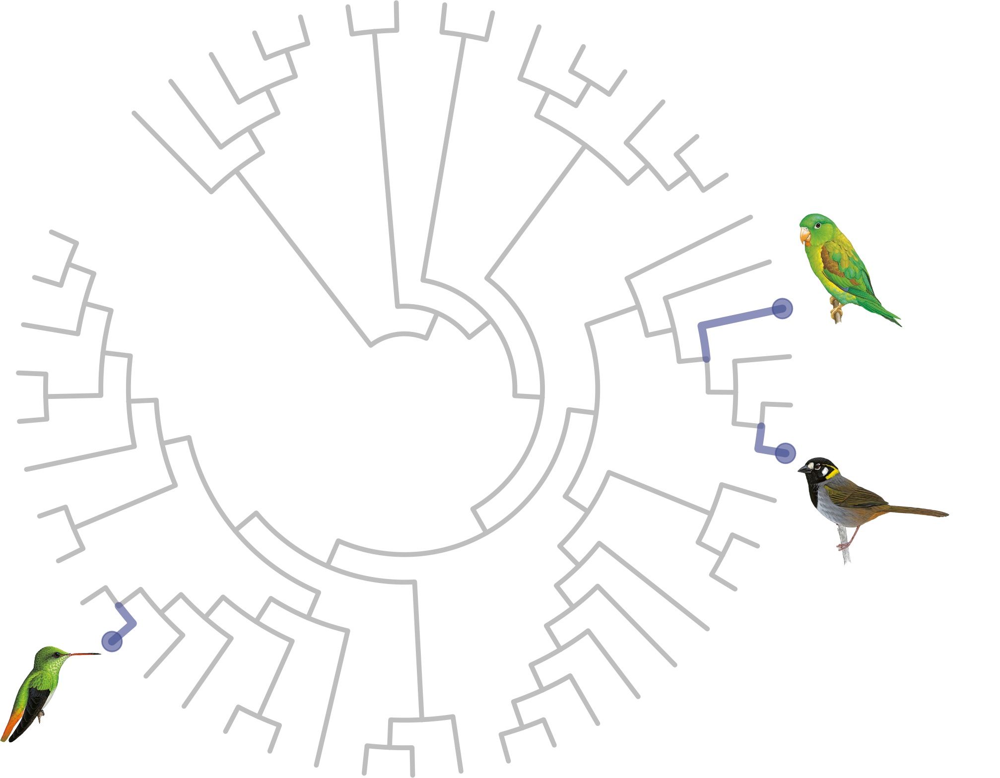
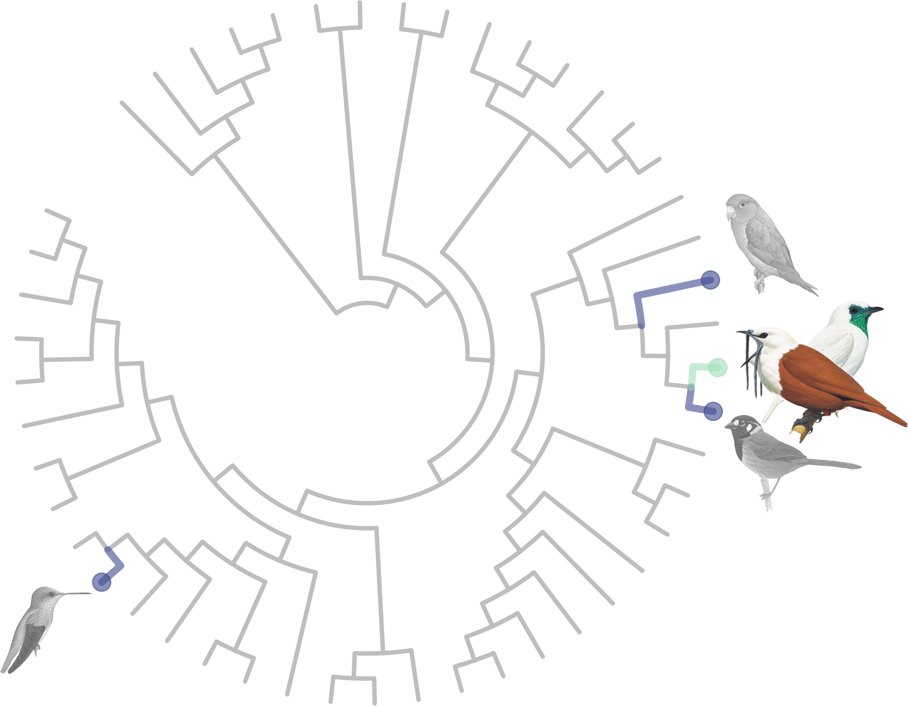
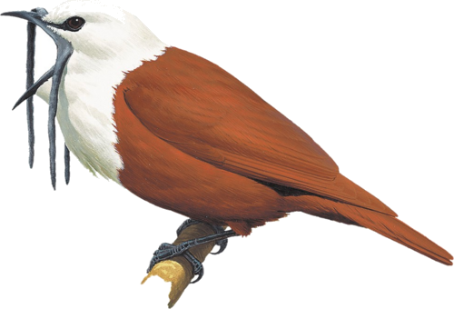
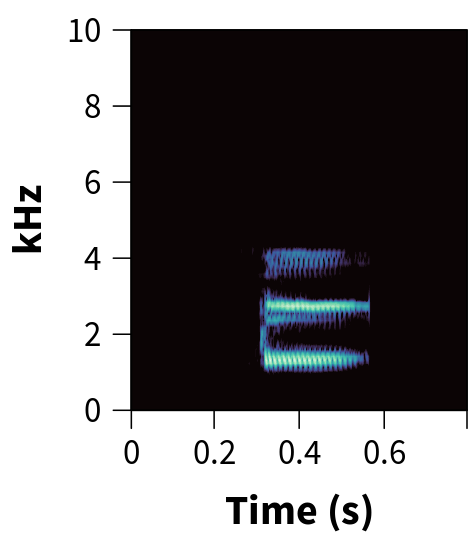
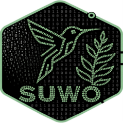
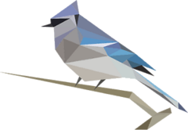
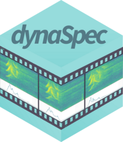

```{r}
#| label: configuracion-global
#| echo: false

# English version of presentation.qmd (the slides hidden there are left out). Images written by
# the chunks get an _en suffix, so that this deck does not overwrite those of the Spanish one

# ==== GLOBAL SETTINGS ==========================================================================
# Every setting that applies to the whole deck. Change a value here and re-render: the CSS
# variables, the ggplot figures, the maps and the spectrograms all take it from here.

## font (must be installed on the computer that renders)
font_family <- "Source Sans Pro"
base_size <- 20                       # base text size of the ggplot figures

## colours of the slides (CSS): titles, text, boxes and backgrounds
deck_cols <- c(
    titulo           = "#366A9F",     # slide titles, table headers, bold text in boxes, arrows
    texto            = "#222222",     # body text
    secundario       = "#555555",     # sources, captions and other secondary text
    acento           = "#38AAAC",     # .custom-color text
    caja             = "#DCEDF9",     # background of the boxes (callouts)
    fondo_conclusion = "#DAD4EA",     # background of the conclusions slide
    fondo_recursos   = "#DEF5E5"      # background of the acknowledgements slide
)

## colour key for sympatric and allopatric species, used throughout the deck
type_cols <- c("Allopatric" = "#3B2F5ECC", "Sympatric" = "#348AA6CC")

## spectrogram palette, for every spectrogram in the deck
spectro_pal <- function(n) viridis::mako(n, direction = 1)

ovlp <- 90
# ===============================================================================================

# data and images are built by prepare_slide_assets.R (run from the project root)

# install/ load packages
sketchy::load_packages(
    packages = c(
        "knitr",
        "ggplot2",
        "dynaSpec",
        "ggtext",
        "viridis",
        "scales",
        "rnaturalearth",
        "ragg"
    )
)

## ggplot themes
theme_function <- theme_classic
presentation_theme <- theme_function(base_size = base_size, base_family = font_family)

theme_set(presentation_theme)

## spectrogram theme, with the palette set above
spectro_theme <- ds_theme(pal = spectro_pal, xlab = "Time (s)", ylab = "Freq. (kHz)", family = font_family, cex.lab = 1.4, cex.axis = 1.4, font.lab = 2, tick.length = 0.6)

ds_set_theme(spectro_theme)

update_geom_defaults("text", list(family = font_family))
update_geom_defaults("label", list(family = font_family))

counts <- read.csv("./data/classification_counts.csv")

# English names
english_names <- c(
    "Procnias tricarunculatus" = "Three-wattled Bellbird",
    "Psarocolius guatimozinus" = "Black Oropendola",
    "Psarocolius montezuma" = "Montezuma Oropendola",
    "Pteroglossus erythropygius" = "Pale-mandibled Aracari",
    "Pteroglossus torquatus" = "Collared Aracari",
    "Ramphastos brevis" = "Chocó Toucan",
    "Ramphastos sulfuratus" = "Keel-billed Toucan"
)

bird_labels <- c(focal = "Focal bellbird", other = "Other bellbirds")

# thousands separator for the numbers on the slides
num <- function(x) formatC(x, big.mark = ",", format = "d")

# species drawing (built by prepare_slide_assets.R); silhouette while a species has none
sp_file <- function(sp) {
    snake <- gsub(" ", "_", tolower(sp))
    f <- file.path("images", paste0(c("icono_", "dibujo_"), snake, ".png"))
    f <- f[file.exists(f)]
    if (length(f)) f[1] else "images/sil_oropendola.png"
}

# drawing as a grob that fits in a box of w x h cm
sp_grob <- function(sp, w, h, ...) {
    img <- png::readPNG(sp_file(sp))
    scale <- min(w / dim(img)[2], h / dim(img)[1])
    grid::rasterGrob(img, width = grid::unit(dim(img)[2] * scale, "cm"),
                     height = grid::unit(dim(img)[1] * scale, "cm"), interpolate = TRUE, ...)
}

# drawing above a bar (and its label), at data position x and bar height y
sp_above <- function(sp, x, y, offset = 0.75, w = 1.25, h = 1.1) {
    annotation_custom(
        sp_grob(sp, w, h, y = grid::unit(0, "npc") + grid::unit(offset, "cm"), vjust = 0),
        xmin = x - 0.4, xmax = x + 0.4, ymin = y, ymax = y
    )
}

# confusion matrix for the performance slides: abbreviated scientific names, first species at
# the top-left and no colour legend (values are printed)
plot_conf <- function(file, species_order, text_size = 5, draw_w = 1, draw_h = 0.85, draw_side = FALSE) {
    d <- read.csv(file)
    short <- setNames(paste0(substr(species_order, 1, 1), ". ", sub(".* ", "", species_order)), species_order)
    d$reference <- factor(short[d$reference], levels = short)
    d$predicted <- factor(short[d$predicted], levels = rev(short))
    n <- length(species_order)
    sympatric <- c("Ramphastos sulfuratus", "Pteroglossus torquatus", "Psarocolius montezuma")
    allopatric <- c("Ramphastos brevis", "Pteroglossus erythropygius", "Psarocolius guatimozinus")
    col_sp <- ifelse(species_order %in% sympatric, type_cols[["Sympatric"]],
                     ifelse(species_order %in% allopatric, type_cols[["Allopatric"]], "black"))
    html <- setNames(sprintf("<i style='color:%s'>%s</i>", col_sp, short), short)
    d$label <- sprintf("%.2f", d$proportion)
    d$label[d$label == "0.00"] <- "0"
    d$text_col <- ifelse(d$proportion > 0.6, "white",
                         ifelse(d$proportion < 0.05 & as.character(d$reference) != as.character(d$predicted),
                                "grey60", "black"))
    ggplot(d, aes(x = reference, y = predicted, fill = proportion)) +
        geom_tile(colour = "white", linewidth = 0.6) +
        geom_text(aes(label = label, colour = text_col), size = text_size, family = font_family) +
        (if (draw_side) lapply(seq_len(n), function(i) annotation_custom(
            sp_grob(species_order[i], draw_w, draw_h, x = grid::unit(0, "npc") - grid::unit(0.15, "cm"), hjust = 1),
            xmin = 0.5, xmax = 0.5, ymin = n + 1 - i - 0.45, ymax = n + 1 - i + 0.45))
         else lapply(seq_len(n), function(i) annotation_custom(
            sp_grob(species_order[i], draw_w, draw_h, y = grid::unit(0, "npc") + grid::unit(0.15, "cm"), vjust = 0),
            xmin = i - 0.45, xmax = i + 0.45, ymin = n + 0.5, ymax = n + 0.5))) +
        coord_equal(clip = "off") +
        scale_fill_gradient(low = "white", high = mako(10)[6], limits = c(0, 1), guide = "none") +
        scale_colour_identity() +
        scale_x_discrete(labels = function(x) html[x]) +
        scale_y_discrete(labels = function(x) html[x]) +
        labs(x = "Reference species", y = "Predicted species") +
        theme(axis.text.x = ggtext::element_markdown(angle = 35, hjust = 1, vjust = 1,
                                                     family = "Source Sans Pro Semibold"),
              axis.text.y = ggtext::element_markdown(hjust = 1, family = "Source Sans Pro Semibold",
                                                     margin = margin(r = if (draw_side) (draw_w + 0.3) * 28.35 else 2.2)),
              axis.line = element_blank(), axis.ticks = element_blank(),
              plot.margin = margin(t = if (draw_side) 10 else 45, r = 5, b = 5, l = 5))
}

# dynaSpec comparison of model (top) and focal bellbird (bottom), as one raw HTML block: one player
# shows both spectrograms and plays them in sequence (see presentation.qmd)
ds_pair <- function(pair, model_sp, model_title, wl = 512, collevels = seq(-50, 0, 5), bp = NULL) {
    wl <- rep(wl, length.out = 2)
    clips <- paste0("clip_", pair, c("_focal", "_model"))
    titles <- c("Focal bellbird", model_title)
    drawings <- c("images/campana_focal_dibujo.png", sp_file(model_sp))
    clips <- rev(clips); titles <- rev(titles); drawings <- rev(drawings); wl <- rev(wl)

    ds_sound <- function(i) {
        dynaspec(file.path("images", paste0(clips[i], ".wav"))) +
            ds_spectrogram(wl = wl[i], ovlp = ovlp, collevels = collevels, pal = spectro_pal)
    }

    x <- ds_compare(ds_sound(1), ds_sound(2), flim = c(1, 8), gap = 0) +
        ds_static(width = 860, height = 330, res = 100,
                  alt = paste("Spectrogram:", gsub("<[^>]+>", " ", paste(titles, collapse = " and ")))) +
        ds_player(speeds = 1, buttons = character(), autoplay = "next") +
        ds_theme(col.line = adjustcolor("orange", 0.6))   # playback line

    if (!is.null(bp[1]))
        x <- x + ds_filter(bp)
    if (!isTRUE(getOption("knitr.in.progress"))) return(x)

    html <- as.character(save_dynaspec(x, play = FALSE, verbose = FALSE))
    html <- paste(gsub("```(\\{=html\\})?", "", html), collapse = "\n")

    writeLines(sub("(?s).*<script>(.*?</script>).*", "<script>\\1", html, perl = TRUE), "dynaspec_player.html")
    player <- sub("<script>.*", "", html)

    rows <- regmatches(player, gregexpr('data-rows="[^"]+"', player))[[1]]
    lab_bottom <- sapply(strsplit(gsub('data-rows="|"', "", rows), ","), function(r) (1 - as.numeric(r[6])) * 100)
    for (i in 1:2) {
        png_file <- file.path("images", paste0("ds_", clips[i], "_en.png"))
        png_b64 <- sub('(?s).*?srcset="data:image/png;base64,([^ "]+)[^"]*".*', "\\1", player, perl = TRUE)
        writeBin(base64enc::base64decode(png_b64), png_file)
        player <- sub('srcset="data:image/png;base64,[^"]+"', paste0('src="', png_file, '"'), player)
        player <- sub(
            '<audio([^>]*) src="data:audio/[^"]+"></audio>',
            paste0('<audio\\1 src="images/', clips[i], '.wav"></audio>',
                   '<div class="ds-etiqueta" style="bottom: ', sprintf("%.2f", lab_bottom[i]), '%"><span>', titles[i], '</span></div>'),
            player
        )
    }

    cat(
        "\n```{=html}\n<div class=\"ds-fila\">",
        paste0('<div class="ds-col">', player, "</div>"),
        "</div>",
        '<span class="fragment ds-autoplay" aria-hidden="true"></span>',
        "```\n", sep = "\n"
    )
}
```

# Quantifying heterospecific vocal mimicry with deep learning: evidence from a bellbird {.titulo-largo .portada background-color="white" background-size="cover" background-image="./images/campana_david_full.jpeg" background-opacity="0.65"}

```{r}
#| output: asis
# the colours of the global settings as CSS variables (used in styles_revealjs.css)
css_vars <- c(setNames(deck_cols, paste0("--col-", gsub("_", "-", names(deck_cols)))),
              "--col-simp" = type_cols[["Sympatric"]], "--col-alop" = type_cols[["Allopatric"]],
              "--r-main-color" = deck_cols[["texto"]], "--r-heading-color" = deck_cols[["titulo"]])
cat("\n```{=html}\n<style>:root {", paste0(names(css_vars), ": ", css_vars, ";", collapse = " "),
    "}</style>\n```\n")
```

<div class="autores"><span class="autor autor-principal"><b>Marcelo Araya-Salas</b></span><span class="afiliacion">Universidad de Costa Rica</span><span class="autor">Pablo Huertas-Vásquez</span><span class="afiliacion">Universidad Nacional de Costa Rica</span><span class="autor">Marcos Q. Oliva</span><span class="afiliacion">Royal Holloway University of London</span></div>

<div class="logos"></div>

::: footer
<span class="texto-pequeno"><a href="https://marce10.github.io/">https://marce10.github.io/</a></span>
:::

::: {.notes}
**0:00–0:15.** Introduce the topic and the co-authors.
:::


## Evolution of vocal learning

<div style="height: 0.25em;"></div>

::: {.columns .filogenia-columnas}
::: {.column width="62%"}
{.filogenia}
:::
::: {.column width="38%"}
:::
:::

<div style="height: 0.25em;"></div>

::: {.fuente}
phylogeny: Open Tree of Life (McTavish et al. 2025)
:::

## Evolution of vocal learning

<div style="height: 0.25em;"></div>

::: {.columns .filogenia-columnas}
::: {.column width="62%"}
{.filogenia}
:::
::: {.column width="38%" .filogenia-puntos}
- Genus *Procnias*
- Dialects and cultural evolution in *P. tricarunculatus*
- Apparent imitation by a captive *P. nudicollis*
:::
:::

<div style="height: 0.25em;"></div>

::: {.fuente}

Saranathan et al. 2007; Kroodsma et al. 2013

:::

::: {.notes}
**About 20 s.** In blue, the Tyranni or suboscines: the sister group of the songbirds, considered non-learners. The bellbirds belong here, which is why their case is so interesting.
:::


## {.video-subtitulo background-video="images/adult_bellbird_spectrogram_short_black_en.mp4" background-size="contain" background-color="black"}

<div class="subtitulo-video sobre-espectro" style="--alto: 0.01; --tamano: 32px">Adult <i>P. tricarunculatus</i> in Monteverde, Costa Rica</div>

::: {.notes}
Full-screen video (9 s, with sound): an adult bellbird singing. It starts only when the slide is reached. To cut it short, move to the next slide.
:::


## {.video-subtitulo background-video="images/focal_spectrogram_black_en.mp4" background-size="contain" background-color="black"}

<div class="subtitulo-video sobre-espectro" style="--alto: 0.01; --tamano: 32px">Focal bellbird: juvenile <i>P. tricarunculatus</i>, Refugio Bosque Alegre, Costa Rica</div>


::: {.notes}
Full-screen video (30 s, with sound): the focal bellbird imitating the aracari and then the toucan. It starts only when the slide is reached. To cut it short, move to the next slide.

**By 3:55.** Pablo found the focal bellbird, a juvenile, alone, interacting with toucans and aracaris. He saw no other bellbird in the area, before or after, so the sounds are unlikely to come from another individual. From its moult and the lack of wattles we estimate it was two or three years old. And it sounded like this.
:::

## Apparent imitations {.dibujos-volteados}

<div style="height: 0.5em;"></div>

```{r}
#| output: asis

ds_pair("toucan", "Ramphastos sulfuratus", "<i>Ramphastos sulfuratus</i>", wl = 512, bp = c(1, Inf))
```

::: {.notes}
**By 4:35.** Pressing → plays both sounds in sequence, and the next → moves to the next slide: first the focal bellbird, then the Keel-billed Toucan. Click on a spectrogram to start from that point.
:::

## Apparent imitations {.dibujos-volteados}

<div style="height: 0.5em;"></div>

```{r}
#| output: asis
ds_pair("aracari", "Pteroglossus torquatus", "<i>Pteroglossus torquatus</i>", wl = 600, bp = c(1, Inf))
```

::: {.notes}
**By 5:10.** Pressing → plays both sounds in sequence: focal bellbird and Collared Aracari.
:::

## Apparent imitations {.dibujos-volteados}

<div style="height: 0.5em;"></div>

```{r}
#| output: asis
ds_pair("oropendola_birdnet", "Psarocolius montezuma", "<i>Psarocolius montezuma</i>", wl = 1024, collevels = seq(-45, 0, 1))
```

::: {.notes}
Pressing → plays both sounds in sequence: focal bellbird and Montezuma Oropendola. This sound of the focal bellbird (recording INVEST_0093) was classified as an oropendola by both BirdNET models. It sounds convincing, but the ear can be fooled: we need a test.
:::

## Vocal similarity {.nostretch}

:::: {.columns}

::: {.column width="50%"}
::: {.callout-note icon=false appearance="simple"}
<span class="texto-medio"><b>Mimicry:</b> copying the species the focal bellbird can hear</span>
:::
:::

::: {.column width="50%"}
::: {.fragment fragment-index=2}
::: {.callout-note icon=false appearance="simple"}
<span class="texto-medio"><b>Chance:</b> variable vocalizations that match other species only by coincidence</span>
:::
:::
:::

::::

```{r}
# schematic predictions (hypothetical values) for one pair of sister toucan species: the
# sympatric Ramphastos sulfuratus (first) and the allopatric R. brevis
pred <- expand.grid(sp = 1:2, hyp = c("chance", "mimicry"))
pred$type <- rep(c("Sympatric", "Allopatric"), length.out = nrow(pred))
pred$x <- pred$sp
pred$value <- c(0.29, 0.30,                         # chance
                0.44, 0.06)                         # mimicry

pred_plot <- function(h, show_y = TRUE) {
    ggplot(pred[pred$hyp == h, ], aes(x = x, y = value, fill = type)) +
        geom_col(width = 0.8) +
        lapply(1:2, function(i) sp_above(c("Ramphastos sulfuratus", "Ramphastos brevis")[i], i,
                                         pred$value[pred$hyp == h][i], 0.15, 2.4, 1.6)) +
        annotate("text", x = 1.5, y = -0.2, label = "Sister species", size = 6,
                 family = font_family, vjust = 1) +
        scale_fill_manual(values = type_cols, guide = "none") +
        scale_x_continuous(breaks = 1:2, labels = c("R. sulfuratus", "R. brevis")) +
        scale_y_continuous(expand = expansion(mult = c(0, 0.1))) +
        coord_cartesian(ylim = c(0, max(pred$value) * 1.4), clip = "off") +
        labs(x = NULL, y = "Similarity of\nbellbird songs") +
        theme(axis.text.x = element_text(size = 20, face = "italic",
                                         colour = type_cols[c("Sympatric", "Allopatric")]),
              axis.text.y = element_blank(), axis.ticks.y = element_blank(),
              axis.title.y = element_text(colour = if (show_y) "black" else "transparent",
                                          lineheight = 0.9, size = rel(0.8)),
              plot.margin = margin(t = 15, r = 10, b = 45, l = 5))
}
arrow_svg <- '<div class="flecha-prediccion"><svg viewBox="0 0 40 60" aria-hidden="true"><path d="M20 2 V48 M6 36 L20 52 L34 36" /></svg></div>'
```

::: {.prediccion-fila}
::: {.fragment fragment-index=1}
`r arrow_svg`

```{r}
#| fig-width: 5
#| fig-height: 3
#| out-width: "100%"
pred_plot("mimicry")
```
:::

::: {.fragment fragment-index=3}
`r arrow_svg`

```{r}
#| fig-width: 5
#| fig-height: 3
#| out-width: "100%"
pred_plot("chance", show_y = FALSE)
```
:::
:::

::: {.fragment fragment-index=1}
<div class="leyenda-tipos"><span><i style="background: var(--col-simp)"></i>Sympatric</span><span><i style="background: var(--col-alop)"></i>Allopatric</span></div>
:::


::: {.fuente}
Kelley et al. 2008; Dalziell et al. 2015
:::

::: {.notes}
**About 40 s.** We want to tell two possibilities apart. If the focal bellbird is copying, its vocalizations should resemble the sympatric species more, since those are the ones it can hear (left). If it produces variable vocalizations that resemble other species by chance, the classifier should assign them equally to the sympatric species and to their allopatric relatives (right). The allopatric species are a good control because, being sister species, they sound like the models: any chance resemblance should be split between both. The bars are schematic.
:::

## Training data

```{r}
#| output: asis
tr <- read.csv("./data/entrenamiento_modelos.csv")
n_ex <- setNames(tr$clips_train + tr$clips_test, tr$species)
n_rec <- setNames(tr$recordings_train + tr$recordings_test, tr$species)
abbr <- function(sp) paste0(substr(sp, 1, 1), ". ", sub(".* ", "", sp))

# example spectrograms (the distribution maps are drawn by the Spanish deck)
for (sp in c("Ramphastos sulfuratus", "Ramphastos brevis", "Pteroglossus torquatus",
             "Pteroglossus erythropygius", "Psarocolius montezuma", "Psarocolius guatimozinus",
             "Procnias tricarunculatus")) {
    snake <- gsub(" ", "_", tolower(sp))
    bb <- sp == "Procnias tricarunculatus"
    ex <- dynaspec(file.path("images", paste0("ejemplo_", snake, ".wav")), flim = c(0, 10)) +
        ds_spectrogram(wl = 512, ovlp = ovlp) +
        (if (bb) ds_theme(axis.type = "standard", xlab = "Time (s)", ylab = "kHz", pal = spectro_pal)
         else ds_theme(axis.type = "none", pal = spectro_pal)) +
        (if (bb) ds_static(width = 470, height = 540, res = 150)
         else ds_static(width = 360, height = 450, res = 150))
    invisible(save_dynaspec(ex, file.path("images", paste0("espectro_", snake, "_en.png")),
                            play = FALSE, verbose = FALSE))
}

# map and example spectrogram side by side
cell <- function(sp) sprintf(
    '<td><div class="esp-par"></div><div class="esp-nombre"><i>%s</i></div></td>',
    gsub(" ", "_", tolower(sp)), sp, gsub(" ", "_", tolower(sp)), sp, abbr(sp))
groups <- list(c("Ramphastos", "toucans", "Ramphastos sulfuratus", "Ramphastos brevis"),
               c("Pteroglossus", "aracaris", "Pteroglossus torquatus", "Pteroglossus erythropygius"),
               c("Psarocolius", "oropendolas", "Psarocolius montezuma", "Psarocolius guatimozinus"))
rows <- vapply(seq_along(groups), function(k) {
    g <- groups[[k]]
    side <- if (k == 1) sprintf(paste0(
        '<td class="esp-campana" rowspan="3">',
        '',
        '<div><i>P. tricarunculatus</i></div><div class="esp-otros">Other individuals</div></td>')) else ""
    sprintf('<tr><th class="esp-genero"><i>%s</i><span>%s</span></th>%s%s%s</tr>',
            g[1], g[2], cell(g[3]), cell(g[4]), side)
}, character(1))
cat("\n```{=html}\n<table class=\"tabla-especies\" data-quarto-disable-processing=\"true\">",
    "<tr><th></th><th class=\"mapa-simpatrico\">Sympatric model</th><th class=\"mapa-alopatrico\">Allopatric relative</th><th class=\"esp-campana-tit\">Bellbird</th></tr>",
    paste(rows, collapse = "\n"), "</table>\n```\n", sep = "\n")
```


::: {.fuente}
Distribution maps: BirdLife International 2025
:::

::: {.notes}
**About 40 s.** The three sympatric species, on the left, share their range with the bellbird (black outline); their allopatric relatives, on the right, never overlap with it. On the far right, the other bellbirds. Next to each map, an example of its sound.
:::

## Model training {.nostretch}

```{r}
#| output: asis
# diagram: BirdNET -> training data of each species (examples and recordings) -> two models.
# Coordinates in an arbitrary 0-120 x 0-64 box (see presentation.qmd)
tr <- read.csv("./data/entrenamiento_modelos.csv")
n_ex <- setNames(tr$clips_train + tr$clips_test, tr$species)
abbr <- function(sp) paste0(substr(sp, 1, 1), ". ", sub(".* ", "", sp))

stage_x <- c(34.5, 89, 128)
stage_title <- c("Get recordings", "(Re)train models", "Classify\nfocal bellbird")
grey_box <- "#c8c8c8"

cell_fill <- sapply(type_cols[c("Sympatric", "Allopatric")], function(cl)
    do.call(rgb, as.list(0.16 * col2rgb(cl)[, 1] / 255 + 0.84)))
row_y <- c(51.5, 38.5, 25.5)
sp_tab <- data.frame(
    sp = c("Ramphastos sulfuratus", "Pteroglossus torquatus", "Psarocolius montezuma",
           "Ramphastos brevis", "Pteroglossus erythropygius", "Psarocolius guatimozinus",
           "Procnias tricarunculatus"),
    x = c(rep(37, 3), rep(58, 3), 47),
    y = c(row_y, row_y, 5.5)
)
sp_tab$counts <- num(n_ex[sp_tab$sp])
sp_tab$counts[1] <- paste(num(n_ex[sp_tab$sp[1]]), "songs")

img_box <- function(f, x, y, w, h) {
    img <- if (grepl("\\.jpe?g$", f)) jpeg::readJPEG(f) else png::readPNG(f)
    a <- dim(img)[1] / dim(img)[2]
    if (a > h / w) w <- h / a else h <- w * a
    annotation_raster(img, xmin = x - w / 2, xmax = x + w / 2, ymin = y - h / 2, ymax = y + h / 2,
                      interpolate = TRUE)
}
arrow_ <- grid::arrow(length = grid::unit(0.3, "cm"), type = "closed")
box <- function(x, y, w, h, fill, col, lwd = 1.6, r = 0.25)
    annotation_custom(grid::roundrectGrob(r = grid::unit(r, "cm"),
                                          gp = grid::gpar(fill = fill, col = col, lwd = lwd)),
                      xmin = x - w / 2, xmax = x + w / 2, ymin = y - h / 2, ymax = y + h / 2)

suwo_y <- 21
repo_icons <- c("images/repo_xc.png", "images/repo_gbif.png", "images/repo_inat.png",
                "images/repo_ml.png")
models <- data.frame(x = 97.5, y = c(35.5, 14.5),
    title = c("Discriminate\nsympatric\nand allopatric", "Discriminate\nsympatric"),
    text = c("+ bellbird\n(7 classes)",
             "+ bellbird\n(4 classes)"))
f1 <- sapply(c("sympatric_and_allopatric/sympatric_and_allopatric", "sympatric/sympatric"), function(f)
    read.csv(paste0("../data/processed/birdnet_models/", f, "_evaluation.csv"), check.names = FALSE)[1, "F1 Score (opt)"])
models$text <- paste0(models$text, "\nOverall F1: ", round(f1 * 100), "%")

time_y <- 69
g_time <- list(
    annotate("segment", x = -2.5, xend = 140, y = time_y, yend = time_y, colour = "grey60",
             linewidth = 1, arrow = arrow_)
)
g_stage <- lapply(seq_along(stage_x), function(i) list(
    annotate("point", x = stage_x[i], y = time_y, size = 4, colour = deck_cols[["titulo"]]),
    annotate("text", x = stage_x[i], y = time_y + 2.2, label = stage_title[i], vjust = 0,
             fontface = "bold", lineheight = 0.85, size = 5.4, family = font_family,
             colour = deck_cols[["texto"]])))
# step 1: recordings and training data
g <- ggplot() +
    box(47, 30.9, 44, 64.8, "white", "grey80", lwd = 1.3) +
    lapply(row_y, function(y) list(
        box(47, y - 0.4, 42, 12.8, cell_fill[["Sympatric"]], NA),
        box(54, y - 0.4, 28, 12.8, cell_fill[["Allopatric"]], NA),
        annotate("rect", xmin = 40, xmax = 47, ymin = y - 0.4 - 6.4, ymax = y - 0.4 + 6.4,
                 fill = cell_fill[["Sympatric"]], colour = NA))) +
    lapply(row_y, function(y) box(47, y - 0.4, 42, 12.8, NA, grey_box, lwd = 1.6)) +
    annotate("text", x = 47, y = -4.3, size = 4.6, fontface = "bold", family = font_family,
             colour = deck_cols[["texto"]],
             label = paste("Total:", num(sum(n_ex)), "songs")) +
    img_box("images/logo_suwo_web.png", 3, suwo_y, 12, 14.3) +
    annotate("segment", x = 9.4, xend = 24.6, y = suwo_y, yend = suwo_y, colour = deck_cols[["titulo"]],
             linewidth = 1.2, arrow = arrow_) +
    box(16.3, suwo_y, 8.4, 28, "white", grey_box, lwd = 1.6) +
    annotate("text", x = 3, y = suwo_y + 8.6, label = "suwo\nR package", vjust = 0, size = 4.4,
             lineheight = 0.9, fontface = "bold", family = font_family, colour = deck_cols[["texto"]]) +
    annotate("text", x = 16.3, y = suwo_y + 14.9, label = "Online\nrepositories", vjust = 0, size = 4.4,
             lineheight = 0.9, fontface = "bold", family = font_family, colour = deck_cols[["texto"]]) +
    lapply(seq_along(repo_icons), function(i)
        img_box(repo_icons[i], 16.3, suwo_y + c(10.9, 3.2, -3.9, -10.9)[i], 6.5, 4.2)) +
    annotate("segment", x = 47, xend = 47, y = row_y[3] - 6.8, yend = 62.3, colour = grey_box,
             linewidth = 0.6) +
    annotate("text", x = c(37, 58), y = 60.3, label = c("Sympatric", "Allopatric"),
             colour = c(type_cols[["Sympatric"]], type_cols[["Allopatric"]]), fontface = "bold",
             size = 5.8, family = font_family) +
    annotate("text", x = 47, y = 15.3, label = "Bellbird", colour = deck_cols[["texto"]],
             fontface = "bold", size = 5.1, family = font_family) +
    lapply(seq_len(nrow(sp_tab)), function(i)
        img_box(sp_file(sp_tab$sp[i]), sp_tab$x[i], sp_tab$y[i] + 2.5, 10, 6.8)) +
    annotate("text", x = sp_tab$x, y = sp_tab$y - 2.6, label = abbr(sp_tab$sp),
             colour = deck_cols[["texto"]], size = 4.4, fontface = "italic", family = font_family) +
    annotate("text", x = sp_tab$x, y = sp_tab$y - 5.3, label = sp_tab$counts, size = 4.6,
             colour = deck_cols[["secundario"]], family = font_family)

title_lh <- 0.8
line_title <- 3.3 * title_lh
line_text <- 2.6 * 0.9
gap <- 1.5
pad <- 2.1
n_title <- lengths(strsplit(models$title, "\n"))
n_text <- lengths(strsplit(models$text, "\n"))
block <- n_title * line_title + gap + n_text * line_text
models$h <- block + 2 * pad
top <- models$y + block / 2
models$y_title <- top - n_title * line_title / 2
models$y_text <- top - n_title * line_title - gap - n_text * line_text / 2

# step 2: BirdNET and the retraining arrows (faded in step 3)
g_models <- list(
    img_box("images/logo_birdnet_web.png", 77, 56.5, 13, 9),
    ggtext::geom_richtext(
        aes(x = 77, y = 46.5, label = "<b>BirdNET</b><br>(>6000 spp)"),
        size = 4.8, lineheight = 0.9, family = font_family, colour = deck_cols[["texto"]],
        fill = NA, label.color = NA),
    annotate("text", x = 77, y = models$y + 3.2, label = "retrain", size = 4.6,
             family = font_family, colour = deck_cols[["titulo"]]),
    annotate("text", x = 77, y = models$y[2] - 2.2, vjust = 1, size = 4.2, lineheight = 0.9,
             family = font_family, colour = deck_cols[["texto"]],
             label = "80% training\n20% testing"),
    annotate("segment", x = 69.8, xend = 85.6, y = models$y, yend = models$y,
             colour = deck_cols[["titulo"]], linewidth = 1.2, arrow = arrow_)
)
g_boxes <- list(
    box(models$x[1], models$y[1], 22, models$h[1], deck_cols[["caja"]], deck_cols[["titulo"]]),
    box(models$x[2], models$y[2], 22, models$h[2], deck_cols[["caja"]], deck_cols[["titulo"]]),
    annotate("text", x = models$x, y = models$y_title, label = models$title, fontface = "bold",
             size = 5.8, lineheight = title_lh, family = font_family, colour = deck_cols[["texto"]]),
    annotate("text", x = models$x, y = models$y_text, label = models$text, size = 4.8,
             lineheight = 0.9, family = font_family, colour = deck_cols[["texto"]])
)
# step 3: classification of the focal bellbird
cat_x <- 128; cat_y <- 25; cat_w <- 22
g_classify <- list(
    annotate("segment", x = models$x + 11.4, xend = cat_x - cat_w / 2 - 0.8,
             y = models$y, yend = cat_y + c(5, -5), colour = deck_cols[["titulo"]],
             linewidth = 1.2, arrow = arrow_),
    img_box("images/campana_focal_dibujo.png", cat_x, cat_y + cat_w / 2 + 5, 13, 8.4),
    img_box("images/catalogo_campana_focal.jpeg", cat_x, cat_y, cat_w, cat_w),
    annotate("rect", xmin = cat_x - cat_w / 2, xmax = cat_x + cat_w / 2, ymin = cat_y - cat_w / 2,
             ymax = cat_y + cat_w / 2, fill = NA, colour = grey_box, linewidth = 0.6),
    annotate("text", x = cat_x, y = cat_y, label = "?", size = 50, fontface = "bold",
             family = font_family, colour = "white", alpha = 0.7),
    annotate("text", x = cat_x, y = cat_y - cat_w / 2 - 1.5, vjust = 1, size = 4.8, lineheight = 0.95,
             label = "15 sampling days /\n8 months\n166 recordings\n1,660 songs",
             family = font_family, colour = deck_cols[["texto"]])
)
frame_ <- list(
    coord_fixed(xlim = c(-3.5, 141.9), ylim = c(-6.5, 76.5), expand = FALSE, clip = "off"),
    theme_void(),
    theme(plot.background = element_rect(fill = NA, colour = NA))
)

steps <- c("images/entrenamiento_linea_tiempo_en.png", sprintf("images/entrenamiento_etapa%d_en.png", 1:3),
           sprintf("images/entrenamiento_paso%d_en.png", 1:3), "images/entrenamiento_paso2_modelos_en.png")
layers <- c(list(ggplot() + g_time), lapply(g_stage, function(l) ggplot() + l),
            list(g, ggplot() + g_models, ggplot() + g_classify, ggplot() + g_boxes))
for (i in seq_along(steps))
    ggsave(steps[i], layers[[i]] + frame_, width = 11.27, height = 6.43, dpi = 300, bg = "transparent")
alt <- "Training diagram: BirdNET is retrained with the vocalizations of the seven species to obtain two models"
img_h <- "537px"
cls <- c('', '.fragment .atenuar data-fragment-index="1"', '.tenue',
         '.fragment .current-visible data-fragment-index="1"', '.tenue',
         '.fragment data-fragment-index="2"', '.fragment .atenuar data-fragment-index="1"',
         NA, '.fragment data-fragment-index="1"', '.fragment data-fragment-index="2"')
src <- steps[c(1, 2, 3, 3, 4, 4, 5, 6, 8, 7)]
cls[7] <- paste(".bajar", cls[7])
cls[c(9, 10)] <- paste(".bajar-der", cls[c(9, 10)])
img_md <- sprintf('{%s fig-alt="%s" height="%s"}', src, cls,
                  c(alt, rep("", length(src) - 1)), img_h)
img_md[is.na(cls)] <- sprintf(paste0('<div class="fragment bajar-der" data-fragment-index="1"></div>'),
                              src[is.na(cls)], sub("px", "", img_h))
cat("\n::: {.r-stack}\n", paste(img_md, collapse = "\n\n"), "\n:::\n", sep = "")
```

::: {.notes}
**About 40 s.** We retrained BirdNET, a network already trained on thousands of species, with our own classes. We used model V2.4 (BirdNET-Analyzer 2.4.0), the version before the current one. We used 2-second examples of each species, with 80% of the recordings for training and 20% for testing, without repeating any. We trained two models: one with the sympatric species, their allopatric relatives and the bellbird, and another with only the sympatric species and the bellbird.
:::

## Similarity to sympatric vs allopatric species {.titulo-pequeno}

```{r}
#| fig-height: 5
pairs <- data.frame(
    pred = c("Ramphastos sulfuratus", "Ramphastos brevis",
             "Pteroglossus torquatus", "Pteroglossus erythropygius",
             "Psarocolius montezuma", "Psarocolius guatimozinus"),
    group = rep(c("Toucans", "Aracaris", "Oropendolas"), each = 2),
    type = rep(c("Sympatric", "Allopatric"), times = 3)
)

totals <- unique(counts[counts$model == "sympatric_allopatric", c("bird", "total")])
bars <- merge(merge(pairs, totals), counts[counts$model == "sympatric_allopatric", c("pred", "bird", "Freq")], all.x = TRUE)
bars$Freq[is.na(bars$Freq)] <- 0
bars$prop <- bars$Freq / bars$total
bars$bird <- factor(bird_labels[bars$bird], levels = bird_labels)
bars$group <- factor(bars$group, levels = c("Toucans", "Aracaris", "Oropendolas"))
bars$type <- factor(bars$type, levels = c("Sympatric", "Allopatric"))   # sympatric bar first
bars$strip <- paste0(bars$bird, " (n = ", num(bars$total), ")")

bias_sp <- data.frame(
    sp = c("Ramphastos sulfuratus", "Ramphastos brevis",
           "Pteroglossus torquatus", "Pteroglossus erythropygius",
           "Psarocolius montezuma", "Psarocolius guatimozinus"),
    x = rep(1:3, each = 2) + c(-0.2, 0.2)
)

ymax <- max(bars$prop) * 1.55
bias_panel <- function(b, y_axis) {
    d <- bars[bars$bird == b, ]
    g <- ggplot(d, aes(x = group, y = prop, fill = type)) +
        geom_col(position = position_dodge(width = 0.8), width = 0.75) +
        geom_text(aes(label = Freq), position = position_dodge(width = 0.8),
                  vjust = -0.4, size = 6) +
        facet_wrap(~ strip) +
        lapply(seq_len(nrow(bias_sp)), function(i)
            sp_above(bias_sp$sp[i], bias_sp$x[i], d$prop[d$pred == bias_sp$sp[i]])) +
        coord_cartesian(clip = "off") +
        scale_fill_manual(values = type_cols, name = "", drop = FALSE) +
        scale_y_continuous(labels = label_percent(), limits = c(0, ymax), expand = c(0, 0),
                           breaks = seq(0, max(bars$prop), by = 0.05)) +
        labs(x = "", y = "Vocalizations\nclassified as") +
        theme(strip.background = element_blank(), strip.text = element_text(size = 22))
    if (y_axis) {
        g <- g + labs(caption = "Numbers above the bars: number of vocalizations") +
            theme(legend.position = "inside", legend.position.inside = c(1, 0.85),
                  legend.justification = c(1, 1), legend.direction = "vertical",
                  legend.background = element_blank(),
                  plot.caption = element_text(hjust = 0), plot.caption.position = "plot")
    } else {
        g <- g + theme(axis.line.y = element_blank(), axis.text.y = element_blank(),
                       axis.ticks.y = element_blank(), axis.title.y = element_blank(),
                       legend.position = "none")
    }
    g
}
bias_plot <- function(show_other) {
    right <- if (show_other) bias_panel(bird_labels[["other"]], FALSE) else patchwork::plot_spacer()
    patchwork::wrap_plots(bias_panel(bird_labels[["focal"]], TRUE), right, nrow = 1)
}

bias_plot(show_other = FALSE)
```

<div class="nota-gris">
<center><span class="texto-medio">Focal bellbird: <span class="simp">sympatric</span> 14 times more than <span class="alop">allopatric</span><br><span class="oculto">Other bellbirds: test recordings (not used for training)</span></span></center>
</div>

::: {.notes}
**By 7:00.** The main result, first for the focal bellbird: the vast majority of its heterospecific classifications fall on the sympatric species, above all the Keel-billed Toucan and the Collared Aracari.
:::

## Similarity to sympatric vs allopatric species {.titulo-pequeno}

```{r}
#| fig-height: 5
bias_plot(show_other = TRUE)
```

<div class="nota-gris">
<center><span class="texto-medio">Focal bellbird: <span class="simp">sympatric</span> 14 times more than <span class="alop">allopatric</span><br>Other bellbirds: test recordings (not used for training)</span></span></center>
</div>

::: {.notes}
**By 7:30.** Now the other bellbirds: no such bias. When the focal bellbird is classified as another species, 93% of the time it is the sympatric one (95% CI: 91–96%), about 14 times more than its allopatric relative; by chance we would expect half and half. The other bellbirds (test recordings, not used for training) are almost never classified as another species: 1 of 137 recordings, and it was as an allopatric one. This supports genuine mimicry.
:::

## Similarity to sympatric species {.desempeno .titulo-pequeno}

```{r}
sp <- counts[counts$model == "sympatric", ]
sp_levels <- c("Ramphastos sulfuratus", "Pteroglossus torquatus", "Psarocolius montezuma")
sp_bars <- expand.grid(pred = sp_levels, bird = c("focal", "other"), stringsAsFactors = FALSE)
sp_bars <- merge(sp_bars, sp[, c("pred", "bird", "Freq")], all.x = TRUE)
sp_bars$Freq[is.na(sp_bars$Freq)] <- 0
sp_bars$total <- unique(sp[, c("bird", "total")])$total[match(sp_bars$bird, unique(sp[, c("bird", "total")])$bird)]
sp_bars$prop <- sp_bars$Freq / sp_bars$total
sp_short <- setNames(paste0(substr(sp_levels, 1, 1), ". ", sub(".* ", "", sp_levels)), sp_levels)
sp_bars$species <- factor(sp_short[sp_bars$pred], levels = sp_short)
sp_bars$bird <- factor(bird_labels[sp_bars$bird], levels = bird_labels)
sp_n <- tapply(sp_bars$total, sp_bars$bird, unique)
sp_lab <- paste0(names(sp_n), " (n = ", num(as.numeric(sp_n)), ")")

ggplot(sp_bars, aes(x = species, y = prop, fill = bird)) +
    geom_col(position = position_dodge(width = 0.8), width = 0.75) +
    geom_text(aes(label = Freq), position = position_dodge(width = 0.8),
              vjust = -0.4, size = 6) +
    scale_fill_manual(values = c(adjustcolor("orange", 0.6), mako(10)[3]), name = "", labels = sp_lab) +
    scale_y_continuous(labels = label_percent(), expand = expansion(mult = c(0, 0.45))) +
    lapply(seq_along(sp_levels), function(i)
        sp_above(sp_levels[i], i, max(sp_bars$prop[sp_bars$pred == sp_levels[i]]), 0.8, 2.6, 1.7)) +
    coord_cartesian(clip = "off") +
    scale_x_discrete(labels = function(x) sprintf("<i style='color:%s'>%s</i>", type_cols[["Sympatric"]], x)) +
    labs(x = "", y = "Vocalizations classified as") +
    theme(legend.position = "inside", legend.position.inside = c(0.5, 0.9), legend.text = element_text(size = 22),
          axis.text.x = ggtext::element_markdown(size = 22, family = "Source Sans Pro Semibold"))
```

::: {.notes}
**By 8:05.** A second classifier, with only the sympatric species, shows how much the bellbird resembles each one: mostly the Keel-billed Toucan, then the Collared Aracari, and very little the oropendola. In the other bellbirds these classifications are practically absent.
:::

## Change over time

```{r}
points <- read.csv("./data/temporal_points.csv")
curves <- read.csv("./data/temporal_curves.csv")

time_labels <- c("Three-wattled Bellbird" = "<i>P. tricarunculatus</i>",
                 "Collared Aracari" = "<i>P. torquatus</i>",
                 "Keel-billed Toucan" = "<i>R. sulfuratus</i>",
                 "Unassigned" = "Unassigned")

for (nm in c("points", "curves")) {
    d <- get(nm)
    d$date <- as.Date(d$date)
    d$species <- factor(time_labels[d$species], levels = time_labels)
    assign(nm, d)
}

months <- as.Date(sprintf("2020-%02d-01", 4:11))

ends <- do.call(rbind, lapply(split(curves, curves$species), function(d) d[which.max(d$date), ]))
draw_y <- c("<i>P. tricarunculatus</i>" = 0.73, "<i>R. sulfuratus</i>" = 0.32, "<i>P. torquatus</i>" = 0.06)
ends <- ends[as.character(ends$species) %in% names(draw_y), ]
ends$y_draw <- draw_y[as.character(ends$species)]
ends$x_draw <- ends$date + 19
ends$x_end <- ends$date + 3

ggplot(points[points$prop > 0, ], aes(x = date, y = prop, color = species, fill = species)) +
    geom_point(aes(size = n), pch = 21) +
    geom_line(data = curves, linewidth = 1.8) +
    geom_segment(data = ends, aes(x = x_draw, xend = x_end, y = y_draw, yend = prop),
                 inherit.aes = FALSE, colour = "grey30", linewidth = 0.7,
                 arrow = grid::arrow(length = grid::unit(0.22, "cm"), type = "closed")) +
    scale_color_viridis_d(alpha = 0.9, end = 0.8, name = "", breaks = "Unassigned") +
    scale_fill_viridis_d(alpha = 0.5, end = 0.8, name = "", breaks = "Unassigned") +
    scale_size_area(max_size = 12, name = "Vocalizations") +
    scale_x_date(breaks = months, labels = month.abb[4:11]) +
    scale_y_continuous(labels = label_percent()) +
    annotation_custom(sp_grob("Procnias tricarunculatus", 2.6, 2, x = grid::unit(0.75, "cm"), hjust = 0.5),
                      xmin = Inf, xmax = Inf, ymin = 0.73, ymax = 0.73) +
    annotation_custom(sp_grob("Ramphastos sulfuratus", 2.6, 2, x = grid::unit(0.75, "cm"), hjust = 0.8),
                      xmin = Inf, xmax = Inf, ymin = 0.37, ymax = 0.37) +
    annotation_custom(sp_grob("Pteroglossus torquatus", 2.6, 2, x = grid::unit(0.75, "cm"), hjust = 0.5),
                      xmin = Inf, xmax = Inf, ymin = 0.06, ymax = 0.06) +
    # asterisk next to the species whose slope differs from zero (only P. tricarunculatus)
    annotation_custom(grid::textGrob("*", x = grid::unit(1.95, "cm"), hjust = 0,
                                     gp = grid::gpar(fontsize = 30, fontface = "bold", col = deck_cols[["texto"]])),
                      xmin = Inf, xmax = Inf, ymin = 0.78, ymax = 0.78) +
    coord_cartesian(clip = "off") +
    labs(x = "2020", y = "Vocalizations classified as") +
    theme(legend.position = "top", legend.box = "horizontal",
          legend.text = ggtext::element_markdown(),
          legend.margin = margin(0, 0, 0, 0), legend.box.spacing = grid::unit(2, "pt"),
          plot.margin = margin(10, 100, 5, 5))
```


::: {.notes}
**By 8:55.** The first observations are dominated by toucan-like sounds and, to a lesser extent, aracari-like sounds. Over time the probability of being classified as a bellbird increases (the only clear trend). The toucan tends to decrease, but with the day-to-day variation its interval includes zero; the aracari shows no clear trend either.
:::

## {.video-subtitulo background-video="images/hanging_with_models_short_web.mp4" background-size="contain" background-color="black"}


::: {.notes}
Full-screen video (32 s, with sound): the focal bellbird next to the aracari and then the toucan.
:::


## Implications {.foto-izquierda background-image="images/DSC_2564_cropped_web.jpeg" background-size="auto 100%" background-position="left center" background-repeat="no-repeat"}

:::: {.columns}

::: {.column width="50%"}
::: {.callout-note icon=false appearance="simple"}
<span class="texto-grande"><b>Learning</b><br><br>Further evidence of vocal production learning in bellbirds</span>
:::
:::

::: {.column width="50%"}
::: {.callout-note icon=false appearance="simple"}
<span class="texto-grande"><b>Complexity</b><br><br>Vocal development comparable in complexity to that of songbirds</span>
:::
:::

::::

<div style="height: 0.5em;"></div>

::: {.callout-note icon=false appearance="simple"}
<center><span class="texto-grande">Mimicry could be a **transient** component of vocal development</span></center>
:::


::: {.notes}
**By 9:45.** A suboscine (Tyranni) that incorporates sounds of other species and then moves on to those of its own species shows a more complex vocal development than expected. If this trajectory is confirmed, mimicry could be a developmental stage and not a permanent trait of the repertoire.
:::


## Credits and resources {.no-linea-titulo .foto-derecha background-image="images/campana_david4_cropped2.jpeg" background-size="auto 100%" background-position="right center" background-repeat="no-repeat"}
:::: {.columns}

::: {.column width="66%"}
<div class="recursos">
<p><b>Funding</b>: Centro de Investigación en Neurociencias, Universidad de Costa Rica</p>
<p><b>Bird illustrations</b>: Birds of the World (Cornell Lab of Ornithology)</p>
<p><b>Photos</b>: David Jimenez</p>
</div>

<div class="recursos recursos-enlaces">
<span></span><p><b>Project site</b>: analyses, code and this presentation<br><a href="https://marce10.github.io/bellbird_vocal_mimicry/">marce10.github.io/bellbird_vocal_mimicry</a></p>
<p><b>suwo</b>: recordings from online repositories in R<br><a href="https://docs.ropensci.org/suwo/">docs.ropensci.org/suwo</a></p>
<p><b>BirdNET</b>: bird identification by sound with deep learning<br><a href="https://birdnet.cornell.edu/">birdnet.cornell.edu</a></p>
<p><b>dynaSpec</b>: the spectrograms with sound in this presentation<br><a href="https://marce10.github.io/dynaSpec/">marce10.github.io/dynaSpec</a></p>
</div>

<div class="recursos recursos-enlaces">
</div>
<div class="recursos">
<span></span><div class="ref-enlace"><a href="#/references">References</a></div>
</div>

:::

::: {.column width="34%"}
<div class="qr-recursos"><div>This presentation</div></div>
:::

::::
::: {.notes}
**By 11:10.** Thank everyone and move to questions. It can stay on screen during the questions: the QR code opens this presentation on the project site.
:::

## References {#references visibility="uncounted" .no-linea-titulo .foto-derecha background-image="images/campana_david1_cropped.jpeg" background-size="auto 100%" background-position="right center" background-repeat="no-repeat"}

```{=html}
<ol class="referencias">
<li>BirdLife International and Handbook of the Birds of the World (2025). Bird species distribution maps of the world. Version <span class="sin-corte">2025.2.&nbsp;<a href="http://datazone.birdlife.org/species/requestdis" aria-label="link" title="http://datazone.birdlife.org/species/requestdis"><svg class="icono-enlace" viewBox="0 0 24 24" aria-hidden="true"><path d="M14 4h6v6M20 4l-9 9"/><path d="M18 14v5a1 1 0 0 1-1 1H5a1 1 0 0 1-1-1V7a1 1 0 0 1 1-1h5"/></svg></a></span></li>
<li>Dalziell, A. H., Welbergen, J. A., Igic, B. and Magrath, R. D. (2015). Avian vocal mimicry: a unified conceptual framework. <i>Biological Reviews</i> 90: <span class="sin-corte">643–668.&nbsp;<a href="https://doi.org/10.1111/brv.12129" aria-label="link" title="https://doi.org/10.1111/brv.12129"><svg class="icono-enlace" viewBox="0 0 24 24" aria-hidden="true"><path d="M14 4h6v6M20 4l-9 9"/><path d="M18 14v5a1 1 0 0 1-1 1H5a1 1 0 0 1-1-1V7a1 1 0 0 1 1-1h5"/></svg></a></span></li>
<li>Jarvis, E. D. (2004). Learned birdsong and the neurobiology of human language. <i>Annals of the New York Academy of Sciences</i> 1016: <span class="sin-corte">749–777.&nbsp;<a href="https://doi.org/10.1196/annals.1298.038" aria-label="link" title="https://doi.org/10.1196/annals.1298.038"><svg class="icono-enlace" viewBox="0 0 24 24" aria-hidden="true"><path d="M14 4h6v6M20 4l-9 9"/><path d="M18 14v5a1 1 0 0 1-1 1H5a1 1 0 0 1-1-1V7a1 1 0 0 1 1-1h5"/></svg></a></span></li>
<li>Kahl, S., Wood, C. and Klinck, H. (2025). BirdNET Model V2.4. <span class="sin-corte">Zenodo.&nbsp;<a href="https://doi.org/10.5281/ZENODO.15050749" aria-label="link" title="https://doi.org/10.5281/ZENODO.15050749"><svg class="icono-enlace" viewBox="0 0 24 24" aria-hidden="true"><path d="M14 4h6v6M20 4l-9 9"/><path d="M18 14v5a1 1 0 0 1-1 1H5a1 1 0 0 1-1-1V7a1 1 0 0 1 1-1h5"/></svg></a></span></li>
<li>Kelley, L. A., Coe, R. L., Madden, J. R. and Healy, S. D. (2008). Vocal mimicry in songbirds. <i>Animal Behaviour</i> 76: <span class="sin-corte">521–528.&nbsp;<a href="https://doi.org/10.1016/j.anbehav.2008.04.012" aria-label="link" title="https://doi.org/10.1016/j.anbehav.2008.04.012"><svg class="icono-enlace" viewBox="0 0 24 24" aria-hidden="true"><path d="M14 4h6v6M20 4l-9 9"/><path d="M18 14v5a1 1 0 0 1-1 1H5a1 1 0 0 1-1-1V7a1 1 0 0 1 1-1h5"/></svg></a></span></li>
<li>Kroodsma, D. E. et al. (2013). Behavioral evidence for song learning in the suboscine bellbirds (<i>Procnias</i> spp.; Cotingidae). <i>The Wilson Journal of Ornithology</i> 125: <span class="sin-corte">1–14.&nbsp;<a href="https://doi.org/10.1676/12-033.1" aria-label="link" title="https://doi.org/10.1676/12-033.1"><svg class="icono-enlace" viewBox="0 0 24 24" aria-hidden="true"><path d="M14 4h6v6M20 4l-9 9"/><path d="M18 14v5a1 1 0 0 1-1 1H5a1 1 0 0 1-1-1V7a1 1 0 0 1 1-1h5"/></svg></a></span></li>
<li>McTavish, E. J. et al. (2025). A complete and dynamic tree of birds. <i>Proceedings of the National Academy of Sciences</i>.</li>
<li>Saranathan, V., Hamilton, D., Powell, G. V. N., Kroodsma, D. E. and Prum, R. O. (2007). Genetic evidence supports song learning in the three-wattled bellbird <i>Procnias tricarunculata</i>. <i>Molecular Ecology</i> 16: <span class="sin-corte">3689–3702.&nbsp;<a href="https://doi.org/10.1111/j.1365-294X.2007.03415.x" aria-label="link" title="https://doi.org/10.1111/j.1365-294X.2007.03415.x"><svg class="icono-enlace" viewBox="0 0 24 24" aria-hidden="true"><path d="M14 4h6v6M20 4l-9 9"/><path d="M18 14v5a1 1 0 0 1-1 1H5a1 1 0 0 1-1-1V7a1 1 0 0 1 1-1h5"/></svg></a></span></li>
<li>Ten Cate, C. (2021). Re-evaluating vocal production learning in non-oscine birds. <i>Philosophical Transactions of the Royal Society B</i> 376: <span class="sin-corte">20200249.&nbsp;<a href="https://doi.org/10.1098/rstb.2020.0249" aria-label="link" title="https://doi.org/10.1098/rstb.2020.0249"><svg class="icono-enlace" viewBox="0 0 24 24" aria-hidden="true"><path d="M14 4h6v6M20 4l-9 9"/><path d="M18 14v5a1 1 0 0 1-1 1H5a1 1 0 0 1-1-1V7a1 1 0 0 1 1-1h5"/></svg></a></span></li>
</ol>
<div class="ref-volver"><a href="#/credits-and-resources">&#8592; Back to resources</a></div>
```

## Discriminating sympatric + allopatric species {.desempeno .titulo-pequeno visibility="uncounted"}

```{r}
#| fig-width: 9
#| fig-height: 6.3
order7 <- c("Ramphastos sulfuratus", "Ramphastos brevis", "Pteroglossus torquatus",
            "Pteroglossus erythropygius", "Psarocolius montezuma", "Psarocolius guatimozinus",
            "Procnias tricarunculatus")
pair_y <- c(6.5, 4.5, 2.5)
pair_lab <- c("Toucans", "Aracaris", "Oropendolas")
conf_box_x <- (-4 + 7.62) / 2; conf_box_w <- 7.62 + 4
plot_conf("./data/confusion_sympatric_allopatric.csv", order7, text_size = 6.2, draw_side = TRUE) +
    lapply(pair_y, function(y) box(conf_box_x, y, conf_box_w, 1.9, NA, grey_box, lwd = 2)) +
    annotate("text", x = 8, y = pair_y, label = pair_lab, hjust = 0, size = 6.2,
             family = font_family, colour = deck_cols[["texto"]]) +
    annotate("point", x = c(1.6, 4.6), y = 8.05, shape = 15, size = 6.5,
             colour = type_cols[c("Sympatric", "Allopatric")]) +
    annotate("text", x = c(1.6, 4.6) + 0.3, y = 8.05, label = c("Sympatric", "Allopatric"),
             hjust = 0, size = 6.6, family = font_family, colour = type_cols[c("Sympatric", "Allopatric")]) +
    theme(plot.margin = margin(t = 40, r = 140, b = 5, l = 5),
          axis.title.y = element_text(margin = margin(r = 28)))
```

::: {.fuente}
870 test vocalizations (not used for training)
:::

::: {.notes}
**About 20 s.** Model 1 includes the seven classes: the three sympatric species, their allopatric relatives and other bellbirds. It is the one that allows comparing sympatric and allopatric species. The diagonal is high: it tells the species apart well; the largest confusion is between the two aracaris.
:::

## Discriminating sympatric species {.desempeno .titulo-pequeno visibility="uncounted"}

```{r}
#| fig-width: 5.6
#| fig-height: 5
order4 <- c("Ramphastos sulfuratus", "Pteroglossus torquatus", "Psarocolius montezuma",
            "Procnias tricarunculatus")
plot_conf("./data/confusion_sympatric.csv", order4, text_size = 6.5, draw_w = 1.4, draw_h = 1.15, draw_side = TRUE)
```


::: {.notes}
**About 15 s.** Model 2 has only the sympatric species and the bellbird, to estimate which of the model species each vocalization resembles most. It also tells the four classes apart well.
:::
