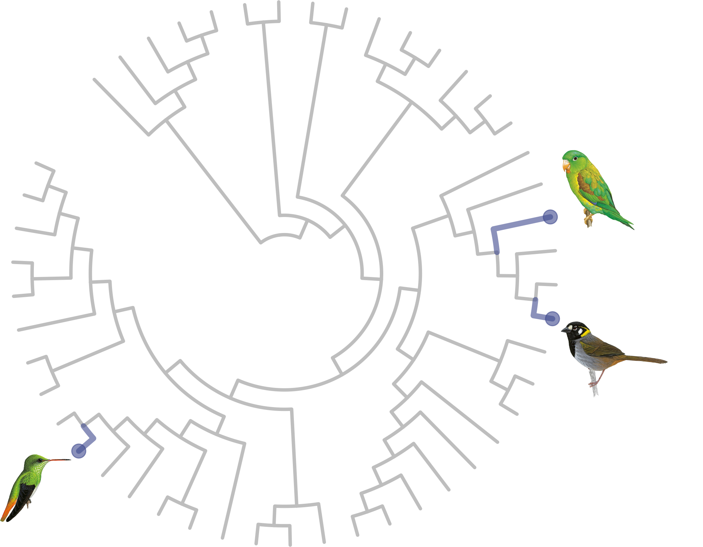
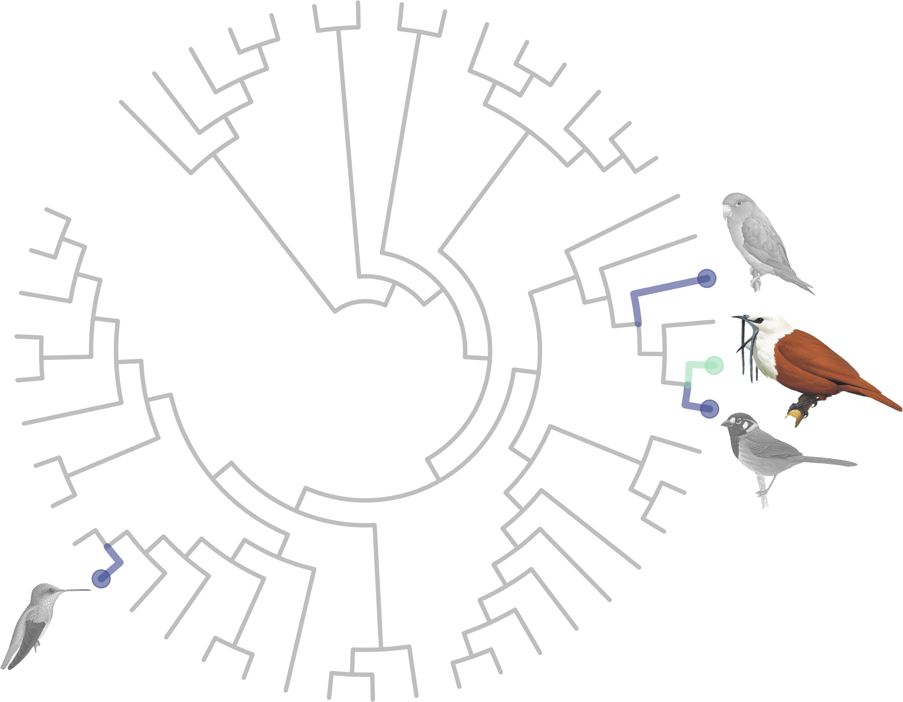
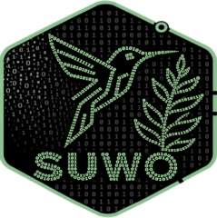
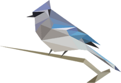
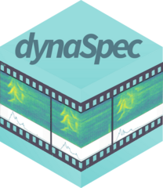

---
format:
  revealjs:
    fig-width: 10
    fig-height: 6.2
    toc: false
    number-sections: false
    embed-resources: true
    auto-section: false
    auto-play-media: true
    dpi: 300
    fig-dpi: 300
    code-line-numbers: false
    code-block-border-left: true
    slide-number: true
    preview-links: auto
    css: styles_revealjs.css
    include-after-body: dynaspec_player.html
execute:
  echo: false
  warning: false
  message: false
editor_options:
  chunk_output_type: console
---

```{r}
#| label: configuracion-global
#| echo: false

# ==== CONFIGURACIÓN GLOBAL =====================================================================
# Every setting that applies to the whole deck. Change a value here and re-render: the CSS
# variables, the ggplot figures, the maps and the spectrograms all take it from here.

## font (must be installed on the computer that renders)
font_family <- "Source Sans Pro"
base_size <- 20                       # base text size of the ggplot figures

## colours of the slides (CSS): titles, text, boxes and backgrounds
deck_cols <- c(
    titulo           = "#366A9F",     # slide titles, table headers, bold text in boxes, arrows
    texto            = "#222222",     # body text
    secundario       = "#555555",     # sources, captions and other secondary text
    acento           = "#38AAAC",     # .custom-color text
    caja             = "#DCEDF9",     # background of the boxes (callouts)
    fondo_conclusion = "#DAD4EA",     # background of the conclusions slide
    fondo_recursos   = "#DEF5E5"      # background of the acknowledgements slide
)

## colour key for sympatric and allopatric species, used throughout the deck: bar charts,
## maps, matrix labels, tables and coloured words in the text
type_cols <- c("Alopátrica" = "#3B2F5ECC", "Simpátrica" = "#348AA6CC")

 # [1] "#0B0405CC" "#28192FCC" "#3B2F5ECC" "#40498ECC" "#366A9FCC" "#348AA6CC" "#38AAACCC" "#54C9ADCC"
 # [9] "#A0DFB9CC" "#DEF5E5CC"

## spectrogram palette, for every spectrogram in the deck (comparisons and examples). It must be
## a palette function (it gets the number of colours); the first colour is the quietest
## (background), so direction = -1 gives a light background. E.g. function(n) viridis::magma(n)
spectro_pal <- function(n) viridis::mako(n, direction = -1)

# ===============================================================================================

# data and images are built by prepare_slide_assets.R (run from the project root)

# install/ load packages
sketchy::load_packages(
    packages = c(
        "knitr",
        "ggplot2",
        "dynaSpec",
        "ggtext",
        "viridis",
        "scales",
        "rnaturalearth",
        "ragg"
    )
)

## ggplot themes
theme_function <- theme_classic
presentation_theme <- theme_function(base_size = base_size, base_family = font_family)

theme_set(presentation_theme)

## spectrogram theme, with the palette set above
spectro_theme <- ds_theme(pal = spectro_pal, xlab = "Tiempo (s)", ylab = "Frec. (kHz)", family = font_family, cex.lab = 1.6, cex.axis = 1.4, font.lab = 2, tick.length = 0.6)


ds_set_theme(spectro_theme)

update_geom_defaults("text", list(family = font_family))
update_geom_defaults("label", list(family = font_family))

counts <- read.csv("./data/classification_counts.csv")

# Spanish names shown on the slides
spanish_names <- c(
    "Procnias tricarunculatus" = "Pájaro campana",
    "Psarocolius guatimozinus" = "Oropéndola negra",
    "Psarocolius montezuma" = "Oropéndola de Moctezuma",
    "Pteroglossus erythropygius" = "Aracari piquipálido",
    "Pteroglossus torquatus" = "Aracari de collar",
    "Ramphastos brevis" = "Tucán del Chocó",
    "Ramphastos sulfuratus" = "Tucán pico iris"
)

bird_labels <- c(focal = "Campana focal", other = "Otros campanas")

# species drawing (built by prepare_slide_assets.R); silhouette while a species has none
sp_file <- function(sp) {
    snake <- gsub(" ", "_", tolower(sp))
    # transparent copy (icono_) if there is one, so drawings do not cover bars or lines
    f <- file.path("images", paste0(c("icono_", "dibujo_"), snake, ".png"))
    f <- f[file.exists(f)]
    if (length(f)) f[1] else "images/sil_oropendola.png"
}

# drawing as a grob that fits in a box of w x h cm
sp_grob <- function(sp, w, h, ...) {
    img <- png::readPNG(sp_file(sp))
    scale <- min(w / dim(img)[2], h / dim(img)[1])
    grid::rasterGrob(img, width = grid::unit(dim(img)[2] * scale, "cm"),
                     height = grid::unit(dim(img)[1] * scale, "cm"), interpolate = TRUE, ...)
}

# drawing under a discrete x axis position, outside the panel
sp_below <- function(sp, x, offset, w, h) {
    annotation_custom(
        sp_grob(sp, w, h, y = grid::unit(0, "npc") - grid::unit(offset, "cm"), vjust = 1),
        xmin = x - 0.4, xmax = x + 0.4, ymin = -Inf, ymax = Inf
    )
}

# drawing above a bar (and its label), at data position x and bar height y
sp_above <- function(sp, x, y, offset = 0.75, w = 1.25, h = 1.1) {
    annotation_custom(
        sp_grob(sp, w, h, y = grid::unit(0, "npc") + grid::unit(offset, "cm"), vjust = 0),
        xmin = x - 0.4, xmax = x + 0.4, ymin = y, ymax = y
    )
}

# confusion matrix heatmap
plot_confusion <- function(file, species_order, text_size = 6, sp_size = 1.5, sp_offset = 7) {
    d <- read.csv(file)
    d$reference <- factor(spanish_names[d$reference], levels = spanish_names[species_order])
    d$predicted <- factor(spanish_names[d$predicted], levels = spanish_names[species_order])
    ggplot(d, aes(x = reference, y = predicted, fill = proportion)) +
        geom_tile() +
        geom_text(aes(label = gsub(".", ",", round(proportion, 2), fixed = TRUE)), size = text_size) +
        lapply(seq_along(species_order), function(i) annotation_custom(
            sp_grob(species_order[i], sp_size * 1.3, sp_size,
                    x = grid::unit(0, "npc") - grid::unit(sp_offset, "cm"), hjust = 1),
            xmin = -Inf, xmax = -Inf, ymin = i - 0.4, ymax = i + 0.4
        )) +
        coord_equal(clip = "off") +
        scale_fill_gradient(low = "white", high = mako(10)[7], name = "Proporción", labels = label_number(decimal.mark = ",")) +
        labs(x = "Especie de referencia", y = "Especie predicha") +
        theme(axis.text.x = element_text(angle = 30, hjust = 1, color = "black"),
              axis.text.y = element_text(color = "black"),
              axis.title.y = element_text(margin = margin(r = (sp_size * 1.3 + 1.2) * 28.35)))
}

# confusion matrix for the performance slide: abbreviated scientific names, first species at
# the top-left, a drawing above each column and no colour legend (values are printed)
plot_conf <- function(file, species_order, text_size = 5, draw_w = 1, draw_h = 0.85) {
    d <- read.csv(file)
    short <- setNames(paste0(substr(species_order, 1, 1), ". ", sub(".* ", "", species_order)), species_order)
    d$reference <- factor(short[d$reference], levels = short)
    d$predicted <- factor(short[d$predicted], levels = rev(short))
    n <- length(species_order)
    # species names in the colour key (sympatric orange, allopatric blue, bellbird black)
    sympatric <- c("Ramphastos sulfuratus", "Pteroglossus torquatus", "Psarocolius montezuma")
    allopatric <- c("Ramphastos brevis", "Pteroglossus erythropygius", "Psarocolius guatimozinus")
    col_sp <- ifelse(species_order %in% sympatric, type_cols[["Simpátrica"]],
                     ifelse(species_order %in% allopatric, type_cols[["Alopátrica"]], "black"))
    html <- setNames(sprintf("<i style='color:%s'>%s</i>", col_sp, short), short)
    # labels: values that round to 0.00 shown as 0; text white on dark cells, grey off the
    # diagonal below 0.05, black otherwise
    d$label <- sub(".", ",", sprintf("%.2f", d$proportion), fixed = TRUE)
    d$label[d$label == "0,00"] <- "0"
    d$text_col <- ifelse(d$proportion > 0.6, "white",
                         ifelse(d$proportion < 0.05 & as.character(d$reference) != as.character(d$predicted),
                                "grey60", "black"))
    ggplot(d, aes(x = reference, y = predicted, fill = proportion)) +
        geom_tile(colour = "white", linewidth = 0.6) +
        geom_text(aes(label = label, colour = text_col), size = text_size, family = font_family) +
        lapply(seq_len(n), function(i) annotation_custom(
            sp_grob(species_order[i], draw_w, draw_h, y = grid::unit(0, "npc") + grid::unit(0.15, "cm"), vjust = 0),
            xmin = i - 0.45, xmax = i + 0.45, ymin = n + 0.5, ymax = n + 0.5)) +
        coord_equal(clip = "off") +
        scale_fill_gradient(low = "white", high = mako(10)[6], limits = c(0, 1), guide = "none") +
        scale_colour_identity() +
        scale_x_discrete(labels = function(x) html[x]) +
        scale_y_discrete(labels = function(x) html[x]) +
        labs(x = "Especie de referencia", y = "Especie predicha") +
        # semibold: the only regular-weight italic installed is Light Italic, too thin in colour
        theme(axis.text.x = ggtext::element_markdown(angle = 35, hjust = 1, vjust = 1,
                                                     family = "Source Sans Pro Semibold"),
              axis.text.y = ggtext::element_markdown(hjust = 1, family = "Source Sans Pro Semibold"),
              axis.line = element_blank(), axis.ticks = element_blank(),
              plot.margin = margin(t = 45, r = 5, b = 5, l = 5))
}

# dynaSpec comparison of focal (top) and model (bottom), as one raw HTML block: one player
# shows both spectrograms and plays them in sequence. Called by hand from presentation/ (e.g.
# ds_pair("toucan", "Ramphastos sulfuratus", "<i>Ramphastos sulfuratus</i>", wl = 1024)), it just shows the
# player in the viewer. wl (window length) is one value for both
# sounds or two values, focal first and model second (e.g. wl = c(512, 1024))
ds_pair <- function(pair, model_sp, model_title, wl = 512, collevels = seq(-50, 0, 5)) {
    wl <- rep(wl, length.out = 2)
    clips <- paste0("clip_", pair, c("_focal", "_model"))
    titles <- c("<i>Procnias tricarunculatus</i><br>focal", model_title)
    drawings <- sp_file(c("Procnias tricarunculatus", model_sp)[1])
    drawings <- c(drawings, sp_file(model_sp))

    # each sound has its own spectrogram settings; the time axis is labelled only on the lower one.
    # Colours and palette come from the theme set with ds_set_theme() (ds_theme() only changes
    # the settings given here; a preset theme added with + would replace the global theme)
    ds_sound <- function(i) {
        dynaspec(file.path("images", paste0(clips[i], ".wav"))) +
            ds_spectrogram(wl = wl[i], ovlp = 90, collevels = collevels, pal = spectro_pal)
    }

    x <- ds_compare(ds_sound(1), ds_sound(2), flim = c(1, 8), gap = 0.5) +
        ds_static(width = 860, height = 330, res = 100, lcol = "orange",
                  alt = paste("Espectrograma:", gsub("<[^>]+>", " ", paste(titles, collapse = " y ")))) +
        ds_player(speeds = 1, buttons = character())
    # called by hand (not while knitting): return the player, which shows in the viewer, to try
    # settings such as wl; nothing is written to disk
    if (!isTRUE(getOption("knitr.in.progress"))) return(x)

    # when knitting, dynaSpec wraps its output in a raw HTML fence: this function writes its own
    html <- as.character(save_dynaspec(x, play = FALSE, verbose = FALSE))
    html <- paste(gsub("```(\\{=html\\})?", "", html), collapse = "\n")

    # the player script is the same for all pairs: it loads once, after the slides
    # plus a script for the hidden step of each pair: pressing "next" on the slide first presses
    # the player's play button (top sound, then bottom), and only the next press advances
    step_js <- paste0(
        "<script>(function () {",
        "var ready = function () {",
        "Reveal.on('fragmentshown', function (e) {",
        "if (!e.fragment.classList.contains('ds-autoplay')) return;",
        "var b = Array.prototype.slice.call(Reveal.getCurrentSlide().querySelectorAll('.dynaspec-compare .ds-play'))",
        ".filter(function (x) { return x.offsetParent; })[0];",
        "if (b) b.click();",
        "});",
        "Reveal.on('fragmenthidden', function (e) {",
        "if (!e.fragment.classList.contains('ds-autoplay')) return;",
        "Reveal.getCurrentSlide().querySelectorAll('audio').forEach(function (a) { a.pause(); });",
        "});",
        "};",
        "var wait = function () {",
        "if (window.Reveal && Reveal.on && Reveal.isReady && Reveal.isReady()) ready();",
        "else setTimeout(wait, 100);",
        "};",
        "wait();",
        "})();</script>")
    writeLines(c(paste0("<script>", sub(".*<script>", "", html)), step_js), "dynaspec_player.html")
    player <- sub("<script>.*", "", html)

    # base64 data makes pandoc stall, so the player points to files that Quarto embeds at the end;
    # each sound also gets its drawing and name, in a column to the left of the plot
    for (i in 1:2) {
        png_file <- file.path("images", paste0("ds_", clips[i], ".png"))
        png_b64 <- sub('(?s).*?srcset="data:image/png;base64,([^ "]+)[^"]*".*', "\\1", player, perl = TRUE)
        writeBin(base64enc::base64decode(png_b64), png_file)
        player <- sub('srcset="data:image/png;base64,[^"]+"', paste0('src="', png_file, '"'), player)
        player <- sub(
            '<audio([^>]*) src="data:audio/[^"]+"></audio>',
            paste0('<audio\\1 src="images/', clips[i], '.wav"></audio>',
                   '<div class="ds-etiqueta"><span>', titles[i], '</span></div>'),
            player
        )
    }

    cat(
        "\n```{=html}\n<div class=\"ds-fila\">",
        paste0('<div class="ds-col">', player, "</div>"),
        "</div>",
        '<span class="fragment ds-autoplay" aria-hidden="true"></span>',
        "```\n", sep = "\n"
    )
}
```

# Cuantificación del mimetismo vocal heteroespecífico mediante aprendizaje profundo: evidencia en el pájaro campana {.titulo-largo background-color="white" background-size="cover" background-image="./images/campana_david_full.jpeg" background-opacity="0.65"}

</br>

<div class="autores"><span class="autor"><b>Marcelo Araya-Salas</b></span><span class="afiliacion">Universidad de Costa Rica</span><span class="autor">Pablo Huertas-Vásquez</span><span class="afiliacion">Universidad Nacional de Costa Rica</span><span class="autor">Marcos Q. Oliva</span><span class="afiliacion">Royal Holloway University of London</span></div>

<div class="logos"></div>

::: footer
<font size=4><a href="https://marce10.github.io/">https://marce10.github.io/</a></font>
:::


## Evolución del aprendizaje vocal

<div style="height: 0.5em;"></div>

{.filogenia}

::: {.fuente}
Jarvis 2004; Suh et al. 2011; filogenia: Open Tree of Life v1.7 (McTavish et al. 2025)
:::

## Evolución del aprendizaje vocal

{.filogenia}
<div style="height: 0.5em;"></div>


::: {.fuente}
Jarvis 2004; Suh et al. 2011; filogenia: Open Tree of Life v1.7 (McTavish et al. 2025)
:::


## Entrenamiento de los modelos {background="#BEBEBE80"}


```{r}
#| dev.args: !expr list(bg = "transparent")
#| fig-width: 11
#| fig-height: 6.2
#| fig-alt: "Diagrama del entrenamiento: BirdNET se reentrena con las vocalizaciones de las siete especies (ejemplos y grabaciones de cada una), separadas en 80 % de las grabaciones para entrenar y 20 % para evaluar, para obtener dos modelos: simpátricas, alopátricas y pájaro campana, y solo simpátricas y pájaro campana"
# diagram: BirdNET -> training data of each species (examples and recordings) -> two models.
# Coordinates in an arbitrary 0-120 x 0-64 box; drawings, colours and numbers come from the
# global settings and data/entrenamiento_modelos.csv
tr <- read.csv("./data/entrenamiento_modelos.csv")
n_ex <- setNames(tr$clips_train + tr$clips_test, tr$species)
n_rec <- setNames(tr$recordings_train + tr$recordings_test, tr$species)
abbr <- function(sp) paste0(substr(sp, 1, 1), ". ", sub(".* ", "", sp))
pct_rec <- round(100 * sum(tr$recordings_train) / sum(tr$recordings_train + tr$recordings_test))

sp_tab <- data.frame(
    sp = c("Ramphastos sulfuratus", "Pteroglossus torquatus", "Psarocolius montezuma",
           "Ramphastos brevis", "Pteroglossus erythropygius", "Psarocolius guatimozinus",
           "Procnias tricarunculatus"),
    x = c(rep(34, 3), rep(54, 3), 44),
    y = c(55, 41, 27, 55, 41, 27, 6.5)
)
sp_tab$type <- c(rep("Simpátrica", 3), rep("Alopátrica", 3), "Campana")
sp_tab$col <- c(type_cols[["Simpátrica"]], type_cols[["Alopátrica"]], deck_cols[["texto"]])[
    match(sp_tab$type, c("Simpátrica", "Alopátrica", "Campana"))]
sp_tab$name <- paste0("italic('", abbr(sp_tab$sp), "')")
sp_tab$counts <- sprintf("%s (%s)", n_ex[sp_tab$sp], n_rec[sp_tab$sp])

sp_tab$counts[1] <- sprintf("  %s cantos (%s indiv)", n_ex[sp_tab$sp[1]], n_rec[sp_tab$sp[1]])

img_box <- function(f, x, y, w, h) {
    img <- png::readPNG(f)
    a <- dim(img)[1] / dim(img)[2]
    if (a > h / w) w <- h / a else h <- w * a
    annotation_raster(img, xmin = x - w / 2, xmax = x + w / 2, ymin = y - h / 2, ymax = y + h / 2,
                      interpolate = TRUE)
}
arrow_ <- grid::arrow(length = grid::unit(0.3, "cm"), type = "closed")
# box with rounded corners (centre x, y; width w, height h, in diagram units)
box <- function(x, y, w, h, fill, col, lwd = 1.6, r = 0.25)
    annotation_custom(grid::roundrectGrob(r = grid::unit(r, "cm"),
                                          gp = grid::gpar(fill = fill, col = col, lwd = lwd)),
                      xmin = x - w / 2, xmax = x + w / 2, ymin = y - h / 2, ymax = y + h / 2)

models <- data.frame(x = 88.5, y = c(42.5, 17.5),
    title = c("Discriminar\nsimpátricas\ny  alopátricas", "Discriminar\nsimpátricas"),
    text = c("+ pájaro campana\n(7 clases)",
             "+ pájaro campana\n(4 clases)"))

g <- ggplot() +
    # data block
    box(44, 33.05, 40, 67.1, deck_cols[['fondo_conclusion']], "grey80", lwd = 1.3) +
    annotate("text", x = c(34, 54), y = 64.3, label = c("Simpátricas", "Alopátricas"),
             colour = c(type_cols[["Simpátrica"]], type_cols[["Alopátrica"]]), fontface = "bold",
             size = 7, family = font_family) +
    annotate("text", x = 44, y = 16.3, label = "Pájaro campana", colour = deck_cols[["texto"]],
             fontface = "bold", size = 6, family = font_family) +
    lapply(seq_len(nrow(sp_tab)), function(i)
        img_box(sp_file(sp_tab$sp[i]), sp_tab$x[i], sp_tab$y[i] + 2.8, 10, 7.6)) +
    annotate("text", x = sp_tab$x, y = sp_tab$y - 2.6, label = abbr(sp_tab$sp),
             colour = sp_tab$col, size = 6, fontface = "bold.italic", family = font_family) +
    annotate("text", x = sp_tab$x, y = sp_tab$y - 5.4, label = sp_tab$counts, size = 5.6,
             colour = deck_cols[["secundario"]], family = font_family) +
    # BirdNET
    img_box("images/logo_birdnet_web.png", 9, 39, 15, 11) +
    # model and software version used (data/processed/birdnet_models/*_Params.csv); V2.4 is the
    # version before the current one
    ggtext::geom_richtext(
  aes(x = 9, y = 25.5,
      label = "<b>BirdNET V2.4</b><br>(preentrenada<br>con >6000 spp)"),
  size = 6, lineheight = 0.9,
  family = font_family,
  colour = deck_cols[["texto"]],
  fill = NA, label.color = NA
) +
    annotate("segment", x = 17.5, xend = 22.5, y = 37, yend = 37, colour = deck_cols[["titulo"]],
             linewidth = 1.2, arrow = arrow_) +
    annotate("text", x = 70.5, y = c(46.5, 21), label = "reentrenar", size = 5.6, 
             family = font_family, colour = deck_cols[["titulo"]]) +
    # split
    annotate("text", x = 50, y = -3.3, size = 5.6, family = font_family, colour = deck_cols[["texto"]],
             label = sprintf("%d %% para entrenar, %d %% para evaluar",
                             pct_rec, 100 - pct_rec)) +
    # arrows to the models
    annotate("segment", x = 65, xend = 76, y = models$y, yend = models$y, colour = deck_cols[["titulo"]],
             linewidth = 1.2, arrow = arrow_) +
    box(models$x[1], models$y[1], 20 + 2.5, 22, deck_cols[["caja"]], deck_cols[["titulo"]]) +
    box(models$x[2], models$y[2], 20 + 2.5, 20, deck_cols[["caja"]], deck_cols[["titulo"]]) +
    annotate("text", x = models$x, y = models$y + 4.6, label = models$title, fontface = "bold",
             size = 7, family = font_family, colour = deck_cols[["titulo"]]) +
    annotate("text", x = models$x, y = models$y - c(6, 4.8), label = models$text, size = 5.8,
             lineheight = 0.9, family = font_family, colour = deck_cols[["texto"]]) +
    coord_fixed(xlim = c(15, 114), ylim = c(-5.5, 67.5), expand = FALSE, clip = "off") +
    theme_void() +
    theme(plot.background = element_rect(fill = NA, colour = NA))   # slide background shows
g
```


## Referencias {visibility="uncounted" .no-linea-titulo .foto-derecha background-image="images/campana_david1_cropped.jpeg" background-size="auto 100%" background-position="right center" background-repeat="no-repeat"}

```{=html}
<ol class="referencias">
<li>BirdLife International y Handbook of the Birds of the World (2025). Bird species distribution maps of the world. Versión 2025.2. <a href="http://datazone.birdlife.org/species/requestdis">link</a></li>
<li>Dalziell, A. H., Welbergen, J. A., Igic, B. y Magrath, R. D. (2015). Avian vocal mimicry: a unified conceptual framework. <i>Biological Reviews</i> 90: 643–668. <a href="https://doi.org/10.1111/brv.12129">link</a></li>
<li>Goller, M. y Shizuka, D. (2018). Evolutionary origins of vocal mimicry in songbirds. <i>Evolution Letters</i> 2: 417–426. <a href="https://doi.org/10.1002/evl3.62">link</a></li>
<li>Janik, V. M. y Slater, P. J. B. (2000). The different roles of social learning in vocal communication. <i>Animal Behaviour</i> 60: 1–11. <a href="https://doi.org/10.1006/anbe.2000.1410">link</a></li>
<li>Jarvis, E. D. (2004). Learned birdsong and the neurobiology of human language. <i>Annals of the New York Academy of Sciences</i> 1016: 749–777. <a href="https://doi.org/10.1196/annals.1298.038">link</a></li>
<li>Kahl, S., Wood, C. y Klinck, H. (2025). BirdNET Model V2.4. Zenodo. <a href="https://doi.org/10.5281/ZENODO.15050749">link</a></li>
<li>Kelley, L. A., Coe, R. L., Madden, J. R. y Healy, S. D. (2008). Vocal mimicry in songbirds. <i>Animal Behaviour</i> 76: 521–528. <a href="https://doi.org/10.1016/j.anbehav.2008.04.012">link</a></li>
<li>Kroodsma, D. E. et al. (2013). Behavioral evidence for song learning in the suboscine bellbirds (<i>Procnias</i> spp.; Cotingidae). <i>The Wilson Journal of Ornithology</i> 125: 1–14. <a href="https://doi.org/10.1676/12-033.1">link</a></li>
<li>McTavish, E. J. et al. (2025). A complete and dynamic tree of birds. <i>Proceedings of the National Academy of Sciences</i>.</li>
<li>Saranathan, V., Hamilton, D., Powell, G. V. N., Kroodsma, D. E. y Prum, R. O. (2007). Genetic evidence supports song learning in the three-wattled bellbird <i>Procnias tricarunculata</i>. <i>Molecular Ecology</i> 16: 3689–3702. <a href="https://doi.org/10.1111/j.1365-294X.2007.03415.x">link</a></li>
<li>Snow, B. K. (1970). A field study of the bearded bellbird in Trinidad. <i>Ibis</i> 112: 299–329. <a href="https://doi.org/10.1111/j.1474-919X.1970.tb00109.x">link</a></li>
<li>Snow, B. K. (1977). Territorial behavior and courtship of the male three-wattled bellbird. <i>The Auk</i> 94: 623–645. <a href="https://doi.org/10.2307/4085260">link</a></li>
<li>Suh, A. et al. (2011). Mesozoic retroposons reveal parrots as the closest living relatives of passerine birds. <i>Nature Communications</i> 2: 443. <a href="https://doi.org/10.1038/ncomms1448">link</a></li>
<li>Ten Cate, C. (2021). Re-evaluating vocal production learning in non-oscine birds. <i>Philosophical Transactions of the Royal Society B</i> 376: 20200249. <a href="https://doi.org/10.1098/rstb.2020.0249">link</a></li>
</ol>
<div class="ref-volver"><a href="#/agradecimientos-y-recursos">&#8592; Volver a recursos</a></div>
```


## Agradecimientos y recursos {.no-linea-titulo .foto-derecha background-image="images/campana_david4_cropped2.jpeg" background-size="auto 100%" background-position="right center" background-repeat="no-repeat"}

:::: {.columns}

::: {.column width="66%"}
<div class="recursos">
<p><b>Financiamiento</b>: Centro de Investigación en Neurociencias, UCR</p>
<p><b>Ilustraciones de aves</b>: Birds of the World (Cornell Lab of Ornithology)</p>
<p><b>Fotos</b>: David Jimenez</p>
</div>

<div class="recursos recursos-enlaces">
<span></span><p><b>Sitio del proyecto</b>: análisis, código y esta presentación<br><a href="https://marce10.github.io/bellbird_vocal_mimicry/">marce10.github.io/bellbird_vocal_mimicry</a></p>
<span></span><p><b>Repositorio en GitHub</b><br><a href="https://github.com/maRce10/bellbird_vocal_mimicry">github.com/maRce10/bellbird_vocal_mimicry</a></p>
<p><b>suwo</b>: grabaciones de repositorios en línea desde R<br><a href="https://docs.ropensci.org/suwo/">docs.ropensci.org/suwo</a></p>
<p><b>BirdNET</b>: identificación de aves por sonido con aprendizaje profundo<br><a href="https://birdnet.cornell.edu/">birdnet.cornell.edu</a></p>
<p><b>dynaSpec</b>: los espectrogramas con sonido de esta presentación<br><a href="https://marce10.github.io/dynaSpec/">marce10.github.io/dynaSpec</a></p>
</div>

<div class="recursos recursos-enlaces">
</div>
<div class="recursos">
<span></span><div class="ref-enlace"><a href="#/referencias">Referencias citadas</a></div>
</div>

:::

::: {.column width="34%"}
<div class="qr-recursos"><div>Esta presentación</div></div>
:::

::::
